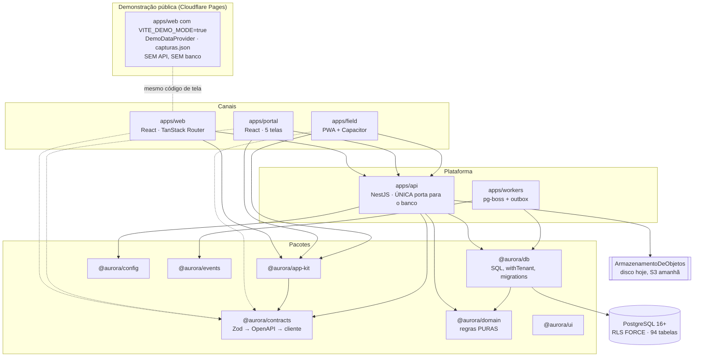
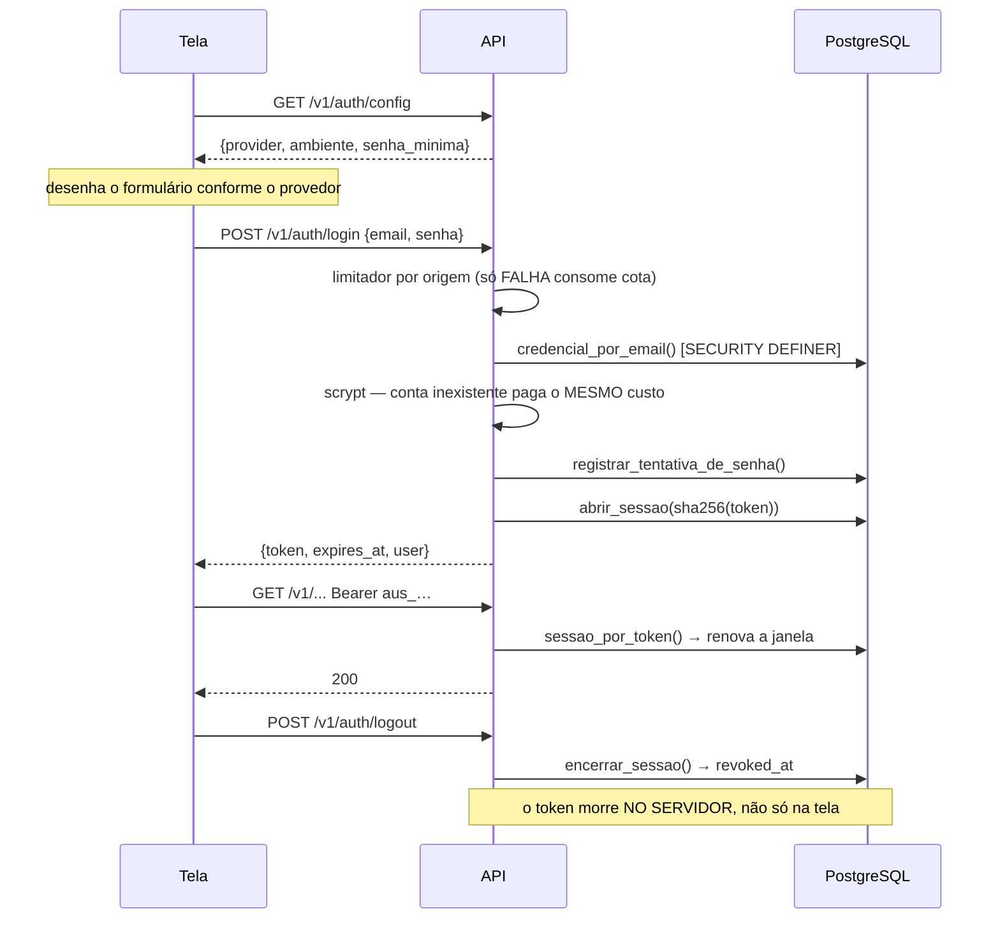
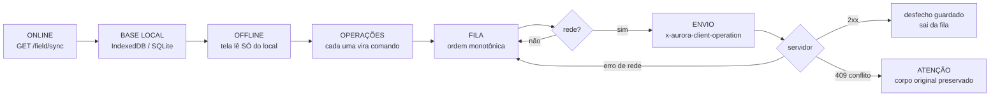

# AI-HANDOFF — o documento canônico de continuidade

> **SE VOCÊ É UMA NOVA IA (OU UMA PESSOA NOVA), COMECE AQUI.**
>
> 1. **Leia este arquivo inteiro.** Depois leia **apenas** os arquivos indicados
>    na seção do módulo que você vai mexer (§34). **Não varra o repositório
>    inteiro** — ele tem ~590 arquivos versionados e a varredura gasta o seu
>    contexto sem ensinar mais do que está escrito aqui.
> 2. **Se a tarefa vier de feedback ou novo pedido do cliente**, leia também
>    `docs/NOVAS-SOLICITACOES.md` (o backlog incremental — §38).
> 3. **Não trate item de NOVAS-SOLICITACOES como implementado.** Este arquivo
>    descreve o que o sistema **é**; aquele descreve o que foi **pedido**.
> 4. **Antes de implementar um pedido:** audite o código → atualize o status
>    dele → planeje → implemente → teste → registre a evidência (commit,
>    migration, rota, testes).
> 5. **Depois de implementar:** atualize `NOVAS-SOLICITACOES.md` (status
>    IMPLEMENTADA + evidência), promova a capacidade para este arquivo e ajuste
>    o mapa de código (§34) se ele mudou.

**Atualizado em:** 09/10/2026 (rodada "overdelivery visual + operacional") · **HEAD de partida:**
`dc4c6c4` (`origin/main`, PR #9) · branch `feat/overdelivery-painel` — confira com `git log -1`
**Migration mais recente:** `0058_importacao_rastreavel.sql` · **59 migrations** (nenhuma nova nesta rodada) ·
**103 tabelas** · **230 rotas HTTP** (229 no OpenAPI + `/health`; **160 com contrato Zod**) ·
**116 permissões** · **11 papéis** · **112 tipos de evento** · **1952 testes de unidade/HTTP**
(106 arquivos, 32 pulados sem PostgreSQL real) **+ 175 de navegador + 8 da demo**

> **Rodada 09/10/2026 — o que mudou (resumo; detalhes nas seções):** Painel de Controle
> (`/painel`) e Modo Exibição (`/painel/tv`) sobre `GET /insights/control-panel` (§15-A);
> **rotas de indicador agora respeitam o escopo do vínculo** (antes agregavam a organização
> inteira); Setores explícitos na ficha do cliente (`/clientes/$id`) e Cliente → Setor →
> Equipamento no cadastro/edição (`POST`/`PATCH /assets`, `PATCH /locations/:id`); módulo
> Planos de manutenção com criação orientada, cronograma, painel e procedimentos
> (`/maintenance-plans/{board,schedule,form-options}`, `POST /maintenance-plans`,
> `/checklist-templates*`) — §16. NS-018/019/020 IMPLEMENTADAS (§38).
>
> **⚠️ Divergência de histórico:** o `main` LOCAL desta máquina tinha 4 commits não publicados
> (`587a708`, `6e3834d`, `d273bde` — telas de engenharia/oportunidade/importação e PostgreSQL
> real no CI —, `5fc2153` — runtime Fly) que NÃO estão em `origin/main` e conflitam com os PRs
> #1–#9 (Dockerfile, destinos, navegação). Esta rodada partiu de `origin/main`; aqueles commits
> continuam só no `main` local, intocados. Decidir se entram (e como) é do responsável.

---

## 1 · Identidade do projeto

| | |
| --- | --- |
| **Repositório** | `voceconectadigital/technecaremeds` — **não renomear** |
| **Branch** | `main` (único) · remoto `origin` = GitHub |
| **HEAD** | confira com `git log -1`. Auditoria de 01/10/2026 partiu de `7e16baa` |
| **Monorepo** | npm workspaces (ADR-021). `packages/*` e `apps/*` |
| **Nome técnico interno** | **Aurora**. É codinome histórico, namespace (`@aurora/*`, `aurora_app`, `aurora:token`) e nome de trabalho. **Não aparece ao cliente** |
| **Marca pública atual** | **Téchne Care** (grafia de `marca.config.json`), definida pelo cliente em 29/09/2026 com logo e cores — §20-B |
| **Nome comercial definitivo** | **pode evoluir.** O cliente também usa "Be Care" (a empresa) e "Be Care Clinical Platform" nos documentos dele; `marca.config.json` marca o nome como **A VALIDAR** e o `appId` das lojas como não definitivo |

### Os três nomes, e o papel de cada um

Perder tempo tentando renomear o projeto é o erro mais caro que você pode
cometer aqui. Não renomeie nada.

- **`technecaremeds`** — o repositório. Nome histórico, vindo do sistema de
  referência auditado. **Fica como está.**
- **`Aurora`** — o nome técnico. Aparece em pacotes, papéis de banco, prefixos de
  variável e chaves de armazenamento. **Trocá-lo quebraria** sessões guardadas,
  migrations aplicadas e a fila offline de quem já tem trabalho no aparelho.
- **`Téchne Care`** — a marca pública **atual**, usada na demonstração e em toda
  tela. Toda string visível ao usuário mora em `marca.config.json` e é carimbada
  por `npm run marca`. Trocar a marca é editar **um** arquivo e rodar **um**
  comando — nunca uma caçada a strings. **"Be Care"** é o nome da empresa do
  cliente (aparece em pedidos como "estoque Be Care"), não um segundo produto.

> `marca.config.json` explica a separação no próprio arquivo. Leia-o antes de
> qualquer conversa sobre nome.

### Objetivo do produto

Plataforma multitenant de gestão de ativos, manutenção e **engenharia clínica**.
Nasceu de uma auditoria somente-leitura do sistema TechneCare/Arkmeds
(`docs/01-AUDITORIA-TECHNECARE.md`) e é especificada por
`docs/AURORA-CMMS-SPEC-v0.2.md`.

**Escopo funcional:** gestão de engenharia clínica · manutenção corretiva e
preventiva · ativos · chamados · ordens de serviço · agenda · estoque ·
contratos e orçamentos · documentos técnicos · indicadores · operação de campo
offline · **metrologia N0 manual estruturada** (registro e proveniência, §16). **Evolução prevista, sem código hoje:** integração física com instrumentos (N1–N4),
IA e integrações (§30).

**Públicos previstos** (PLAT §2 dos documentos do cliente): prestadora de
serviço (a Be Care é a primeira), hospital, fabricante, consultoria, laboratório
de instrumentação. **Uma plataforma, configuração diferente** — não cinco
sistemas. Dentro de cada organização: coordenação/gestão (web), técnico (field)
e o cliente final — hospital — pelo portal.

---

## 2 · Resumo do produto

Um CMMS de engenharia clínica: o hospital abre chamado, a coordenação tria e
vira ordem de serviço, o técnico executa em campo (com ou sem rede), e o sistema
emite documento, mede SLA e produz indicador.

**Cinco canais, todos sobre a MESMA API:**

| Canal | O que é | Quem usa |
| --- | --- | --- |
| `apps/web` | Aplicação interna, 25 rotas (22 protegidas). Também é o build da **demonstração pública** (§27-A) | Coordenação, gestão, administração |
| `apps/portal` | Portal do cliente, 8 rotas (4 na barra inferior) | O hospital: abre chamado e acompanha |
| `apps/field` | PWA **e** app de loja (Capacitor) | Técnico em campo, offline-first |
| `apps/api` | NestJS. **Única porta para o banco** | Todos os acima, e integrações |
| `apps/workers` | pg-boss + publicador de outbox | Varreduras, SLA, expiração |

> **Padrão que se repete e que você precisa saber:** a camada de banco é mais
> larga que a API, e a API é mais larga que as telas. Muitas tabelas têm
> função de escrita em `packages/db` usada só por seed e teste, **sem rota**
> (cliente, ativo — edição, OS — edição, plano, modelo de checklist, papel
> personalizado, depósito, item de estoque). Não conclua que existe porque a
> tabela existe — confira o controller.

---

## 3 · Estado atual

**Legenda:** ✅ implementado · 🟡 parcial · ⬜ futuro · 🔒 bloqueado · ❓ a validar

| Domínio | Estado | Observação |
| --- | --- | --- |
| Identidade / organizações | ✅ | `organizations`, `users`, `memberships`, `membership_scopes` |
| **Autenticação por senha** | ✅ | **Novo em 29/09/2026.** Ver §7 |
| MFA | ⬜ | `users.mfa_enabled` existe e é sempre `false` |
| SSO | ⬜ | A porta `AuthProvider` existe para isso |
| RBAC | ✅ / 🟡 | 110 permissões, 11 papéis de fábrica, `deny` individual, escopos. **Falta:** criar/editar papel personalizado (schema aceita, sem rota) e tela de escopo |
| RLS / isolamento | ✅ | `FORCE` em todas as tabelas tenant-scoped; 24 suítes adversariais |
| Clientes (cadastro) | ✅ / 🟡 | `customers` + `customer_contacts` (0008). Lista `/clientes`, cadastro (`POST /customers`) e **ficha `/clientes/$id`** com a seção **Setores** (criar, renomear, atalhos de nome livre) e equipamentos por setor. **Sem edição do cliente** |
| **Setores** | ✅ | **São `locations` do tipo `setor`** (escada inicial, 0008) — sem tabela nova. Criar: `POST /locations`; renomear: `PATCH /locations/:id` (`location.update`, 404 fora do escopo) |
| Ativos | ✅ / 🟡 | Criar com **Cliente\* e Setor\*** conferidos no servidor (`POST /assets`: setor de outro cliente/tenant/fora do escopo → 422; tipo que não recebe equipamento → 422), **editar dados cadastrais** (`PATCH /assets/:id`; mudar de setor = transferência com motivo), transferir, baixar, importar, QR, ficha, linha do tempo (API) e substituição (0056). `location_id` **continua anulável** no banco (importação, comodato). **Sem depreciação**, **sem disponibilidade** |
| QR Code do ativo | 🟡 | Token, resolução pública, leitura no Field, rotação, dados de etiqueta. **Sem imagem de QR e sem tela de etiqueta** — §22-A |
| Chamados (`service_requests`) | ✅ | Entidade separada da OS (ADR-002) |
| Ordens de serviço | ✅ / 🟡 | Estados × motivos configuráveis (ADR-003). **Sem edição de campos** (sem PATCH), **sem baixar/imprimir/enviar** |
| SLA | ✅ | Tempo útil por fuso e feriado, pausa por motivo |
| Agenda | ✅ | Projeção da OS (ADR-011); confere antes de salvar |
| Checklists | ✅ / 🟡 | Motor versionado e imutável, 8 tipos de item (`measurement` desde a 0052), execução no Field. **Resposta não se sobrescreve** (0047). **Criar com itens, revisar (versão seguinte) e publicar** pela API e pela tela (`/checklist-templates*`, aba Procedimentos de `/planos`), com tipo de procedimento; o checklist da tarefa do plano é anexado à OS da preventiva; `default_checklist_key` continua não lido |
| Planos de manutenção | ✅ / 🟡 | Módulo `/planos` (item próprio no menu): **criação orientada** (`POST /maintenance-plans`: cliente → setor → equipamentos → tipo → procedimento → periodicidade), **painel** (`/board`), **cronograma** com previstos (`/schedule`), procedimentos. Varredura gera ciclo e OS (gatilho **calendário** apenas); alvo por categoria/local/ativo + filtros 0055, recortado pelo cliente do plano; lista/detalhe respeitam o escopo de cliente; **ciclo nunca fecha** — §32; educação continuada ⬜ |
| Estoque | ✅ | Razão imutável, saldo por gatilho, reserva, **imagem e categoria por item** (0046). Sem rota para criar depósito/item |
| Contratos | ✅ | Cobertura por expressão, medição congelada. Tela só de leitura |
| Orçamentos | ✅ | Versionado, dinheiro em centavos |
| Documentos | ✅ / 🟡 | Motor completo; 7 tipos (aceite desde esta rodada) com `payloadFields` técnicos **vazios** (norma); **rascunho a partir da sessão de medição** por cópia; **PDF** (interno e portal); tela web só lista — §15 |
| Indicadores | ✅ / 🟡 | 14 métricas com definição, **recortadas pelo escopo do vínculo**; **Painel de Controle** (`/painel`, gráficos de série e composição, filtros período/cliente/setor) e **Modo Exibição** (`/painel/tv`); "Indicadores detalhados" (`/indicadores`) com as definições — §15-A |
| Portal | ✅ | Com varredura anti-vazamento (§21). Leitura + abrir chamado + **decidir orçamento** + **avaliar atendimento** + **baixar PDF** do documento liberado |
| Field / offline | ✅ | Idempotência provada sob concorrência |
| Notificações | 🟡 | Tabelas e roteamento existem; **nenhum transporte**, e nada as dispara em produção — §18 |
| Automações | 🟡 | Motor de regras com salvaguardas, API e tela de simular/ativar. **Não está ligado**: `runAutomations` só é chamado em teste; gatilho `schedule` sem motor — §18 |
| Busca global | ✅ | `tsvector` nativo (ADR-027). Todo resultado leva a uma tela que existe (cliente → contratos, pessoa → configurações: não há ficha própria) |
| Geolocalização / check-in | ⬜ | `locations.geo_lat/geo_lng` existem e ninguém lê nem escreve |
| Engenharia clínica | 🟡 | Criticidade, ciclo de vida, substituição, tipo de documento de aceite, protocolos de calibração/TSE/qualificação/aceite como dado; **campos técnicos por norma e critérios: BLOQUEADO — ESPECIALISTA** |
| **Metrologia N0** | ✅ (registro) / 🔒 (ciência) | Instrumento, certificado externo, protocolo, sessão, leituras, dado bruto, envelope neutro — §16. **Cinco decisões continuam bloqueadas** — §17 |
| Oportunidade (núcleo) | ✅ API / ⬜ tela | Necessidade, origem, prazo, prioridade, fornecedor, autorização comercial com trilha (0057) |
| Modo de uso / recursos por organização | ✅ API / ⬜ tela | `usage_mode` + `enabled_features` (0049); padrão: tudo habilitado |
| Identificador externo | ✅ | `external_source/external_id` em 6 entidades, único por organização e origem (0048) |
| Migração Arkmeds | 🟡 | **Pipeline rastreável genérico existe** (0058: lote, linha crua, arquivo original, amostra/oficial, relatório). **Parser do formato Arkmeds: BLOQUEADO — CLIENTE** |
| Integrações (Omie, WhatsApp, BI…) | ⬜ | Nada. Ver §30 |
| IA | ⬜ | Nada (nenhuma biblioteca, nenhuma chamada). Ver §30 |
| Deploy | ✅ | **Produção conectada no ar** (09/10/2026): web, portal e campo no Cloudflare Pages (upload direto) e API + workers + PostgreSQL no runtime do HostPanel. A demo segue em `technecaremeds.pages.dev`. §27 |

---

## 4 · Arquitetura



### Responsabilidade de cada pacote

| Pacote | Responsabilidade | Regra que o define |
| --- | --- | --- |
| `packages/domain` | Regras **puras**. UUID v7, contexto, erros, permissões, checklists, SLA, senha, metrologia | **Sem HTTP, sem banco, sem SDK.** Se precisa de `pg`, não é domínio |
| `packages/db` | Migrations, SQL, `withTenant`, outbox, harness de teste | **`withTenant` é o único caminho** para tabela tenant-scoped |
| `packages/contracts` | Esquemas Zod das operações | **Fonte única**: valida o controller, gera o OpenAPI, tipa o cliente |
| `packages/events` | Catálogo de 107 eventos de domínio | Nome no formato `agregado.fato_no_passado` |
| `packages/config` | `loadEnv`, marca, **guard de destino de banco** | Falha **alto** no boot; nunca default silencioso em segurança |
| `packages/ui` | Design system próprio | Tokens em `src/styles/tokens.css`; componentes em §20-A |
| `packages/app-kit` | Sessão, cliente da API, tema, URL-state | Infra **sem opinião de produto**. Nada que decida o que a tela mostra |

---

## 5 · Fluxo de requisição

```
navegador
   │  Authorization: Bearer <token>
   │  x-aurora-organization: <uuid>   (sugestão, NUNCA autorização)
   ▼
context.middleware  ──► ContextResolver
   │                      ├─ AuthProvider.verify(token) → identidade
   │                      ├─ find_memberships_for_email() → vínculo REAL
   │                      └─ loadEffectivePermissions()
   ▼
PermissionsGuard (@RequirePermissions)
   ▼
Controller ──► parseWith(contrato, body)
   ▼
withTenant(db, ctx, …)  ← SET LOCAL de contexto, transaction-local
   ▼
PostgreSQL com RLS FORCE
   │
   └─► domain_events (outbox, MESMA transação)
            ▼
       apps/workers → OutboxPublisher → EventSink
```

**O frontend NUNCA executa CRUD de negócio direto no banco nem no Supabase.**
Não há cliente Supabase em nenhum `apps/*`. É o critério de aceite 9 do cliente
("APIs externas não acessam diretamente o banco") e é verificável:
`grep -ri supabase apps/*/src` não devolve nada.

---

## 6 · Multitenancy — como NÃO furar o isolamento

Esta é a propriedade que não pode falhar uma vez. São 10 camadas (SPEC §37); as
que você precisa conhecer para escrever código:

1. **`organization_id` nunca vem do cliente como autorização.** O cabeçalho
   `x-aurora-organization` só *sugere*; quem decide é a consulta de vínculo.
2. **`FORCE ROW LEVEL SECURITY`** em toda tabela tenant-scoped. `ENABLE` sozinho
   não vale para o dono da tabela.
3. **Contexto transaction-local** (`set_config(..., is_local => true)`): morre no
   COMMIT e nunca vaza para a próxima requisição da mesma conexão do pool.
4. **Falha fechada.** Sem contexto, `current_organization_id()` é `NULL`, e
   `organization_id = NULL` é falso → zero linhas.
5. **Papel sem privilégio.** O usuário da API herda de `aurora_app`:
   `NOBYPASSRLS`, não é dono de tabela nenhuma. O boot **recusa subir** se o
   papel puder ignorar RLS (`assertAppRoleIsSafe`).
6. **Chaves estrangeiras compostas** incluindo `organization_id` em toda relação
   entre tabelas tenant-scoped — a verificação de FK roda como dona da tabela e
   **ignora a RLS**.

### Padrão obrigatório para uma tabela tenant-scoped nova

```sql
CREATE TABLE aurora.minha_coisa (
  id                uuid PRIMARY KEY,
  organization_id   uuid NOT NULL REFERENCES aurora.organizations(id) ON DELETE CASCADE,
  -- … campos …
  created_at        timestamptz NOT NULL DEFAULT now(),

  -- 1. par (id, organization_id) único: é o que permite FK composta vinda de fora
  CONSTRAINT minha_coisa_id_org_uq UNIQUE (id, organization_id),

  -- 2. TODA FK para outra tabela tenant-scoped é COMPOSTA
  CONSTRAINT minha_coisa_ativo_org_fk
    FOREIGN KEY (asset_id, organization_id)
    REFERENCES aurora.assets (id, organization_id) ON DELETE RESTRICT
);

CREATE INDEX minha_coisa_org_idx ON aurora.minha_coisa (organization_id);

DO $do$
BEGIN
  ALTER TABLE aurora.minha_coisa OWNER TO aurora_owner;
  ALTER TABLE aurora.minha_coisa ENABLE ROW LEVEL SECURITY;
  ALTER TABLE aurora.minha_coisa FORCE  ROW LEVEL SECURITY;   -- 3. FORCE, sempre

  CREATE POLICY minha_coisa_tenant_isolation ON aurora.minha_coisa FOR ALL
    USING (organization_id = aurora.current_organization_id())
    WITH CHECK (organization_id = aurora.current_organization_id());  -- 4. WITH CHECK também

  GRANT SELECT, INSERT, UPDATE, DELETE ON aurora.minha_coisa TO aurora_app;
  GRANT SELECT ON aurora.minha_coisa TO aurora_readonly;
END
$do$;

-- 5. auditoria, se for dado de negócio
CREATE TRIGGER minha_coisa_audit AFTER INSERT OR UPDATE OR DELETE
  ON aurora.minha_coisa FOR EACH ROW EXECUTE FUNCTION aurora.fn_audit('minha_coisa');
```

E **acrescente a tabela à lista esperada** em
`packages/db/src/__tests__/migrations.test.ts` — há um teste que compara o schema
inteiro e ele vai falhar (de propósito).

**Nunca** use `unsafeCrossTenant` em código de domínio: uma regra de lint o
barra, e ela **dispara de verdade** (foi verificada com probe).

---

## 7 · Autenticação  ⚠️ MUDOU EM 29/09/2026

### A porta

`apps/api/src/auth/auth-provider.port.ts` define `AuthProvider`: uma função,
`verify(bearerToken) → identidade | null`. **O domínio nunca conhece o SDK de um
fornecedor.**

### Os três adaptadores

| Valor de `AURORA_AUTH_PROVIDER` | Estado | O que faz |
| --- | --- | --- |
| `local` | ✅ dev/teste | Aceita `local:<sujeito>:<e-mail>`. **SEM SENHA.** Recusado em homologação e produção, duas vezes: pela configuração e pelo construtor |
| `password` | ✅ **é o login real** | Senha em `scrypt`, sessão como token opaco revogável |
| `supabase` | 🔒 **sem adaptador** | O boot **LANÇA**. Bloqueado por falta de acesso ao projeto (ADR-025, OQ-16) |

> **Defeito corrigido em 29/09:** `AURORA_AUTH_PROVIDER` existia, era validada e
> **ninguém a lia** — `app.module` caía em `LocalAuthProvider` sempre. Definir
> `supabase` fazia o boot passar e o processo continuava aceitando entrada sem
> senha. A escolha agora está em **um** lugar
> (`apps/api/src/auth/escolher-provedor.ts`) e o caso sem adaptador falha alto.

### Autenticação por ambiente — o estado REAL

| Ambiente | Provedor | Existe hoje? |
| --- | --- | --- |
| **Desenvolvimento** (máquina do dev) | `local` (sem senha) ou `password` | ✅ |
| **Teste / CI / Playwright** | `local` — o login por senha tem provas HTTP, não E2E (§32) | ✅ |
| **Demonstração pública** | **nenhum.** `VITE_DEMO_MODE` troca a entrada por "Explorar plataforma"; não há API, token nem conta (§27-A) | ✅ publicada |
| **Homologação conectada** | seria `password` (o boot recusa `local`) | ⬜ sem máquina |
| **Produção futura** | `password`; MFA/SSO a decidir | ⬜ |

O **`AuthProvider` em uso** é escolhido por `AURORA_AUTH_PROVIDER` em
`apps/api/src/auth/escolher-provedor.ts`; o login real é o `password`.

### Como o login por senha funciona



**Rotas** (as três públicas, na lista de isenção do `context.middleware`):
`GET /v1/auth/config` · `POST /v1/auth/login` · `POST /v1/auth/logout`

**Decisões que você não deve desfazer sem pensar:**

- **Token opaco, não JWT.** Revogar um JWT exige lista de revogados consultada no
  banco a cada requisição — o custo que o JWT prometia evitar. Sem esse ganho,
  sobra a desvantagem: JWT roubado vale até expirar.
- **O banco guarda `sha256(token)`, nunca o token.** Vazou o backup? Ninguém
  entra como ninguém.
- **A recusa é idêntica** para e-mail inexistente, conta sem senha e senha
  errada — **inclusive no tempo** (a conta inexistente paga um `scrypt` de
  engodo). Distinguir transformaria o login num oráculo de cadastro.
- **Bloqueio progressivo COM prazo** (5 erros → 1 min; 10 → 15 min). Permanente
  viraria negação de serviço contra a pessoa certa.
- **O limitador por origem conta só FALHAS.** Contar acertos puniria um hospital
  inteiro atrás de um NAT.
- **`aurora.definir_senha` NÃO é concedida a `aurora_app`.** Só o comando
  administrativo define senha.

### Sessão no cliente

`localStorage`: `aurora:token` e `aurora:organizacao`. A organização é **escolha**,
nunca autorização — trocá-la à mão no navegador dá 403. Sobrevive a refresh.
Sair chama `POST /auth/logout` **e** limpa o local (`useEncerrarSessao`).

### Criar a primeira conta

```bash
npm run admin:criar
```

Interativo: escolhe organização, pede e-mail, nome, e a senha **duas vezes com
eco desligado**. Não aceita senha por argumento nem por variável de ambiente.
Argumentos: `--org=<slug> --email=… --nome=… --papel=admin|owner`,
`--senha-stdin` (para automação), `--aceitar-senha-fraca` (dispensa explícita,
que grita na saída).

**MFA e recuperação por e-mail não existem.** Recuperação depende de transporte
de e-mail, que o sistema não tem. Esquecer a senha hoje = rodar `admin:criar` de
novo.

---

## 8 · RBAC

- **110 permissões**, fonte única em `packages/domain/src/permissions.ts`. O banco
  é espelho, e um teste garante que não divergem.
- **11 papéis de fábrica**, `is_system`, não editáveis. Customizar é duplicar.
- **`deny` individual vence** qualquer concessão de papel.
- **Escopo** é outra coisa: `membership_scopes` limita por cliente, local,
  atribuição e almoxarifado. **Permissão + escopo = autorização.**
- **Papéis de fábrica:** `owner`, `admin`, `maintenance_manager`, `coordinator`,
  `technician`, `metrologist`, `storekeeper`, `finance`, `auditor` (equipe) e
  `requester`, `customer_manager` (portal).

### O que a administração consegue fazer HOJE

| Ação | API | Tela |
| --- | --- | --- |
| Listar, convidar, suspender membro | ✅ `members.controller.ts` | ✅ `/configuracoes` (`membros.tsx`) |
| Atribuir papéis, conceder/negar permissão individual | ✅ `roles.controller.ts` | ✅ `acesso.tsx` |
| Ajustar escopo de um membro | ✅ `PATCH …/members/:id/scope` | ⬜ **sem tela** (o convite manda "ajustar depois") |
| Criar/editar/excluir **papel personalizado** | ⬜ **sem rota** (o schema aceita: `roles.copied_from_key`) | ⬜ |
| "Cargo" / "função" como conceito separado de papel | ⬜ não modelado | ⬜ |

Várias permissões estão **declaradas e nunca exigidas por rota** porque a rota
não existe (`customer.create/update`, `asset.update`, `work_order.update`,
`procedure.*`, `insight.manage_dashboards`). Isso é esperado — não as remova.

### Como adicionar uma permissão

1. Acrescente em `PERMISSIONS` (`packages/domain/src/permissions.ts`).
2. Inclua nos papéis de fábrica que a devem ter (ou em `except`).
3. `syncPermissionCatalog(adminDb)` grava no banco — o seed e o `admin:criar` já
   chamam. **Sem isso, a FK recusa** a associação.
4. Proteja a rota: `@RequirePermissions('recurso.acao')`.
5. Declare no contrato (`permissions: ['recurso.acao']`) — `npm run openapi:check`
   **falha** se o contrato e o guard discordarem.
6. Teste com um papel que **não** a tem, esperando 403.

> `PermissionsGuard` devolve 403 **nomeando a permissão que falta**. Rota sem
> `@RequirePermissions` passa pelo guard — a autenticação é do middleware.

---

## 9 · Banco de dados

PostgreSQL **16+**. Sem extensões (ADR-026 sem `ltree`, ADR-027 sem `pg_trgm`):
não são garantidas em PostgreSQL gerenciado e não existem no PGlite.

**UUID v7 gerado na aplicação** (ADR-024), por `newId()` de `@aurora/domain`.
Nenhuma coluna de chave de negócio tem `DEFAULT` de geração no banco.

**Numeração humana** (`SR-2026-0001`, `WO-2026-0001`, `CAL-…`) sai de contador com
bloqueio de linha — nunca `max(n)+1`, que sob concorrência gera dois iguais.

**Contexto de tenant** — `withTenant` (`packages/db/src/client.ts`) faz
`set_config(..., is_local => true)` de `aurora.organization_id`, `actor_id`,
`actor_kind`, `request_id`, `source`, `client_ip` e `user_agent`. A RLS lê
`aurora.current_organization_id()`; a auditoria lê os demais.

**Auditoria:** gatilho `aurora.fn_audit` grava em `audit_logs` (append-only,
`aurora_app` só lê). **Eventos:** `domain_events` na mesma transação (§18).

**Funções `SECURITY DEFINER`** — as únicas portas que atravessam a RLS, cada
uma com propósito estreito: `find_memberships_for_email` e
`find_user_id_by_email` (resolução de identidade) · `effective_permissions` ·
`fn_audit` · `resolve_qr_token` (rota pública `/q/:token`) ·
`credencial_por_email`, `abrir_sessao`, `sessao_por_token`, `encerrar_sessao`,
`registrar_tentativa_de_senha`, `definir_senha` (autenticação, 0045) ·
`fn_checklist_answer_revision` (histórico de medição, 0047/0053) ·
`fn_opportunity_history` (trilha da oportunidade, 0057). Função
`SECURITY DEFINER` nova exige `SET search_path` fixo e teste adversarial.

### Papéis de banco

| Papel | Para quê |
| --- | --- |
| `aurora_owner` | Dono das tabelas |
| `aurora_migrator` | Aplica migrations |
| `aurora_app` | **A API.** `NOBYPASSRLS`, não é dono, submetido às políticas |
| `aurora_identity` | Resolve vínculos. **SÓ SELECT** — há teste que exige isso |
| `aurora_auth` | **Novo (0045).** Credenciais e sessões. Escreve em 2 tabelas, e só |
| `aurora_publisher` | Lê o outbox entre organizações; não altera negócio |
| `aurora_scheduler` | pg-boss |
| `aurora_readonly` | Leitura |

### Mapa de tabelas por domínio

| Domínio | Tabelas principais |
| --- | --- |
| **Plataforma** | `organizations` · `users` · `memberships` · `membership_scopes` · `roles` · `permissions` · `role_permissions` · `membership_roles` · `membership_permission_overrides` |
| **Autenticação** | `user_credentials` · `user_sessions` — **sem privilégio para `aurora_app`** |
| **Auditoria/eventos** | `audit_logs` (append-only) · `domain_events` (outbox) |
| **Diretório** | `customers` · `customer_contacts` · `locations` · `location_types` · `suppliers` · `teams` · `team_members` · `calendars` · `calendar_windows` · `availability_blocks` |
| **Catálogos** | `catalog_definitions` · `catalog_items` · `custom_field_definitions` |
| **Ativos** | `assets` · `asset_categories` · `asset_models` · `manufacturers` · `criticality_levels` · `asset_identifiers` (projeção de unicidade) · `asset_transfers` · `meters` · `meter_readings` |
| **Chamados/OS** | `service_requests` · `work_orders` · `work_order_statuses` · `work_order_status_transitions` · `wait_reasons` · `work_order_comments` · `*_status_history` |
| **Execução** | `checklist_templates/_sections/_items` · `checklist_responses/_answers` (+ `_answer_revisions`) · `time_entries` · `attachments` (dono: OS, resposta, sessão, certificado ou lote) · `signatures` · `completion_requirements` |
| **SLA** | `sla_policies` · `sla_targets` · `sla_clocks` · `sla_pauses` |
| **Preventivas** | `maintenance_plans` · `plan_tasks` · `plan_cycles` · `plan_cycle_items` |
| **Estoque** | `warehouses` · `inventory_items` · `stock_movements` (razão imutável) · `stock_balances` (projeção) · `stock_reservations` · `stock_lots` · `price_lists` |
| **Comercial** | `contracts` · `contract_coverages` · `contract_services` · `contract_periods` · `quotes` · `quote_items` |
| **Documentos** | `document_types` · `documents` · `document_signatures` · `number_series` |
| **Analytics** | `fact_work_order` (mantida por gatilho) |
| **Notificações** | `notifications` · `notification_preferences` · `notification_deliveries` |
| **Automações** | `automation_rules` · `automation_actions` · `rule_runs` |
| **Offline** | `client_operations` (idempotência de campo) |
| **Metrologia N0** | `instruments` (1:1 com `assets`) · `instrument_certificates` (externo, imutável) · `checklist_template_instruments` · `measurement_sessions` (1:1 com `checklist_responses`) · `checklist_answer_revisions` (append-only) |
| **Comercial (núcleo)** | `opportunities` · `opportunity_status_history` |
| **Migração** | `import_batches` · `import_rows` |

---

## 10 · Migrations

```bash
npm run db:migrate    # aplica
npm run db:status     # o que já foi aplicado
npm run db:destino    # só confere para onde a URL aponta
```

- Arquivos em `packages/db/migrations/NNNN_nome.sql`, aplicados em ordem.
- **Checksum**: alterar uma migration já aplicada é detectado e recusado.
- **Trava de transação** (`pg_advisory_xact_lock`) — duas instâncias migrando o
  mesmo banco não se atropelam.
- Idempotentes e reprodutíveis do zero.

### ⚠️ O GUARD DE DESTINO — leia antes de qualquer comando de banco

Em 30/08/2026 um projeto Supabase criado para o Aurora amanheceu com o schema
inteiro de **outro produto** dentro. O comando que fez isso não era do Aurora —
mas até ali todo script do Aurora aceitava qualquer `DATABASE_URL`.

`aurora.destinos.json` + `packages/config/src/destino.ts` são a correção:

- **lista fechada** por ambiente (host + banco + `ref` do Supabase);
- **não há variável de escape** — "uma saída de emergência vira o caminho normal
  na primeira pressa";
- o `ref` é extraído do host **e** do usuário do pooler (`postgres.<ref>@…`);
- destino **remoto exige `AURORA_AMBIENTE`** declarado, e a intenção é conferida
  contra o destino;
- há uma lista de **bloqueados** que recusa **com o motivo**.

Destino novo entra na lista **por decisão**, editando o JSON — nunca por acidente.

---

## 11 · Supabase

**Estado: 🔒 BLOQUEADO, e nada depende disso. NÃO é o backend do site.**

Existe um projeto Supabase chamado **"Aurora CMMS"** (ref
`egoajboqzhnvkpenrszw`, sa-east-1). Em 30/08/2026 ele amanheceu com o schema,
os dados e 9 jobs de cron do **E-commerce Template** — outro produto; o Aurora
**nunca foi aplicado lá**. Ele está na lista de **bloqueados** de
`aurora.destinos.json`, e o guard de destino recusa qualquer comando do Aurora
contra ele. Detalhes: `docs/AUDITORIA-CONTAMINACAO-SUPABASE-2026-08-30.md` e
`docs/PLANO-RECUPERACAO-SUPABASE-AURORA-2026-08-30.md`.

Os destinos `homologacao` e `producao` de `aurora.destinos.json` estão **sem
`ref`**: todo destino remoto é recusado. A demonstração pública não fala com
Supabase (há teste que reprova se falar — §27-A). Para usar um Supabase:
recuperar ou recriar o projeto **e** registrá-lo por decisão no JSON (ADR-025,
OQ-16).

**Não confunda quatro coisas:**

| | O que é |
| --- | --- |
| **Supabase hospedado** | O projeto remoto "Aurora CMMS". Contaminado e bloqueado |
| **Supabase local** | Stacks de **outros produtos** na máquina do dev (`ecommerce-template`, `pragminas-digital-hub`, `hpproto`). **NÃO TOQUE** |
| **PostgreSQL da aplicação** | O que o Aurora usa. Hoje, o contêiner `aurora-postgres` |
| **Supabase Auth** | Provedor de identidade previsto, **sem adaptador** (§7) |

Nada no código depende de Supabase: as migrations rodam em qualquer PostgreSQL
16+, arquivos vão por adaptador, identidade vai por porta.

---

## 12 · Fluxo de chamado / OS

```
service_request (relato do cliente, IMUTÁVEL após envio)
   └─ triagem ──► aceita ──► 1..N work_orders
                  recusada (exige motivo)
                  duplicada (aponta a original, não destrói)
work_order
   └─ atribuição ─► agenda (confere ANTES de salvar)
        └─ execução: checklist · horas · peças · fotos · diagnóstico · assinatura
             └─ bloco de conclusão → 412 com a LISTA do que falta
                  └─ concluída → validada → fechada
                       └─ reabrir cria relógio de SLA NOVO
```

**A máquina de estados é DADO, não código** (ADR-003):

- **Categoria** — fixa na plataforma. É o que o software interpreta (se conta
  como ativa, se o relógio corre, se o equipamento está parado).
- **Situação** — configurável por organização, declarando uma categoria. É o
  vocabulário do cliente.
- **Motivo de espera** — configurável, com `pauses_sla` e responsável.

> **Não escreva `if (status === 'aguardando')` em lugar nenhum.** O grafo vive em
> `work_order_status_transitions` e um gatilho recusa transição não declarada. A
> referência auditada tinha **42 estados** porque codificou o motivo dentro do
> estado.

**Falta de peça NÃO pausa o SLA** por padrão: o atraso é nosso.

---

## 13 · Offline (a seção que mais importa do `apps/field`)



### Invariantes que você NÃO pode quebrar

1. **Reenviar a mesma operação nunca duplica registro.** `client_operations`
   guarda o desfecho por `client_operation_id`. A reserva acontece **dentro da
   transação do trabalho** — um interceptor deixaria "já fiz isso" gravado para
   trabalho que nunca aconteceu.
2. **Nada sai da fila sem resposta do servidor sobre aquele comando.** Não sai
   por tempo, nem por número de tentativas, nem por erro de rede. O único
   descarte é o explícito, numa tela que mostra o que está sendo jogado fora.
3. **Nada é descartado em silêncio.** Mesmo id + outro corpo → 409
   `digest_mismatch`. Mesmo id + outra pessoa → 409 `membership_mismatch`.
   Conflito de estado é gravado **com o corpo da requisição**, em transação
   própria.
4. **A tela lê SEMPRE da base local**, nunca da rede. Ler "quando dá" dá dois
   modos à tela, e o vazio aparece justamente no subsolo.
5. **O relógio é o do servidor.** `synced_at` volta como `since`.
6. **A porta de armazenamento tem 8 regras de semântica** e uma suíte de
   conformidade que roda contra memória, SQLite **e** IndexedDB real no
   navegador. Dois adaptadores propositalmente errados vivem na suíte para
   provar que ela reprova.

**Rotas sob garantia de idempotência (9):** criar OS · transicionar OS · abrir
chamado · anexar checklist · responder item · cronômetro · apontar hora · anexar
arquivo · assinar · consumir peça.

**Fotos:** metadado na base local, estado do envio no mesmo registro, **bytes num
adaptador de arquivos**. Envio retomável por fatia de 256 kB, progresso gravado
**depois de cada fatia aceita**, e quem manda no progresso é o servidor.

---

## 14 · Storage / attachments

`ArmazenamentoDeObjetos` (`apps/api/src/common/arquivos/porta.ts`): disco hoje,
S3 amanhã, memória nos testes. **A escrita é posicional**
(`escrever(chave, deslocamento, bytes)`) — é o que torna a retomada segura: a
mesma fatia entregue duas vezes escreve por cima de si mesma.

- Registro em `aurora.attachments`; **bytes fora do banco**.
- `sha256` conferido no fim do envio.
- Chave de armazenamento **decidida pelo servidor**, com prefixo por organização.
- Dono: OS, resposta de checklist, **sessão de medição** (`raw_data`), **certificado
  externo** (`certificate`) ou **lote de importação** (`import_source`) — `att_has_owner`
  e `att_purpose_matches_owner` (0053/0058). Essas três finalidades exigem SHA-256.
- Identidade do anexo (dono, finalidade, chave, tipo, tamanho, resumo) é **imutável**
  depois de registrado; criação e remoção entram em `audit_logs` (0053).
- Tipos e tetos por finalidade em `packages/domain/src/attachments.ts`.

**Para adicionar um tipo novo de anexo:** acrescente o valor em
`attachment_purpose` (enum), declare o content-type permitido e o teto em
`ALLOWED_CONTENT_TYPES`/`MAX_BYTES`, e ajuste o CHECK `att_has_owner` se o dono
for uma entidade nova.

> ⚠️ `AURORA_ARQUIVOS_DIR` num contêiner efêmero **some com o contêiner**, e as
> fotos com ele — em silêncio, porque o registro continua no banco.

---

## 15 · Documentos

Motor **único** com tipos (ADR-013) — a referência tinha seis módulos com 90% de
estrutura comum.

`draft → under_review → issued → released → (expired | superseded | cancelled)`

- **Número emitido nunca é reaproveitado.** Cancelado mantém o número queimado,
  com motivo de ≥10 caracteres.
- **Documento assinado não se edita** — gatilho recusa.
- **Hash canônico**: chaves ordenadas em toda profundidade.
- **O sistema não afirma validade jurídica de assinatura.** `icp_brasil` está
  modelado e é **recusado** enquanto a cadeia não for verificada.

🟡 **Parcial, e diga isso a quem perguntar:** os **7** tipos (`work_order_report`,
`calibration_certificate`, `electrical_safety_test`, `standard_certificate`,
`obsolescence_report`, `thermal_qualification` e, desde 02/10, `acceptance_report`)
continuam com **`payloadFields: []`** — os campos TÉCNICOS de cada um dependem de
norma não confirmada (há teste que garante isso). O que mudou: o documento pode
**nascer da sessão de medição**, com um instantâneo COPIADO na chave reservada
`payload.measurement_session` (protocolo, instrumento, certificado, pontos,
leituras, dado bruto, aviso de que não há veredito automático) — sem média,
incerteza, correção ou veredito por ponto.

### Capacidade por item (`migrations/0034`, `0054` · `documents.controller.ts`)

| Capacidade | Estado | Onde |
| --- | --- | --- |
| Tipos de documento | ✅ 7 de fábrica (aceite: RT + assinatura como padrão **A VALIDAR**), payload técnico vazio | `packages/domain/src/documents.ts` |
| Numeração por série | ✅ `number_series`, número queimado no cancelamento | 0034 |
| Versionamento | ✅ `version` + `supersedes_id` (a versão nova leva o vínculo com a sessão) | API |
| Revisão / aprovação | ✅ `draft → under_review → issued → released` | API |
| Assinatura | ✅ evidência + `signed_content_hash`; `icp_brasil` **recusado** | API |
| Hash de conteúdo | ✅ SHA-256 canônico | domínio |
| **Rascunho a partir da sessão** | ✅ `POST /documents/from-session/:sessionId`: só sessão encerrada; tipo precisa combinar com o procedimento do protocolo (`DOCUMENT_TYPES_BY_PROCEDURE`) | `packages/db/src/session-documents.ts`, `packages/domain/src/documento-da-sessao.ts` |
| **Emissão confere a sessão** | ✅ certificado do instrumento vencido antes da medição impede; cadeia vazia impede certificado de calibração; instantâneo adulterado impede | `documentIssueCheck` |
| Liberação ao cliente / portal | ✅ | API + portal |
| Vencimento | ✅ job `documents.expiry` | worker + web |
| **PDF** | ✅ `GET /documents/:id/pdf` e `GET /portal/documents/:id/pdf` — PDF 1.4 escrito à mão (`apps/api/src/documents/pdf.ts`), determinístico, texto sempre escapado, faixa "NÃO EMITIDO" em rascunho, hash no corpo e em `x-aurora-content-hash`, `no-store`. Gerado na hora; `pdf_key` continua sem uso | API |
| **Download** | ✅ portal (botão por documento); web: só pela API (a tela `/documentos` não tem botão) | |
| Impressão / envio por e-mail | ⬜ (sem transporte, §18) | — |
| Tela web | 🟡 `/documentos` só **lista** | `features/documentos/lista.tsx` |

O mesmo vale para a **OS**: ver ✅, **editar / baixar / imprimir / enviar** ⬜ (NS-005).

---

## 15-A · Indicadores

**Fonte:** `packages/domain/src/metrics.ts` (definições) ·
`packages/db/src/metrics.ts` (consultas) · `migrations/0035` (tabela de fatos
`fact_work_order`, mantida por gatilho) · `apps/api/src/insights/insights.controller.ts`
(`/v1/insights/*`) · tela `apps/web/src/features/indicadores/painel.tsx`.

**Toda métrica viaja com a própria definição** (numerador, denominador,
exclusões, nota de comparabilidade) — a tela mostra a cobertura, não só o número.

### As 14 métricas e a definição que o CÓDIGO usa

| Métrica | Definição real | Na tela? |
| --- | --- | --- |
| Abertas / concluídas | OS com `opened_at` / `completed_at` no período | ✅ |
| **Backlog** | **Quantidade de OS abertas e ainda não concluídas no instante de corte:** `opened_at` não nulo e ≤ corte, **não canceladas**, e `completed_at` nulo **ou** posterior ao corte. Rascunho não conta (não tem `opened_at`). Vem com faixas de idade 0–7 / 8–30 / 31–90 / 90+ dias (`backlog_age`) | ✅ |
| **MTTR** | média de `completed_at − opened_at` das OS **corretivas** concluídas no período, não canceladas | ✅ |
| **MTBF** | por ativo, intervalo entre aberturas consecutivas de corretivas no período; ativo com uma falha só fica fora | ⬜ (API sim) |
| **SLA** | relógios encerrados no período: cumpridos ÷ (cumpridos + estourados), também por tipo; cobertura conta OS sem relógio | ✅ |
| Primeira resposta | envio do chamado → primeira triagem | ✅ |
| Preventiva × corretiva | composição das OS do período (rosca) | ✅ |
| **Conformidade de plano** | itens de ciclo com vencimento no período: feitos ÷ (esperados − pulados) | ✅ |
| Tempo por motivo de espera | do histórico de situação | ✅ |
| Tempo por situação | do histórico de situação | ⬜ (API sim) |
| **Produtividade** | por responsável: OS concluídas + soma de minutos apontados | ⬜ (API sim, **sem contrato**) |
| Horas apontadas | soma de `time_entries` | ⬜ (API sim) |

### Painel de Controle e Modo Exibição (09/10/2026)

`GET /v1/insights/control-panel?from&to[&customerId][&sectorId]` (contrato
`insights.controlPanel`, `packages/db/src/painel.ts`) devolve, numa ida: os
envelopes de abertas, concluídas, backlog, MTTR, MTBF, SLA, mix, conformidade e
produtividade (as MESMAS funções de `metrics.ts`); `series` — abertas,
concluídas (preventiva/corretiva) e backlog no fim de cada fatia, com
granularidade dia (≤ 31 dias), semana (≤ 120) ou mês; `open_now` (OS abertas por
situação e prioridade); `park` (equipamentos por **status cadastrado** e por
setor — **não é disponibilidade**); e as listas de clientes/setores que o filtro
pode oferecer A ESTA pessoa. Telas: `apps/web/src/features/painel/{painel,tv,dados,rotulos}`.
A TV (`/painel/tv`) fica fora da moldura, atualiza a cada 60 s, cabe em 16:9 sem
rolagem (gráficos medem o espaço que recebem) e sai com Esc.

**2ª entrega (09/10/2026):** a tela tem 8 KPIs (MTTR, MTBF, backlog, SLA,
disponíveis agora, chamados abertos, concluídos, preventivas vencidas) e 6
gráficos (evolução dos chamados, OS por situação, preventivas por mês,
disponibilidade do parque, MTTR no tempo, backlog no tempo). A resposta ganhou
`series[].mttrMinutes`/`mttrSamples` (média de `resolution_minutes` das
corretivas concluídas na fatia — a mesma definição do MTTR; **nulo** sem amostra,
e o `TrendChart` aceita `null` como lacuna) e `preventives` (o `planBoard` do
período, com o mesmo cliente/setor/escopo). "Disponíveis agora" é derivado na
tela de `park.byStatus` (`disponibilidadeAgora` em `features/painel/dados.ts`:
disponível = `active` + `standby`; indisponível = `under_maintenance`;
`loaned` à parte; baixados fora) — **não** é disponibilidade no tempo. Período
personalizado: `?periodo=custom&de=AAAA-MM-DD&ate=AAAA-MM-DD` (incompleto,
invertido ou acima de 400 dias vira aviso, sem consulta). Cartões levam à lista
filtrada: `/ordens?vista=lista&categoria=…`, `/ativos?situacao=under_maintenance`,
`/planos?aba=cronograma&estado=late`.

**Atalhos rápidos** (`features/painel/atalhos.tsx`): dez atalhos no topo do painel, só para
rotas que existem, filtrados por permissão ("Novo X" exige a permissão de criar; sem ela,
a listagem; sem ver, nada). Não há "Nova OS" na web — o atalho é a lista de Ordens.
`/clientes?novo=sim` e `/ativos?novo=sim` abrem os diálogos de cadastro existentes
(`sim`, e não `1`: o roteador lê `1` da URL como número e `useUrlState` só aceita texto).

**Escopo (corrigido nesta rodada):** toda rota `/insights/*` passa a recortar por
`membership_scopes` (cliente e subárvore de local) via `membershipScope` →
`scopeCustomerIds`/`scopeLocationPaths` em `MetricFilters`. Antes, qualquer
vínculo com `insight.read` via o agregado da organização. `customerId` fora do
escopo — ou de outra organização — responde **404**.

### Limitações reais

- **Filtros:** a API aceita `from`/`to` (≤ 400 dias) e `customerId`,
  `locationPath`, `assetCategoryId`, `teamId`, `membershipId`; desde 09/10 todas
  respeitam o escopo, e conformidade de plano honra `customerId`. Tempo por
  situação/motivo continuam sem os filtros de tela (só o escopo).
- **Não existe:** disponibilidade/tempo parado (sem definição do cliente),
  série de ativo × inativo (não há histórico de status do ativo), indicador por
  equipamento, comparação com período anterior, exportação/relatório, perfis de
  indicador por cliente ou contrato (NS-008), editor de painel.
- `work_order_type_settings.causes_asset_downtime` e
  `countsForAvailability()` existem e **nenhuma métrica os lê**.

**Não invente fórmula diferente desta tabela.** Indicador novo exige definição
confirmada pelo cliente (§33, regra 8).

---

## 16 · Engenharia clínica / metrologia

**Fonte obrigatória:** `docs/AUDITORIA-GAP-BECARE-TECHNECARE-V2-2026-09.md`
(auditoria de gap contra os dois PDFs do cliente, 40 seções + matriz de 68
requisitos).

| Conceito | Estado | Onde |
| --- | --- | --- |
| Criticidade, ciclo de vida, substituição | ✅ | `assets`, 0056 |
| Risco | 🟡 `risk_class`/`operational_risk` texto livre; **fórmula: BLOQUEADO — ESPECIALISTA** | |
| **Instrumento** | ✅ extensão 1:1 de `assets` (interface, protocolo, firmware, adaptador, última validação, limitações, status, posse). Sem driver | 0051 · `packages/db/src/metrology.ts` · `/instruments` |
| **Certificado externo** | ✅ número, laboratório, emissão, validade, escopo (TEXTO declarado), rastreabilidade (`traceable_to_id` + declaração), arquivo (anexo `certificate`). Imutável; revoga-se com motivo | 0051 · `/instruments/:id/certificates`, `/instrument-certificates/:id/*` |
| **Protocolo** | ✅ checklist versionado + `procedure_kind` (calibração, TSE, qualificação, aceite) + responsável técnico + instrumentos exigidos por categoria + item `measurement` (unidade, nominal, tolerâncias −/+, modo absoluto/percentual, leituras exigidas) **como dado** | 0052 |
| **Sessão de medição** | ✅ 1:1 com a resposta de checklist: OS, ativo, instrumento, certificado (precisa COBRIR o dia: `certificadoCobreAMedicao`), técnico, origem, data civil, início/fim, ambiente declarado, notas. Proveniência imutável | 0053 · `/work-orders/:id/measurement-sessions`, `/measurement-sessions/*` |
| **Leituras** | ✅ `value_readings`, unidade copiada do protocolo (unidade diferente é **recusada** — sem conversão), origem, instrumento do ponto, relógio do aparelho; correção preserva o original (0047) | `registerMeasurement` |
| **Dado bruto** | ✅ anexo `raw_data` da sessão (CSV, JSON, XML, texto, PDF, binário), SHA-256 obrigatório, envio retomável. **Não é lido nem interpretado** | 0053 |
| **Envelope neutro + porta `FonteDeMedicao`** | ✅ só a fonte **manual** (N0); arquivo/gateway/SDK/instrumento estão no vocabulário e `fonteDe` recusa por falta de adaptador | `packages/domain/src/medicao.ts` |
| Veredito do ponto de medição | 🔒 **sempre `na`** — critério de aceitação e arredondamento bloqueados (§17); há teste que prova "na" dentro, no limite e fora | `checklists.ts` |
| Calibração / TSE / qualificação / aceite (documento) | ✅ fluxo; campos técnicos por norma 🔒 | §15 |
| Field | 🟡 o ponto `measurement` aparece identificado no app, **sem entrada de leituras** (registro pela API/sessão) | `apps/field/src/telas/ordem.tsx` |
| Telas web de instrumento/sessão | ⬜ | — |

### Checklists, procedimentos e preventivas — o que existe de verdade

- **Motor de checklist** (`migrations/0024`, `packages/domain/src/checklists.ts`,
  `packages/db/src/execution.ts`): modelo versionado (`draft → published →
  archived`, publicado é imutável por gatilho); item com `kind` texto, número
  (com `min_value`/`max_value`/**`unit`**), booleano, opção, múltipla opção,
  foto, data; `failing_options`, foto obrigatória na falha, visibilidade
  condicional, `fail_action` (sinalizar, bloquear conclusão, abrir OS).
  Resposta congela `template_key` + `template_version`; veredito por item
  `pass/fail/na`.
- **Execução:** só no Field (`apps/field/src/telas/ordem.tsx`), via
  `/work-orders/:id/checklists` e `/checklist-responses/:id/answers`.
- **Criar/revisar/publicar modelo (09/10):** `GET/POST /v1/checklist-templates`,
  `GET /:id`, `POST /:id/revisions` (versão seguinte com os itens informados; o
  `procedure_kind` não muda entre versões), `POST /:id/publish`
  (`packages/db/src/procedures.ts`, `apps/api/src/plans/procedures.controller.ts`).
  Publicar na mesma operação exige `procedure.publish`. A tela (aba
  "Procedimentos e checklists" de `/planos`) oferece: texto/alfanumérico,
  sim/não, conforme/não conforme (opção com "Não conforme" como falha —
  declarado pelo técnico), numérico com unidade, medição (nominal ± tolerância
  absoluta/percentual, leituras — DADO, veredito `na`), opções, observação, foto,
  data. **Sem faixa min/max na tela** (ela produziria veredito automático).
- **Ainda ausente:** tipo "preditiva"; vínculo direto checklist ↔ categoria/modelo
  de equipamento; `work_order_type_settings.default_checklist_key` (nunca lido);
  ver o checklist respondido na ficha web da OS. O vínculo com cliente/setor/
  equipamento existe **pelo plano** (`plan_tasks.checklist_template_key`, anexado
  pelo `materializeCycle` na versão publicada mais recente).
- **Procedimento** como entidade própria: não — é o checklist com `procedure_kind`
  (0052). Os tipos de PLANO são derivados (sem coluna nova), em
  `packages/db/src/plan-board.ts` (`PLAN_KINDS`): Preventiva = natureza
  `preventive` + checklist sem `procedure_kind`; Calibração = `calibration`;
  TSE e Qualificação = natureza **`inspection`** + `procedure_kind` próprio
  (A VALIDAR). Educação continuada: ⬜ (não é manutenção de ativo).
- **Preventivas** (`migrations/0029`): plano → tarefas (alvo ativo, categoria
  ou subárvore de local; frequência dia…ano; tolerância; equipe) → ciclos →
  itens com OS. A varredura `plans.sweep` gera ciclo e OS **só para gatilho
  `calendar`**. **Criação orientada (09/10):** `POST /v1/maintenance-plans` cria
  plano + tarefas — setor inteiro = UMA tarefa `location_subtree`; equipamentos
  escolhidos = uma tarefa `asset` cada —, conferindo no servidor que setor e
  equipamentos são do cliente, estão no escopo e que o procedimento é publicado e
  do mesmo tipo. **Painel** (`/board`): itens de ciclo EXISTENTES no período,
  com `complianceState` (tolerância) dobrado em realizado/pendente/vencido/
  dispensado, por mês, tipo, cliente e setor. **Cronograma** (`/schedule`):
  itens reais + ciclos futuros PROJETADOS por `addFrequency` a partir do fim do
  último ciclo (ou da âncora) sobre os ativos que o alvo alcança hoje — marcados
  `projected`, nunca gravados; teto de 1500 previstos por resposta.

**Não transforme planejamento em feature pronta.** O que está acima como ⬜ não
existe, mesmo que os documentos do cliente descrevam.

---

## 17 · A fronteira metrológica  🔒 NÃO ATRAVESSE

`docs/AURORA-METROLOGIA-FRONTEIRA.md` e `packages/domain/src/metrologia.ts`.

**O que está implementado** — porque não há nada a decidir:

- validade do padrão avaliada **na data da medição** (comparação de **texto** em
  `YYYY-MM-DD`, nunca `Date`: `new Date('2026-03-15')` é meia-noite UTC, que no
  Brasil é dia 14);
- o dia do vencimento **ainda vale**;
- data mal formada é **recusada**, não comparada;
- conferência de preenchimento da cadeia de rastreabilidade.

### As cinco decisões BLOQUEADAS

| # | Decisão | Por que não dá para inventar |
| --- | --- | --- |
| 1 | **Incerteza expandida** | Compor contribuições, graus de liberdade efetivos e o fator *k* são decisões com consequência regulatória |
| 2 | **Correção de erro sistemático** | Aplicar ou não, e com que sinal, muda o veredito |
| 3 | **Critério de aceitação e veredito por ponto** | O limite vem da norma do equipamento, não do sistema que registra |
| 4 | **Limites normativos de segurança elétrica** | Inventá-los **aprovaria equipamento reprovado** |
| 5 | **Arredondamento e algarismos significativos** | Arredondar antes de comparar transforma reprovado em aprovado |

**Há um teste que FALHA se alguém acrescentar uma função de cálculo ao módulo.**
Não é burocracia: o modo desta fronteira apodrecer não é alguém decidir violá-la
— é alguém acrescentar "só uma fórmula simples" num dia de pressa.

**Para destravar qualquer item:** procedimento escrito do responsável técnico +
casos de referência com resultado conhecido (incluindo pelo menos um **no
limite** da tolerância) + validação por metrologista. Sem os três, continua aqui.

O mesmo vale para **fórmulas de risco** não validadas.

---

## 18 · Eventos e workers

- **`domain_events` é outbox transacional**: o evento é gravado na MESMA
  transação do dado. Nunca "salva e torce para publicar".
- `OutboxPublisher` roda sob `aurora_publisher`, com `FOR UPDATE SKIP LOCKED`.
  Garantia **at-least-once** — o consumidor precisa ser idempotente por
  `event_id`.
- **pg-boss** é o agendador durável (roda também em PGlite). 6 jobs:
  `sla.sweep`, `plans.sweep`, `quotes.expire`, `contracts.alerts`,
  `documents.expiry`, `outbox.publish`.

| Job | Agenda | O que faz |
| --- | --- | --- |
| `aurora.sla.sweep` | a cada 5 min | avisos e estouros de SLA |
| `aurora.plans.sweep` | de hora em hora | abre ciclos de preventiva e as OS |
| `aurora.quotes.expire` | diário | expira orçamentos |
| `aurora.contracts.alerts` | diário | expira contratos e avisa fim próximo |
| `aurora.documents.expiry` | diário | avisa documento perto do vencimento |
| `aurora.outbox.publish` | a cada minuto | publica o outbox |

### ⚠️ O que o worker NÃO faz hoje

- **O `EventSink` em uso é só log** (`REGISTRO` em `apps/workers/src/main.ts`):
  publicar um evento hoje = escrever uma linha no stdout. Nenhum consumidor
  real existe.
- **Automações não rodam em produção.** `runAutomations`
  (`packages/db/src/automations.ts`) só reage a gatilho `event` e **só é
  chamado pelos testes** — nem a API nem o worker o invocam. Regras
  `schedule` (cron) e `condition_watch` podem ser gravadas, mas não há motor
  (o próprio `jobs/catalog.ts` registra isso). Ações existentes: `notify`,
  `assign`, `change_status`, `add_comment`, `create_work_order`. Salvaguardas
  existentes: não reage ao próprio efeito, profundidade ≤ 3, quarentena por
  taxa, simulação obrigatória antes de ativar, `rule_runs` registra tudo.
- **Notificações:** `routeEvent` só é chamado pela ação `notify` (que não
  roda); nenhum transporte; o resumo diário/semanal não é montado.

Ligar o motor de automações ao `EventSink` é o passo que falta para
automação e notificação existirem em operação.

**Para criar um evento:** declare em `packages/events/src/catalog.ts` (formato
`agregado.fato_no_passado`) — há um CHECK no banco e o catálogo recusa tipo
desconhecido. **Para criar um job:** `apps/workers/src/jobs/catalog.ts`.

---

## 19 · API

REST com OpenAPI 3.1 **gerado do roteador real** (`docs/openapi.json`).
Prefixo `/v1`, exceto `/q/:token` (vai impresso em etiqueta).
Erros no formato **RFC 9457** com `code`, `message`, `request_id`.

`npm run openapi:check` roda no `verify` e **falha** se: rota perdeu contrato,
contrato aponta para rota inexistente, contrato e guard discordam de permissão,
escrita guardada por permissão de leitura, ou rota literal sombreada.

### Estado real (02/10/2026)

- **214 rotas nos controllers** (37 controllers) + `/health` fora do OpenAPI.
  **141 têm contrato Zod (66%)** — toda rota nova desta rodada tem; as 73 restantes aparecem no OpenAPI sem
  esquema de corpo. Contrato novo é obrigatório para rota nova; as antigas
  ganham contrato quando forem tocadas.
- **Auth:** `context.middleware` resolve identidade + organização em tudo,
  exceto a lista **exata** `PUBLIC_PATH`: `health/*`, `auth/config|login|logout`,
  `me/organizations` (faz a própria verificação de credencial) e `q/*`.
- **Permissões:** `@RequirePermissions` + `PermissionsGuard` (§8).
- **Idempotência:** cabeçalho `x-aurora-client-operation`
  (`apps/api/src/common/client-operation.ts`) nas rotas de campo (§13).
- **Uploads:** envio retomável por fatia (§14).
- **Erros:** RFC 9457; `PROBLEM_CODES` é lista fechada, compartilhada com o
  cliente. O cliente (`packages/contracts/src/client.ts`) reconhece 405/404/501
  sem JSON e 200 com HTML como "a API não respondeu neste endereço".
- **Escrita que NÃO existe** (não procure): criar/editar cliente; editar ativo;
  editar campos de OS; criar/editar plano e tarefa; criar/publicar modelo de
  checklist (inclusive protocolo metrológico); criar papel; criar depósito, item
  de estoque e lista de preço; criar regra de automação pela tela.
- **Resposta binária:** contrato com `produces` (ex.: `application/pdf`); o
  cliente devolve `Blob` e a demo recusa com a mensagem de "versão conectada".

### Os desvios API × contrato — **corrigidos em 02/10/2026**

Os quatro registrados em 30/09 eram erro do CONTRATO (a API estava certa):
situações de solicitação (`duplicate`, não `merged`), `seat_type` (`staff|portal`
— um convite com `customer` dava 500), origens de solicitação (`qr`/`system` não
existiam no banco) e a forma de `insights.mttr`/`firstResponse` (`{value, samples}`)
e `byWaitReason` (lista por motivo). O teste da demo não tem mais lista de
exceções, e `apps/api/src/__tests__/paridade-contratos.test.ts` compara cada lista
repetida com o domínio. O item "numeric volta número no PGlite e texto no `pg`" é
diferença do motor de TESTE, não da API de produção.

### Caminho para criar um endpoint

```
1. contrato   packages/contracts/src/operations/<dominio>.ts → defineOperation
2. registro   exporte em packages/contracts/src/index.ts
3. permissão  packages/domain/src/permissions.ts (se for nova)
4. controller apps/api/src/<dominio>/<x>.controller.ts
              @RequirePermissions(...) + parseWith(Contrato, body)
5. dados      packages/db/src/<dominio>.ts, SEMPRE por withTenant
6. testes     apps/api/src/__tests__/api-<dominio>.test.ts
              incluindo um caso de OUTRA organização
7. npm run openapi   (regenera; o check no CI compara)
```

**Nunca** redeclare um DTO no frontend: o tipo vem do contrato.

---

## 20-A · Design system — o que saber antes de desenhar uma tela

### ⚠️ Redesign enterprise (09/10/2026) — a direção visual ATUAL

**v2 (mesma data, segunda rodada — vale sobre a v1 onde divergir):**

- **Moldura com canvas inset:** o fundo da janela é a cor da navegação (`bg-nav`) e o conteúdo é um canvas claro (`--aurora-bg` #eef1f5) de cantos 20px que flutua dentro dela a partir de 768px. Topbar dentro do canvas; a conta da pessoa mora na base da barra lateral (`ContaNaNavegacao`), e no celular o avatar volta à topbar.
- **Item ativo da navegação:** superfície clara (`nav-active`) com texto marinho (`nav-active-text`), ícone azul (`nav-active-icon`) e ponto verde.
- **Cartão sem borda** no estilo Téchne (`--aurora-card-border: transparent`; anel de 1px na `shadow-card`); raio 16, controle 10, folha 20. Use `border-card-border`, não `border-border`, em superfície de cartão.
- **Tipografia:** título de página 32px bold (`text-2xl`), seção 19px (`xl`), cartão 16px (`lg`), KPI herói 56px.
- **Painel de Controle:** KPI herói (disponibilidade, cartão marinho com barra empilhada) + painel 4×2 de indicadores sem ícone em círculo; ações rápidas em tiles de 44px; evolução dos chamados como gráfico protagonista (2/3); linha final em três colunas. `TrendChart` desenha curva monotônica com área em degradê e tooltip escuro; `BarChart layout="stacked"` para cartão de painel.
- **Listas:** barra de ferramentas DENTRO do painel (`Toolbar embedded` ou bloco com `border-b`), cabeçalho de colunas discreto, linhas sem cartões soltos (Solicitações, OS, Ativos, Contratos).

**v1:**

Objetivo: SaaS B2B enterprise, não "admin genérico". Só camada visual — rotas,
permissões, contratos e regras intocados.

- **Estilo padrão `techne`** (claro). `ESTILOS` em `packages/app-kit/src/theme.tsx`
  e o script de cada `index.html` (web, portal, campo) já começam nele;
  `futuristico`, `mindfulness` e `wellness` continuam selecionáveis. O `techne`
  é o `:root` de `tokens.css` (não tem bloco `[data-estilo]` próprio).
- **Cor:** rampa `brand` a partir de `marca.config.json` (`#4a7fc4` = 500 real;
  botão = 600 `#3b6db3` 5,22:1; texto = 700 `#335f9e`); verde `#78c018` só como
  forma (marcador da navegação, ícones do painel de marca), texto verde = lime-700.
  Neutros frios (`bg #f5f6f8`, borda `#e3e6ec`).
- **Navegação azul-marinho** (`--aurora-brand-950 #102038`) via papéis
  `nav-*` (`bg-nav`, `text-nav-text`, `text-nav-label`, `bg-nav-active`,
  `bg-nav-marker`…). Nos outros estilos os papéis apontam para a superfície
  rebaixada. Dentro de `.aurora-nav` o estilo `techne` usa a logo escura.
- **Tipografia:** Plus Jakarta Sans variável, **hospedada no pacote**
  (`@fontsource-variable/plus-jakarta-sans`, importada em `apps/web` e
  `apps/portal`; o Campo segue na pilha do sistema). Escala: caption 11 · label 12
  · tabela 13 · corpo 14 · leitura 16 · título de cartão (`lg`) 15 · seção (`xl`) 18
  · página (`2xl`) 24 bold · KPI (`3xl`) 30 bold · herói (`4xl`) 40.
- **Ritmo:** múltiplos de 8 (8/12/16/24/32/40); `--aurora-content-max` 1600px;
  raio controle 8 · cartão 12 · folha 16; sombra quase só de contato.
- **Moldura** (`shell/app-shell.tsx`): cabeçalho da página no mesmo plano do
  conteúdo e rolando junto (exceto tela `bleed`, o quadro de OS); topbar sólida
  com a conta à direita; título + subtítulo à esquerda, ações à direita.
- **Componentes novos/unificados:** `AlternadorDeTelas` (`shell/alternador.tsx`,
  controle segmentado para telas-irmãs — use em vez de copiar links);
  `SegmentGroup` + `FilterChip segment` (escolha exclusiva: período, janela);
  `MolduraDeEntrada` (`routes/entrar-vitrine.tsx`, login real e da demo).
  `Metric`/KPI: rótulo em frase, número na cor do texto (só atenção/problema
  pintam o número), estado no ícone; tendência só com série real.
- **Listas-tabela:** cabeçalho de colunas discreto (`aria-hidden`, as linhas são
  links) e colunas de largura fixa para chips (Ativos, OS em lista).
- **Prova:** `e2e/demo/redesign-auditoria.spec.ts` roda axe nos 4 estilos e
  confere overflow/`h1` em 390/768/1024/1280/1440, sem API (`npm run demo:e2e`).

Redesenhado em 29/09/2026. A fundação (tokens semânticos, contraste conferido,
foco visível, estado nunca só por cor) **não mudou**; o que mudou foi
calibração e o catálogo de componentes.

**Escala tipográfica DUPLA.** Base operacional densa (`2xs`…`md`, 11–16px)
porque leitura de tabela depende dela; e aberta a partir de `lg` (19px) até
`4xl` (49px), onde moram título de cartão, de seção, de página e número de
indicador. Títulos acima de 24px usam `tracking-display` (entreletra negativa).
**Hierarquia é a distância entre corpo e título, não o tamanho do corpo.**

**Elevação.** `shadow-card` é o piso de todo `Card` — dois estágios, quase
invisível de perto, e é o que dá profundidade a uma tela que antes era só
retângulos de 1px. `shadow-raised` para o que precisa se destacar DENTRE
cartões. A borda continua sendo a separação de lista e tabela.

**Superfícies:** `bg` (janela) < `surface-subtle` (barra lateral, cabeçalho de
tabela) < `surface` (cartão). A navegação fica sobre a rebaixada para que o
conteúdo seja a superfície mais clara da tela.

**Paleta de dados** (`--color-data-1..6`): só para série de gráfico e
identidade de miniatura. **Nunca para estado** — uma série que reusasse o
vermelho de crítico faria uma barra alta parecer alarme.

### Componentes de apresentação de dados

| Componente | Quando usar | A regra que ele carrega |
| --- | --- | --- |
| `Metric` / `MetricGrid` | número de painel | `value={null}` vira traço, nunca zero; `coverage` fica visível, não atrás de clique |
| `BarChart` | comparar grandezas com rótulo em frase | barras horizontais; tem tabela só para leitor de tela |
| `DonutChart` | composição de um todo | nunca para comparar grandezas |
| `Sparkline` | tendência dentro de um cartão | responde "para onde", não "quanto" |
| `TrendChart` | série no tempo (1–4 linhas) | um eixo só; passo inteiro; cursor + dica no hover; tabela para leitor de tela; `scale="tv"` para o Modo Exibição |
| `ColumnChart` | composição por fatia de tempo (empilhada) | estado por `tone` (vencido = `bad`), sempre com legenda |
| `RateRing` | uma taxa (SLA, conformidade) | nulo vira traço; 0 não desenha arco |

> **Armadilha corrigida em 09/10:** a tabela só-para-leitor dentro de `<table class="aurora-sr-only">`
> não encolhe para 1 px (tabela cresce com o conteúdo) e esticava a página. Agora o
> `aurora-sr-only` fica num `div` em volta da tabela — faça o mesmo em gráfico novo.
| `Thumb` | item físico numa lista | o vazio é DESENHADO — iniciais sobre cor estável derivada do nome |
| `Section` | bloco de página com título | título `text-xl`, para varrer a página sem ler |
| `Toolbar` | busca + filtro + ação de uma lista | sempre na mesma ordem, em toda tela |
| `FilterChip` | filtro visível | ativo em três canais: fundo, peso e borda |
| `StatStrip` | números no topo de uma lista | versão compacta do `Metric`, quando o assunto já é da tela |
| `FieldPair` | rótulo + valor numa ficha | rótulo pequeno em caixa alta; o valor é o conteúdo |

**Gráficos são SVG à mão, sem biblioteca** — três formas simples não pagam
40–150 kB nem um segundo sistema de temas que discorda do nosso na primeira
cor. Todo gráfico tem alternativa textual: um `<svg>` sem ela é informação que
não existe para metade do painel.

### Estoque: imagem e categoria (migration 0046)

- `inventory_items.image_key` guarda **caminho relativo** sem barra inicial
  (`catalogo/filtro-hepa.svg`). A restrição `inventory_items_image_key_relativa`
  **recusa URL absoluta** — nada é hotlinked de fornecedor.
- A borda HTTP (`apps/api/src/inventory/inventory.controller.ts`) monta
  `image_url`; o banco nunca guarda URL.
- `inventory_items.category` (texto não vazio, indexado) dá à grade o eixo
  além do nome e alimenta o filtro.
- **Assets locais:** 13 ilustrações SVG próprias em `apps/web/public/catalogo`
  (usam `currentColor` + paleta de dados, seguem o tema). Leia o `LEIA-ME.md` de
  lá antes de acrescentar uma.
- **Fallback:** item sem `image_key` vira `Thumb` com **iniciais sobre cor
  estável derivada do nome** — o vazio é desenhado, nunca um ícone quebrado.
- **Foto real (futuro):** o caminho está pronto (`image_key` pode apontar para
  um objeto do armazenamento, também relativo). **Falta a tela de upload** —
  hoje a imagem só entra por seed ou banco. Foto real deve ir para o
  `ArmazenamentoDeObjetos` (§14), nunca URL externa.

### O redesign implementado (29/09/2026, `docs/RELATORIO-REDESIGN-PREMIUM.md`)

| Tela | O que tem hoje |
| --- | --- |
| **Hoje** (`/`) | 5 indicadores com tom e atalho, rosca de distribuição, o que vence, paradas em barras, estoque crítico |
| **Solicitações** | faixa de 4 números, barra de urgência na borda, alerta de pedido envelhecido |
| **OS / Kanban** | local, data com destaque de atraso, "sem responsável", ponto de categoria por coluna, contagem; arrastar pede ao servidor |
| **Agenda** | faixas por urgência, baldes explicados, responsável, horário, duração e remarcações |
| **Ativos** | colunas alinhadas (nome, fabricante/modelo, local, identificadores monoespaçados, garantia) |
| **Estoque** | grade de cartões com imagem, categoria, situação em 4 níveis, barra de cobertura do mínimo |
| **Contratos** | barra de vigência, aviso de vencimento, renovação automática visível |
| **Indicadores** | 9 métricas com nulo ≠ zero e cobertura à vista; rosca preventiva × corretiva (§15-A) |
| **Configurações** | pessoas (convite, suspensão), acesso (papéis e exceções), automações — **fora** da lista de telas do redesign; herdaram tokens e componentes |

**Não redesenhados:** Portal, Field e a ficha da OS (`ordens/ficha.tsx`, a
maior tela) — herdaram tokens e elevação, não uma revisão própria.

### Três armadilhas que já custaram um teste vermelho

1. **Cor de série como cor de texto.** `--color-data-3` é âmbar e dá ~3,5:1
   sobre fundo claro. Para texto, misture com `--color-text` — resolve os dois
   temas de uma vez.
2. **Link de texto como alvo de toque.** A altura da linha fica abaixo dos
   24×24 da WCAG 2.2. Use `min-h-6`.
3. **Teste amarrado à decoração.** A saudação da tela inicial segue o relógio;
   uma asserção em "Bom dia" falha à tarde, sozinha, na integração contínua.

---

## 20-B · Marca / branding — Téchne Care

> `marca.config.json` e `packages/ui/src/styles/tokens.css` apontam para esta
> seção como o lugar do procedimento.

**Fonte única:** `marca.config.json` (nome, títulos por aplicação, descrições,
cores para superfícies que não importam CSS) → `npm run marca`
(`tools/marca/aplicar.mjs`) carimba títulos de aba, `theme-color`, favicon,
manifesto do PWA, strings nativas dos projetos de loja e
`packages/app-kit/src/marca.gerada.ts` (arquivo **gerado**, fora do Prettier).
`npm run marca:check` roda no `verify` e no CI e reprova divergência.

| Item | Valor / local |
| --- | --- |
| Logo horizontal | `apps/web/public/marca/technecare-horizontal.png` (arquivo **real** do cliente, 272 px de largura) |
| Símbolo | `apps/web/public/marca/technecare-simbolo.png` |
| Componente | `Logo` em `packages/ui/src/components/logo.tsx`: teto de largura, `alt` = nome do produto, **área clara de respiro no tema escuro** (a logo foi desenhada para papel branco; filtrar a imagem alteraria as cores da marca) |
| Azul — cor de **produto** (desde 09/10) | `#4a7fc4` (`corPrimaria`) → escala `--aurora-brand-50…950`; `accent` = 600 `#3b6db3` (5,22:1), texto = 700 |
| Verde — **acento** (desde 09/10) | `#78c018` (`corAcento`, 2,25:1 — **reprova como texto**). Só FORMA. Texto usa `brand-accent-text` (lime-700 `#4a7a12`, 5,14:1) |
| Tinta | neutros frios de `#161a23` a `#f5f6f8` |
| Tema claro / escuro (`theme-color`) | `#f5f6f8` / `#070a10` |
| Título da aba | "Téchne Care" (web), "Portal — Téchne Care", "Campo — Téchne Care"; na demo, "Téchne Care — Demonstração" |

**Como as cores foram obtidas (refazível):** histograma dos pixels **opacos**
do arquivo da logo, agrupados em blocos de 8 e ordenados por
frequência; os três grupos dominantes são as três cores. Não foram estimadas a
olho. Depois, cada par crítico texto/fundo foi conferido contra WCAG AA — é
isso que criou `brand-accent-text` e o degrau `550` dos neutros.

**Regras:**

- **Identidade não é estado.** Emergência continua vermelha, atenção âmbar,
  sucesso verde — e o verde semântico é **outro** verde, de propósito.
- **"Aurora" não aparece ao cliente** como marca: nem título, favicon,
  `theme-color`, manifesto ou string nativa. Continua em namespaces técnicos
  (`@aurora/*`, `aurora_app`, `x-aurora-*`, `aurora:` no `localStorage`) —
  **não os renomeie** (§1).
- **Não definitivo:** `appId` `br.com.aurora.field` e o esquema de link
  profundo `aurora-campo` estão em `$naoDefinitivo` — trocá-los depois de
  publicar na loja cria um app novo.
- Prefixo `[HOMOLOGAÇÃO]` no nome da organização é extraído e vira etiqueta
  própria; em produção não sobra nada.

## 20 · Frontends


| | `apps/web` | `apps/portal` | `apps/field` |
| --- | --- | --- | --- |
| **Objetivo** | Operação interna | Autoatendimento do cliente | Execução em campo |
| **Rotas** | `/entrar` `/login`→`/entrar` `/organizacoes` `/` `/clientes[/$id]` `/solicitacoes[/nova\|/$id]` `/ordens[/$id]` `/agenda` `/planos[/$id]` (`?aba=visao\|cronograma\|procedimentos`) `/ativos[/$id]` `/estoque` `/contratos[/$id]` `/orcamentos[/$id]` `/documentos` `/painel` `/painel/tv` `/indicadores` `/notificacoes` `/perfil` `/configuracoes[/automacoes]` | `/entrar` `/` `/chamados[/$id]` `/abrir` `/equipamentos` `/documentos` `/orcamentos` | HOJE · OS · QR · SINCRONIZAÇÃO · PERFIL (+ assinatura e atenção) |
| **Estado** | TanStack Query + URL-state | idem | **base local é a fonte** |
| **Auth** | `useSession` + `/auth/login` | idem | idem |
| **Dados** | `useApiQuery`/`useApiMutation` tipados pelo contrato | idem | `useColecaoLocal` |
| **Responsivo** | testado em 1440/1280/1024/768/390 (`viewports.spec.ts`), gaveta de menu em 390 | barra embaixo, 4 destinos; E2E em Pixel 7 | polegar, 4 destinos; E2E em Pixel 7 |
| **Publicado?** | só como **demo** (§27-A) | ⬜ | ⬜ |
| **Carregamento** | por rota (`lazy`), exceto entrar/organizações/hoje | — | **nenhuma tela preguiçosa** (rota preguiçosa não abre no subsolo) |

**Regras que atravessam as três:** filtro mora na URL · as ações possíveis vêm do
servidor (a tela não deduz o grafo) · arrastar no Kanban pede ao servidor antes
de mover · erro nunca evapora · WCAG 2.2 (foco visível, alvo de 44px, estado
nunca só por cor).

---

## 21 · Portal do cliente — proteção anti-vazamento

**O portal NÃO pode serializar entidades internas.** O modo de ele falhar não é
alguém decidir vazar — é uma consulta que ganha uma coluna a mais num `SELECT`
bem-intencionado, seis meses depois.

**PORTAL-011** (`apps/api/src/__tests__/api-portal.test.ts`) percorre a resposta
**inteira** de cada rota do portal, em toda profundidade, contra uma lista de
chaves que pertencem à prestadora: custo, margem, fornecedor, nota interna, quem
vai atender, valor de aquisição.

Duas coisas o tornam confiável:

1. **controle positivo** — a mesma lista apontada para a rota **interna** da
   mesma OS, exigindo que ela **acuse**. Sem isso, chaves com nome errado fariam
   tudo passar para sempre, provando nada.
2. **massa não vazia** — três provas anteriores passavam contra lista vazia
   (lista vazia não tem campo proibido dentro).

**Se você criar rota de portal, acrescente as chaves novas a essa lista.**

O vocabulário do cliente é **dado**: `work_order_statuses.customer_label`.

### O que o portal faz hoje (`apps/portal`, `apps/api/src/portal/portal.controller.ts`)

| Existe | Ainda é futuro |
| --- | --- |
| Início: pendências do cliente, chamados abertos, próximas visitas | Indicadores/KPIs do cliente |
| Abrir chamado e acompanhar, com comentários | Ficha de vida do equipamento, QR público com página |
| **Avaliar o atendimento** (1–5 + comentário, uma vez, depois de atendido) — `POST /portal/requests/:id/rating` | Conta de NPS (definição não dada) |
| Equipamentos: nome, tag, série, situação, próxima visita — **sem valores** | Co-branding |
| Documentos **liberados** + **baixar PDF** (`GET /portal/documents/:id/pdf`) | Notificação entregue (sem transporte) |
| Orçamentos (totais) + **aprovar/recusar** com motivo do catálogo (`POST /portal/quotes/:id/decision`, `GET /portal/quotes/rejection-reasons`), mesma transição interna, evidência de aceite | |

As escritas do portal são três: abrir solicitação, decidir orçamento, avaliar
atendimento. `api-portal-decisoes.test.ts` cobre outro cliente da mesma
prestadora, outra organização, rascunho, já decidido, sem `quote.approve`, e usa
lista de PERMISSÃO de chaves nas respostas novas.

**Cross-tenant e cross-customer:** papéis de portal (`requester`,
`customer_manager`) têm `seat_type` portal; todo vínculo exige linha de escopo (clientes e locais visíveis)
(`migrations/0039`); a RLS isola a organização e o escopo isola o cliente
dentro dela; o PORTAL-011 isola o que é interno da prestadora.

---

## 22 · Field

- **PWA e aplicativo de loja da MESMA base** (ADR-029/030), via **Capacitor**.
  React Native exigiria reescrever telas, fila e motor de conflito — e a versão
  reescrita divergiria.
- Porta `ArmazenamentoOffline` com **8 regras** e suíte de conformidade.
  IndexedDB no navegador; SQLite **preparado e não ligado**.
- Recursos do aparelho atrás de porta (câmera, leitor, arquivos, rede, push),
  carregados **sob demanda**.
- A tela de QR **resolve contra a base local** — um leitor que precisa de rede
  não serve na casa de máquinas.
- **Lojas estão fora desta fase.** Nada publicado, nada assinado. O que trava
  está em `docs/AURORA-FIELD-LOJAS.md`.

### O que existe no Field, item a item

| Capacidade | Estado | Onde |
| --- | --- | --- |
| PWA | ✅ `apps/field/public/manifest.webmanifest` (standalone, retrato, só ícone SVG) + `sw.js` que guarda **só a casca**; dados do dia ficam no IndexedDB | `apps/field/public` |
| Capacitor | ✅ `apps/field/capacitor.config.ts` (`appId` não definitivo), projetos `android/` e `ios/` presentes; plugins: app, barcode-scanner, camera, filesystem, network, push-notifications | `apps/field` |
| Base local | ✅ IndexedDB (navegador); SQLite preparado, **não ligado** | `apps/field/src/armazenamento` |
| Sincronização | ✅ `GET /field/sync` com `since` = relógio do servidor | `sincronizacao.ts`, `packages/db/src/field-sync.ts` |
| Fila + idempotência | ✅ `client_operation_id`, ordem monotônica, 409 com corpo preservado, nada sai sem resposta do servidor (§13) | `fila.ts` |
| Retry | ✅ erro de rede mantém na fila; sem descarte por tempo ou contagem | `fila.ts` |
| Conflitos | ✅ tela **Atenção** com o corpo original; descarte só explícito | `telas/atencao.tsx` |
| Anexos / fotos | ✅ envio retomável por fatia de 256 kB, `sha256` no fim | `anexos.ts`, `arquivos/` |
| Assinatura | ✅ captura na tela, enviada como operação idempotente | `telas/assinatura.tsx` |
| Checklist | ✅ responder item, foto na falha; ponto `measurement` aparece identificado, **sem entrada** (registro pela sessão de medição) | `telas/ordem.tsx` |
| QR | 🟡 leitura e resolução local — §22-A | `telas/qr.tsx` |
| Geolocalização / check-in | ⬜ **não pede localização**; não há entidade de visita | — |
| Push | ⬜ plugin instalado, sem servidor nem FCM/APNs | — |
| Publicação | ✅ PWA em https://campo-technecaremeds.voceconecta.com.br (produção); ⬜ lojas não publicadas | §27 |

Prova: `e2e/specs/campo.spec.ts`, incluindo **SOBREVIVÊNCIA** — vinte passos
sem rede e com o app fechado no meio, sem perda nem duplicata.

---

## 22-A · QR Code do ativo — SOMENTE o que existe

| Capacidade | Estado | Evidência |
| --- | --- | --- |
| Token por ativo | ✅ `assets.qr_token` (obrigatório, único) | `migrations/0014` |
| Resolução pública | ✅ `GET /q/:token` — sem sessão, limitada por origem, via `aurora.resolve_qr_token` (`SECURITY DEFINER`); devolve organização, rótulo e resumo do ativo e se pode abrir chamado; **mesma 404** para token inexistente e organização que não permite acesso anônimo | `apps/api/src/assets/qr.controller.ts`, `migrations/0017` |
| Rotação | ✅ `POST /v1/assets/:id/rotate-qr` (`aurora.rotate_qr_token`) devolve o anterior e o novo | idem |
| Dados de etiqueta | ✅ `POST /v1/labels` (até 500 ativos) devolve **JSON** (id, nome, tag, patrimônio, `qr_token`, categoria, local) — **deliberadamente sem PDF/imagem** | idem |
| Leitura no Field | ✅ câmera (`@capacitor/barcode-scanner` nativo ou `BarcodeDetector` do navegador) + campo manual; resolve **contra a base local** por token, patrimônio, tag ou série | `apps/field/src/telas/qr.tsx`, `dispositivo/` |
| Exibição na ficha web | 🟡 o token aparece **como texto** | `apps/web/src/features/ativos/ficha.tsx` |
| **Gerar a imagem do QR** | ⬜ nenhuma biblioteca, nenhum SVG | — |
| **Visualizar / baixar / imprimir etiqueta** | ⬜ nenhuma tela chama `labels`, `rotate-qr` ou `/q/` | — |
| Página pública aberta pelo QR | ⬜ a rota de dados existe; **não há tela** que a consuma | — |

Testes: `apps/api/src/__tests__/api-qr.test.ts`. "Gerar etiqueta para colar no
equipamento" **não está pronto** — é a solicitação NS-015.

---

## 23 · Segurança

### NUNCA FAÇA

| ❌ | Por quê |
| --- | --- |
| `db.query` direto fora da infraestrutura de dados | Pula `withTenant` → sem contexto → ou vaza, ou falha estranho. **Há regra de lint que barra** |
| Aceitar `organization_id` do cliente como autorização | É o vetor clássico de cross-tenant |
| `unsafeCrossTenant` em código de domínio | Escotilha administrativa, barrada por lint, exige justificativa ≥10 chars |
| Desabilitar RLS, ou criar tabela sem `FORCE` | A política vira decoração |
| Dar `BYPASSRLS`/`SUPERUSER` ao papel da API | O boot recusa subir — e está certo |
| Service role / chave secreta no frontend | Não existe nenhuma hoje. Mantenha assim |
| Commitar segredo | `tools/ci/check-secrets.mjs` varre a cada commit — **mas pula `docs/`**: documentação é varrida à mão |
| Escrever senha, token ou credencial (inclusive de demo) em documentação, teste ou exemplo | Uma senha de demonstração já vazou assim (commit `9398762`, num exemplo de teste). Ela continua no histórico |
| Apontar a demo para a API, ou ligar `VITE_API_URL` no projeto Pages da demo | O build recusa os dois juntos; mantenha recusando |
| Criar rota tipo `/admin-sem-login` ou cadastro público | Não existe, e não deve |
| Chavear limitador em `x-forwarded-for` | O cliente escreve esse cabeçalho. Use o soquete (`req.ip`) |
| Afirmar validade jurídica de assinatura | O sistema registra **evidência**, não afirma validade |
| Inventar fórmula metrológica | §17 |
| Rodar comando de banco sem conferir destino | §10 |

### O que já existe

Autenticação individual real · RBAC com 110 permissões · RLS `FORCE` em todas as
tabelas tenant-scoped · trilha de auditoria **append-only** (só o gatilho
insere; `aurora_app` só lê) · `client_operations` sem `DELETE` · varredura de
segredos no CI · guard de destino de banco · **24 suítes com caso adversarial**
de outra organização.

**Uploads:** chave de armazenamento decidida pelo servidor com prefixo por
organização; tipo e teto por finalidade; `sha256` conferido (§14). **Rota
pública única** além do login: `/q/:token`, limitada por origem e sem oráculo.

**Faltando:** MFA · permissões por contrato e por ativo · criptografia de campo ·
rotina de backup/restauração documentada · auditoria em `checklist_answers` e
`attachments` · troca da senha da conta de demonstração local que está no
histórico do Git (§28).

---

## 24 · Testes

| Camada | Onde | Quanto |
| --- | --- | --- |
| Unidade + HTTP | 104 arquivos (102 rodam, 2 só com PostgreSQL real) | **1883 passando**, 32 pulados — medido em 02/10/2026, `npx vitest run --maxWorkers=3` |
| PostgreSQL real | mesma suíte, com `AURORA_TEST_PG_URL` | as 32 provas puladas acima. **Não rodadas em 02/10**: o Docker Desktop desta máquina não sobe (socket `sailor-ingest.sock` inacessível) — ver §32 |
| Navegador | `e2e/specs/*.spec.ts` (18 arquivos) | **148 testes listados** (`npx playwright test --list`), perfis desktop, portal e campo (Pixel 7); inclui `acessibilidade.spec.ts` (axe) e `viewports.spec.ts`. Exige banco — não rodado nesta auditoria |
| Demonstração | `e2e/demo/demonstracao.spec.ts` | **8 testes** (4 × desktop 1440 + Pixel 7); **fora do CI**, roda à mão |
| Contratos/OpenAPI | `npm run openapi:check` | conferência estrutural — ✅ em 01/10 |
| Segredos | `tools/ci/check-secrets.mjs` | bloqueante — ✅ em 01/10 (590 arquivos; `docs/` excluído) |
| Formatação | `npm run format:check` | Prettier; **`docs/` está no `.prettierignore`** |

```bash
npm run verify        # spec:audit → typecheck → lint → marca → openapi → test
npm test              # só a suíte
npx vitest run <arquivo>
npx playwright test   # precisa de AURORA_E2E_DATABASE_URL e AURORA_E2E_ADMIN_DATABASE_URL
npm run demo:e2e      # demo; DEMO_URL=https://… para rodar contra o site publicado
npm run format:check
node tools/ci/check-secrets.mjs
```

Estado dos portões em 02/10/2026: `spec:audit`, `typecheck`, `lint`, `marca:check`,
`openapi:check`, testes, segredos, builds (web conectado, demo, portal, field) e
`demo:e2e` (local e publicado) — **verdes**. `format:check` verde em checkout LF
(o checkout Windows com `autocrlf` acusa CRLF em arquivos que não mudaram; o CI
roda em Linux). **Rode a suíte com `--maxWorkers=3` numa máquina de 16 GB**: com
o padrão (um worker por núcleo) os PGlite estouram a memória e workers morrem.

**Banco de teste:** PGlite por padrão (ADR-022) — PostgreSQL 16.4 em WASM, em
processo. **Uma conexão só**: mais severo para vazamento de contexto, mais fraco
para concorrência. O que ele não prova tem suíte própria contra PostgreSQL real.

> A suíte **encontra defeito**: 40 na primeira fase, e nesta rodada mais dois — o
> limitador que punia NAT e o 422 onde o contrato dizia 429. Escreva testes que
> possam falhar.

---

## 25 · CI

`.github/workflows/ci.yml`, três tarefas:

| Tarefa | Banco | Prova |
| --- | --- | --- |
| `estatico` | nenhum | spec:audit, typecheck, lint, formatação, OpenAPI, marca, segredos |
| `banco` | PostgreSQL 16 de serviço | a suíte com `AURORA_TEST_PG_URL` ligado |
| `navegador` | PostgreSQL 16 de serviço | Playwright com a API sob papel **sem privilégio** |

A `estatico` é separada de propósito: termina em segundos. **Todos os três
precisam passar** antes de merge. **O CI não publica nada** — não há passo de
deploy; a demo é publicada pela integração Cloudflare Pages ↔ GitHub (§27-A),
e o `e2e/demo` não roda no CI.

---

## 26 · Ambientes

`AURORA_AMBIENTE` responde "**qual implantação é esta**" e é outra pergunta que
`NODE_ENV` ("qual o modo de execução"). Uma homologação roda **com** build de
produção e mesmo assim **não é** produção.

| Ambiente | Existe? | Seed? | Travas |
| --- | --- | --- | --- |
| `desenvolvimento` | ✅ contêiner `aurora-postgres` local | ✅ | nenhuma |
| `teste` | ✅ banco `aurora_e2e` | ✅ | nenhuma |
| `homologacao` | ⬜ **sem máquina** | ✅ quando existir | recusa `AURORA_ALLOW_UNSAFE_DEV` e `AURORA_AUTH_PROVIDER=local` |
| `producao` | ⬜ não existe | ❌ **nunca** | idem, mais rígido |

Detalhes em `docs/AURORA-AMBIENTES.md`.

---

## 27 · Deploy

### ⚠️ A PRODUÇÃO CONECTADA ESTÁ NO AR (conferido em 09/10/2026)

O cutover de `deploy/producao/CUTOVER.md` foi executado: o domínio principal
deixou de servir a demonstração e passou a servir o produto conectado. A demo
continua publicada, só que em `technecaremeds.pages.dev` (§27-A).

| Peça | Onde | Estado |
| --- | --- | --- |
| **Web** (equipe) | Cloudflare Pages `technecare-web` → https://technecaremeds.voceconecta.com.br | ✅ produção · `main` `f16d0b1` (redesign v2), publicado em 10/10/2026 |
| **Portal** (cliente) | Pages `technecare-portal` → https://portal-technecaremeds.voceconecta.com.br | ✅ produção · `f16d0b1` |
| **Campo** (técnico, PWA) | Pages `technecare-field` → https://campo-technecaremeds.voceconecta.com.br | ✅ produção · `f16d0b1` |
| **API** (NestJS) | https://api-technecaremeds.voceconecta.com.br/v1 → `80.190.72.199` (runtime PostgreSQL VPS do HostPanel, node `apps-us-east-01`, segundo o CUTOVER) | ✅ runtime `pgv-pe0b9asx` (HostPanel → Aplicações) reimplantado do `main` `f16d0b1` em 10/10/2026. `/v1/health/version` → `impressao` **`adcda99e0720`** (= `npm run versao` no `f16d0b1`); `commit` vem **nulo** (o HostPanel monta a imagem sem `.git`). `/v1/health/ready` ok |
| **Workers** (pg-boss) | mesmo runtime, pelo manifesto `deploy/hostpanel/technecare-producao.manifest.json` | 🟡 não verificável de fora |
| **PostgreSQL 16** | mesmo runtime, rede interna, sem porta pública (`db`, banco `aurora`; `aurora.destinos.json` → `producao.hostsInternos`) | ✅ (pela saúde da API) |
| **Demo** | Pages `technecaremeds` (ligado ao GitHub) → https://technecaremeds.pages.dev | ✅ publica sozinho a cada push no `main` — é também o rollback do domínio principal |
| Supabase | projeto "Aurora CMMS", **contaminado e bloqueado**; não é backend de nada (§11) | 🔒 |
| Lojas (Play/App Store) | projetos nativos existem; **nada assinado, nada publicado** (`docs/AURORA-FIELD-LOJAS.md`) | ⬜ |

> **Lição de 09/10/2026.** Um front publicado sobre uma API mais antiga quebrou o
> Painel de Controle (404) e foi revertido. A API agora informa a versão: antes de
> publicar front, compare a `impressao` de `/v1/health/version` com `npm run versao`
> no commit do front.
>
> **Reimplantar a API (produção):** HostPanel → `/dashboard/applications` → linha
> "Téchne Care — produção" (`pgv-pe0b9asx`) → **deploy**, informando o SHA completo
> do `main`. O build + migrations leva ~2 min; a API reinicia sozinha.

**Imagem e runtime:** `Dockerfile` (uma imagem: API, workers e migrations
one-off), `deploy/hostpanel/*.manifest.json` e o roteiro
`deploy/producao/CUTOVER.md` (passos, smoke e rollback). Não há `wrangler.toml`:
os projetos Pages são configurados na conta.

### Como publicar o front de produção

Os três projetos de produção são **upload direto** — NÃO publicam sozinhos com
push no `main` (só a demo publica). Conta Cloudflare
`7b7ce518846bdc2f6f3bdf476cbd053b` (voceconecta):

```
# 1. confirmar que a API de produção já roda o commit que vai ao ar
# 2. builds conectados (a demo não pode estar ligada: o build recusa os dois juntos)
VITE_API_URL=https://api-technecaremeds.voceconecta.com.br/v1 npx vite build --config apps/web/vite.config.ts
VITE_API_URL=https://api-technecaremeds.voceconecta.com.br/v1 npx vite build --config apps/portal/vite.config.ts
VITE_API_URL=https://api-technecaremeds.voceconecta.com.br/v1 npx vite build --config apps/field/vite.config.ts
# 3. publicar (CLOUDFLARE_ACCOUNT_ID=7b7ce518846bdc2f6f3bdf476cbd053b)
npx wrangler pages deploy apps/web/dist    --project-name technecare-web    --branch main --commit-hash <sha>
npx wrangler pages deploy apps/portal/dist --project-name technecare-portal --branch main --commit-hash <sha>
npx wrangler pages deploy apps/field/dist  --project-name technecare-field  --branch main --commit-hash <sha>
```

**A ordem importa:** API primeiro, front depois. Um front novo sobre uma API
antiga quebra as telas que dependem de rota nova (o Painel de Controle, por
exemplo, depende de `/insights/control-panel`). Conferir depois: os três
domínios servem o `index-*.js` do build, o web não mostra "Demonstração" e
chama `api-technecaremeds…/v1`.

**Rollback do front:** cada projeto Pages guarda as publicações anteriores;
reativar a anterior no painel da Cloudflare. Rollback do domínio principal para
a demo: ver `deploy/producao/CUTOVER.md`.

---

## 27-A · DEMO PÚBLICA

**URL:** https://technecaremeds.pages.dev — desde o cutover (09/10/2026) o
domínio `technecaremeds.voceconecta.com.br` é a PRODUÇÃO conectada (§27), e não
mais a demo. Funciona **sem API, sem Supabase e sem banco**: dados fictícios,
nada persiste, nenhuma chamada de rede além dos próprios arquivos do site.

### Como funciona — uma troca, num lugar só

```
VITE_DEMO_MODE=true  → DemoDataProvider  (apps/web/src/demo/provedor.tsx)
caso contrário       → ApiDataProvider   (apps/web/src/dados/provedor.tsx)
```

Os dois entregam à árvore o MESMO `ApiClient` do `@aurora/app-kit`. As telas
chamam `useApiQuery(operação)` e não sabem qual dos dois está embaixo — **não
existe `if (demo)` nas telas.** Os únicos pontos que conhecem o modo:

| Arquivo | O que faz |
| --- | --- |
| `apps/web/src/dados/ambiente.ts` | `MODO_DEMO` (constante de compilação `__MODO_DEMO__`) e o contexto `useAmbiente` |
| `apps/web/src/dados/provedor.tsx` | `DataProvider`: escolhe `DemoDataProvider` ou `ApiDataProvider` |
| `apps/web/src/demo/cliente.ts` | `criarClienteDemo()`: o `ApiClient` que responde com as capturas — sem `fetch` |
| `apps/web/src/demo/entrar.tsx` | Entrada da demo: logo, "Ambiente de demonstração", botão **Explorar plataforma** (sem senha) |
| `apps/web/src/demo/sessao.ts` | Marca "já entrou" no `localStorage` com um marcador legível — **não é token**, não vai a lugar nenhum |
| `apps/web/src/routes/router.tsx` | `/entrar` vira a entrada da demo; link direto para tela interna abre a tela |
| `apps/web/src/shell/faixa-demonstracao.tsx` | Faixa no topo de toda tela: **DEMONSTRAÇÃO** · "dados fictícios e não persistentes" |

Título da aba: **Téchne Care — Demonstração** (o nome segue `marca.config.json`).

### As fixtures — respostas reais da API, sobre dados fictícios

`apps/web/src/demo/capturas.json` **não é escrito à mão.** Sai de:

```
npm run demo:capturar
```

que sobe a API de verdade **em processo**, sobre um PGlite em memória semeado
por `tools/demo/semeadura.ts` (3 clientes, 15 locais, 22 ativos, 28 OS em todos
os estados, 10 chamados, 13 itens de estoque com ilustração, 3 contratos, 5
orçamentos, 3 planos, 8 pessoas), faz as mesmas leituras que as telas fazem
(`tools/demo/capturar.test.ts`) e grava ~270 respostas. Nada toca rede,
Supabase ou banco remoto. Campos calculados (SLA, MTTR, saldos) são os que o
servidor calcula.

Na leitura, o cliente da demo: (1) desloca as datas em dias inteiros até hoje
— o que era passado na captura continua passado, janelas de agenda andam com
o calendário; (2) aplica filtros não capturados pelo campo de mesmo nome; (3)
resolve a busca global (OS, ativo, solicitação, comandos com `>`) localmente.

**Escrita:** todo comando (POST/PATCH/PUT/DELETE) é recusado com "Disponível
na versão conectada. Esta é uma demonstração: nenhuma alteração é gravada." —
a tela mostra como mostra qualquer recusa do servidor. "Sair" funciona.

**Mudou um contrato ou uma tela passou a pedir outra operação?** Rode
`npm run demo:capturar` de novo e versione o `capturas.json`. O teste
`apps/web/src/demo/__tests__/cliente.test.ts` reprova se uma captura deixar de
caber no contrato. Rode de manhã: a semeadura empurra "hoje à tarde" para o dia
seguinte quando roda depois do meio-dia, para nada nascer atrasado.

### Como garantir que a demo não chama API

1. **Build:** `vite.config.ts` **recusa** `VITE_DEMO_MODE=true` junto de
   `VITE_API_URL`. No build conectado, `../demo/provedor` é resolvido para um
   módulo vazio — as capturas **não existem** no pacote de produção (conferido:
   nenhum `capturedAt`/"Explorar plataforma" no `dist` conectado).
2. **Código:** `criarClienteDemo` não tem `fetch` nem URL base.
3. **Prova automática:** `npm run demo:e2e` (`e2e/demo/`) — desktop 1440 e
   Pixel 7 — reprova se houver pedido a `/v1`, `/api`, `*.supabase.co` ou a
   qualquer domínio externo, resposta ≥ 400, erro de console ou rolagem
   lateral; cobre entrada, as 9 telas principais, ficha de OS e de ativo
   recarregadas, rota profunda direta, busca e uma escrita recusada. Contra o
   site publicado: `DEMO_URL=https://technecaremeds.pages.dev npm run demo:e2e`.
4. **Única requisição externa no domínio publicado:** o beacon do Cloudflare
   Web Analytics (`static.cloudflareinsights.com`), injetado pela BORDA porque a
   zona `voceconecta.com.br` tem o Web Analytics automático ligado — não está
   no nosso HTML (o `*.pages.dev` não o tem). Não é backend; o teste o tolera
   nominalmente. Para zerar, desligue o Web Analytics da zona no painel.

### Como publicar

O projeto Pages `technecaremeds` (conta Cloudflare voceconecta) é ligado ao
GitHub e publica **a cada push em `main`**:

| Configuração | Valor |
| --- | --- |
| Build command | `npm run build --workspace @aurora/web` |
| Output | `apps/web/dist` |
| Variável (produção e preview) | `VITE_DEMO_MODE=true` |
| `VITE_API_URL` | **não definida** — o build recusaria |

Local: `npm run demo:build` (usa `apps/web/.env.demo`) e
`npm run preview:demo --workspace @aurora/web`.

**Quando a API existir:** o site conectado precisa de OUTRO projeto Pages (ou
remover `VITE_DEMO_MODE` deste e definir `VITE_API_URL`). Não misture: o
build recusa os dois juntos de propósito.

**O que a demo NÃO cobre:** portal e field (só o `apps/web` tem modo demo),
qualquer escrita, login real e telas que dependam de operação não capturada.
Na tela, "Explorar plataforma" entra direto; a faixa **DEMONSTRAÇÃO** fica em
toda tela interna.

---

## 27-B · HostPanel e infraestrutura — contexto, não requisito

- **HostPanel** (`voceconectadigital/hostpanel`, diretório local `hospedagem`)
  é outro produto da mesma conta, com projeto Supabase próprio ("Sites Schema
  Gerais", bloqueado em `aurora.destinos.json`). **Desde 09/10/2026 hospeda a
  API, os workers e o PostgreSQL de produção do Téchne Care** (runtime PostgreSQL
  VPS, manifesto `deploy/hostpanel/technecare-producao.manifest.json`, roteiro
  `deploy/producao/CUTOVER.md`). O texto abaixo é o contexto anterior.
- Auditoria de infraestrutura feita fora deste repositório (relatada pelo
  responsável em 01/10/2026): o HostPanel atual **não suporta aplicação Node
  persistente** como a API (NestJS) e os workers (pg-boss) deste projeto. Isso é
  **contexto** para a escolha de hospedagem — não é tarefa de implementação.
- O que a API e os workers precisam para existir remotamente: um processo
  Node persistente, PostgreSQL 16+ alcançável, armazenamento de objetos
  persistente (§14) e o destino registrado em `aurora.destinos.json`. Opções
  comparadas com custo em `docs/AURORA-AMBIENTES.md`.

---

## 28 · Homologação

```bash
npm run homolog:semear -- --reset   # massa
npm run admin:criar                  # conta administrativa
npm run smoke:homolog                # 14 verificações contra uma implantação
```

**A massa:** 2 organizações (`[HOMOLOGAÇÃO] Prestadora Horizonte` e
`Hospital Santa Clara`), 8 personas, 3 clientes, 8 locais, 7 ativos, 3 chamados,
7 OS em vários estados, 2 contratos, 1 plano, 5 saldos (2 abaixo do mínimo).

**Nada é dado real.** Organizações com `[HOMOLOGAÇÃO]` no nome; e-mails em
`@homologacao.aurora.test` (domínio reservado que não recebe mensagem); pessoas
são personagens. O script **recusa rodar** com `AURORA_AMBIENTE=producao`.

### ⚠️ Conta temporária de demonstração

Existe hoje, no banco local, uma conta **`admin.demo@becare.local`** com papel
`admin` na Prestadora Horizonte, criada para o cliente avaliar o produto.

**Ela é temporária, tem senha fraca aceita deliberadamente
(`--aceitar-senha-fraca`) e NÃO serve para produção.** A senha foi combinada por
escrito e **não está nos arquivos atuais** — mas **está no histórico do Git**
(commit `9398762`, num exemplo de teste já corrigido; ver
`docs/RELATORIO-REDESIGN-PREMIUM.md` §10-A). Trate-a como conhecida: **troque-a**
com `npm run admin:criar` antes de qualquer uso fora da máquina local, e nunca
a escreva em documento. Esta conta **não tem relação** com a demonstração
pública, que não usa conta nenhuma.

---

## 29 · Migração do Arkmeds

**Não acesse o Arkmeds.** A auditoria de 28/08 foi somente-leitura e está
encerrada; toda informação necessária está em `docs/01-AUDITORIA-TECHNECARE.md`.

**Estratégia** (PLAT §12 do cliente): preservar a exportação original → arquivo
histórico → mapear ativos, locais, fabricantes, preventivas, OS, documentos,
contratos, usuários → deduplicar e padronizar → importar amostra → validar →
lote oficial com relatório de inconsistências → operar em paralelo no piloto.

**O que existe (02/10/2026):** o **pipeline rastreável genérico** (0058,
`packages/db/src/imports.ts`, `/imports`): lote com origem, amostra/oficial,
cliente de destino, arquivo original como anexo `import_source` (SHA-256) e
relatório persistido; linhas cruas com identificador externo, desfecho
(validada/importada/falhou), erro com campo e registro criado. **Amostra** roda
num savepoint que volta atrás — valida sem gravar ativo nem fabricante.
**Oficial** grava com `external_source/external_id` (0048); reimportar o mesmo
registro de origem falha na linha. Lote processado não se reprocessa; linha crua
não se reescreve. Só o destino **ativos** existe (é o importador que havia).

**O que falta:** o **leitor do formato do Arkmeds** (BLOQUEADO — CLIENTE: sem o
arquivo real de exportação, seria adivinhação) e destinos além de ativos
(locais, OS, planos, documentos, contratos, usuários).

---

## 30 · Integrações futuras — ⬜ NADA DISTO EXISTE

Não conclua que existe porque os documentos do cliente descrevem.

| | Estado |
| --- | --- |
| Omie | ⬜ nem conector, nem `external_id` |
| WhatsApp / e-mail / calendário | ⬜ a fila de saída existe; **nenhum transporte** |
| BI / exportação CSV-XLSX | ⬜ |
| Sistemas hospitalares | ⬜ |
| Webhooks / API key | ⬜ previstos na SPEC §30, sem tabela |
| Instrumentos (N1 arquivo, N2 gateway, N3 SDK, N4 próprio) | ⬜ |
| **Be Care Link** | ⬜ hardware. Só o lado software: `client_operation_id`, fila e envio retomável **já são** a metade "transporte" |
| IA (5 modos) | ⬜ |

---

## 31 · Decisões de produto (ADRs reais)

30 ADRs em `docs/AURORA-CMMS-SPEC-v0.2.md` §45. As que mais mudam código:

| ADR | Decisão |
| --- | --- |
| **001** | Linha por tenant com RLS — não instância nem schema por cliente |
| **002** | **Chamado ≠ OS.** `service_request` é entidade própria |
| **003** | **Situação ≠ motivo de espera.** Categoria fixa + situação configurável + motivo separado |
| **004** | **Cliente sempre presente**, com `is_internal` — um único caminho de código |
| **006** | `asset` universal com rótulo configurável ("Equipamento" é vocabulário, não conceito) |
| **009** | Campos personalizados: jsonb **com definições tipadas** |
| **010** | **Monólito modular** + BaaS para identidade e arquivos. **Não microserviços** |
| **011** | **Não existe entidade "agendamento"** — a agenda é projeção da OS |
| **012** | Checklist **relacional e versionado**, não JSON |
| **013** | **Motor único de documentos** com tipos |
| **014** | Auditoria **e** eventos — são coisas diferentes |
| **015** | Portal usa `membership` com `seat_type`, não tabela de solicitantes |
| **018/029** | Field é PWA **e** app de loja, mesma base, via Capacitor |
| **022** | PGlite como banco de teste padrão |
| **024** | UUID v7 na aplicação |
| **026/027** | **Sem `ltree`, sem `pg_trgm`** — extensão não é garantida |
| **028** | Catálogos planos em `catalog_items`: mesma forma, mesma tabela |
| **025** | Supabase remoto **bloqueado** |

---

## 32 · Known issues e pendências

| Problema | Impacto | Estado | Depende de | Próxima ação |
| --- | --- | --- | --- | --- |
| **Ciclo de plano nunca fecha** | `plan_cycles.status` nunca vira `closed`; consulta por `status='open'` duplica a tarefa a partir do 2º ciclo | contornado (consultas pegam o maior `seq`, com teste) | **decisão do cliente** | Definir: fecha no fim da janela, no 1º item concluído, ou na abertura do seguinte? |
| **Payload técnico dos 7 tipos de documento vazio** | Calibração/TSE/qualificação/aceite não têm campos técnicos (o instantâneo da sessão é cópia, não campo de norma) | 🔒 | **norma técnica / especialista** | §17 |
| **Veredito do ponto de medição** | Sempre `na`: critério de aceitação e arredondamento não validados | 🔒 | metrologista + casos de referência | §17 |
| **PostgreSQL real e E2E conectado não rodados em 02/10** | As 32 provas de PostgreSQL real e os 148 testes de navegador do produto conectado exigem banco; o Docker Desktop local falha ao iniciar (`sailor-ingest.sock`) | aberto | consertar o Docker local ou rodar no CI | o CI (tarefas `banco` e `navegador`) roda os dois |
| **Telas web das capacidades novas** | Instrumento, sessão de medição, oportunidade, importação, modo da organização e linha do tempo do ativo existem na API, sem tela web | aberto | priorização | §16, §29 |
| **Sem transporte de notificação** | Fila de saída nunca entrega; entrega fica `pending` | deliberado | decisão de canal | Um "enviado" falso some sem rastro — por isso não foi simulado |
| **MFA inexistente** | `mfa_enabled` sempre `false` | 🔒 BLOQUEADO — CLIENTE/INFRA | escolha do provedor de identidade | §7 — não inventar TOTP próprio sem a decisão |
| **Recuperação de senha por e-mail** | Esquecer a senha exige `admin:criar` | aberto | transporte de e-mail | documentado na tela de login |
| **E2E do login por senha** | A suíte de navegador roda com provedor `local`; o login por senha tem 17 provas de HTTP e foi verificado à mão no navegador, mas **não tem prova automatizada de ponta a ponta** | aberto | um 4º par api+web no `playwright.config` | próxima rodada |
| **Supabase remoto** | Projeto "Aurora CMMS" contaminado; nenhuma operação remota possível | 🔒 | recuperar/recriar + registrar destino | §11 |
| **Versão da API em produção invisível** | A API de produção não expõe o commit em execução; publicar front exige confirmar a API com o responsável | aberto | endpoint de versão (ex.: `/v1/health/version`) | §27 |
| **Automações e notificações não ligadas** | `runAutomations` só roda em teste; `EventSink` é log; regra `schedule` sem motor; nenhum transporte | aberto | decisão de ligar + canal | §18 |
| **Escrita sem rota** | Cliente, edição de ativo e de OS, plano/tarefa, modelo de checklist, papel personalizado, depósito e item de estoque só se criam por seed | aberto | priorização | §19 |
| **73 rotas sem contrato Zod** | OpenAPI sem esquema de corpo nessas rotas | aberto | — | §19 |
| **Escopo de membro sem tela** | `PATCH …/members/:id/scope` existe; a tela manda ajustar e não oferece onde | aberto | — | §8 |
| **E2E da demo fora do CI** | Regressão na demo só aparece quando alguém roda `npm run demo:e2e` | aberto | — | §27-A |
| **Senha da conta de demo local no histórico do Git** | Commit `9398762` | aberto | quem tem a conta | trocar com `admin:criar` (§28) |
| **`fn_calendar_window_no_overlap` usa advisory lock** | `EXCLUDE` exigiria `btree_gist` | deliberado | — | comentado na migration |
| **Retenção de `client_operations`** | Tabela só cresce; sem `DELETE` por desenho | ❓ | decisão de operação | apagar reabre a duplicata que ela fecha |
| **130 organizações-lixo** já apareceram no banco de desenvolvimento, deixadas por suítes | atrapalha listagens administrativas | mitigado | — | `admin:criar` filtra slugs com cara de teste |

> **Só pendência TÉCNICA do sistema existente mora aqui.** Pedido novo do
> cliente (funcionalidade que ele quer e o sistema não tem) mora em
> `docs/NOVAS-SOLICITACOES.md` — §38.

---

## 33 · Regras de continuidade para uma nova IA

1. **Leia este arquivo inteiro.** Ele substitui a leitura do repositório.
2. **Leia só os arquivos da seção do módulo que vai alterar** (§34).
3. **Não varra o repositório inteiro sem necessidade.**
4. **Confira `git log -1` e `npm run db:status`** antes de alterar banco.
5. **Rode os testes do módulo** enquanto trabalha:
   `npx vitest run <arquivo>`.
6. **Rode `npm run verify` antes de qualquer commit.** No CI ainda somam
   `format:check` e a varredura de segredos.
7. **Atualize este arquivo** se mudar arquitetura, auth, banco, tenant, offline,
   convenção de API, infraestrutura, deploy ou estado de uma feature
   importante (§36).
8. **Não invente**: fórmula metrológica (§17), exigência jurídica, validade de
   assinatura, regra de norma técnica, ou fórmula de indicador não confirmada.
   Marque **A VALIDAR** e siga para trabalho independente.
9. **Diga o que não fez.** Este projeto tem o hábito de registrar a lacuna por
   extenso — mantenha-o.
10. **Pedido do cliente → `docs/NOVAS-SOLICITACOES.md` primeiro.** Audite o
    código, atualize o status do pedido (`EM ANÁLISE` → `APROVADA`/`PLANEJADA`
    → `EM IMPLEMENTAÇÃO`), implemente e teste, registre a evidência (commit,
    migration, rota, testes), marque `IMPLEMENTADA` e **só então** promova a
    capacidade para este arquivo. Nunca apague um pedido do histórico.
11. **Não trate item `NOVA`/`PARCIAL` como pronto**, nem descreva ao cliente
    como existente o que está lá.

---

## 34 · Mapa de código — "se quiser alterar X, leia Y"

| Quero mexer em… | Leia primeiro |
| --- | --- |
| **Autenticação / login** | `apps/api/src/auth/*` · `packages/domain/src/senha.ts` · `packages/db/src/credenciais.ts` · `migrations/0045` · `apps/web/src/routes/entrar.tsx` · `packages/app-kit/src/session.tsx` + `encerrar-sessao.ts` |
| **Criar conta / senha** | `tools/admin/criar.mjs` |
| **RBAC / permissões** | `packages/domain/src/permissions.ts` · `packages/db/src/rbac.ts` · `apps/api/src/common/permissions.guard.ts` · `migrations/0006` |
| **Multitenancy / RLS** | `packages/db/src/client.ts` (`withTenant`) · `migrations/0003`, `0007` · `packages/db/src/__tests__/tenant-isolation.test.ts` |
| **Contexto de requisição** | `apps/api/src/common/context.resolver.ts` + `context.middleware.ts` |
| **Ordens de serviço** | `packages/domain/src/work-orders.ts` · `packages/db/src/work-orders.ts` · `apps/api/src/work-orders/*` · `migrations/0020–0023` |
| **Chamados** | `packages/domain/src/service-requests.ts` · `migrations/0018–0019` |
| **Execução / checklist** | `packages/domain/src/checklists.ts` · `packages/db/src/execution.ts` · `migrations/0024–0026` |
| **SLA** | `packages/domain/src/business-time.ts` · `packages/db/src/sla.ts` · `migrations/0027–0028` |
| **Ativos** | `packages/domain/src/assets.ts` · `packages/db/src/assets.ts` · `migrations/0013–0016` |
| **Agenda** | `packages/domain/src/schedule.ts` · `migrations/0033` |
| **Preventivas** | `packages/domain/src/maintenance-plans.ts` · `migrations/0029` |
| **Estoque** | `packages/db/src/inventory.ts` · `migrations/0030` |
| **Contratos / orçamentos** | `packages/domain/src/contracts.ts`, `quotes.ts` · `migrations/0031–0032` |
| **Documentos** | `packages/domain/src/documents.ts` · `packages/db/src/documents.ts` · `migrations/0034` |
| **Metrologia** | `docs/AURORA-METROLOGIA-FRONTEIRA.md` **primeiro** · `packages/domain/src/metrologia.ts` |
| **Indicadores** | `packages/domain/src/metrics.ts` · `packages/db/src/metrics.ts` · `migrations/0035` |
| **Offline / fila** | `apps/field/src/fila.ts` · `armazenamento/porta.ts` + `conformidade.ts` · `packages/db/src/client-operations.ts` · `migrations/0043` |
| **Upload de anexo** | `apps/api/src/common/arquivos/*` · `packages/db/src/attachment-uploads.ts` · `migrations/0044` |
| **Sincronização de campo** | `packages/db/src/field-sync.ts` · `apps/api/src/work-orders/field.controller.ts` |
| **Portal** | `apps/api/src/portal/portal.controller.ts` · `packages/db/src/portal.ts` · `apps/portal/src/*` · **e a lista do PORTAL-011** |
| **Eventos / workers** | `packages/events/src/catalog.ts` · `apps/workers/src/*` |
| **Contratos de API** | `packages/contracts/src/operations/*` · `tools/openapi/generate.mjs` |
| **Marca / nome** | `marca.config.json` · `tools/marca/aplicar.mjs` |
| **Destino de banco** | `aurora.destinos.json` · `packages/config/src/destino.ts` · `tools/db/destino.mjs` |
| **Configuração / env** | `packages/config/src/env.ts` · `.env.example` |
| **Design system** | `packages/ui/src/styles/tokens.css` · §20-A deste documento |
| **Clientes** | `packages/db/src/directory.ts` · `apps/api/src/directory/customers.controller.ts` · `packages/contracts/src/operations/directory.ts` · `migrations/0008`, `0027` (SLA padrão) |
| **QR Code** | §22-A · `apps/api/src/assets/qr.controller.ts` · `migrations/0017` · `apps/field/src/telas/qr.tsx` · `apps/field/src/dispositivo/*` |
| **Checklists (modelos)** | §16 · `packages/domain/src/checklists.ts` · `packages/db/src/execution.ts` · `migrations/0024` · `apps/field/src/telas/ordem.tsx` |
| **Preventivas (geração)** | `packages/db/src/maintenance-plans.ts` (`materializeCycle`, `sweepPlans`) · `apps/api/src/plans/plans.controller.ts` · `apps/web/src/features/planos/*` |
| **Agenda (tela)** | `apps/api/src/schedule/schedule.controller.ts` · `apps/web/src/features/agenda/*` |
| **Automações** | §18 · `packages/domain/src/automations.ts` · `packages/db/src/automations.ts` · `migrations/0037` · `apps/workers/src/main.ts` (o `EventSink`) |
| **Notificações** | `packages/db/src/notifications.ts` · `migrations/0036` |
| **Indicadores (tela)** | §15-A · `apps/api/src/insights/insights.controller.ts` · `apps/web/src/features/indicadores/painel.tsx` |
| **Painel de Controle / Modo TV** | §15-A · `packages/db/src/painel.ts` · `packages/contracts/src/operations/painel.ts` · `apps/web/src/features/painel/*` · `packages/ui/src/components/charts-tempo.tsx` |
| **Escopo do vínculo em consultas** | `membershipScope`/`assertCustomerInScope` (`packages/db/src/painel.ts`) · `scopeSql` (`packages/db/src/metrics.ts`) |
| **Setores / ficha do cliente** | `apps/web/src/features/clientes/ficha.tsx` · `apps/api/src/directory/locations.controller.ts` (`PATCH`) · `apps/api/src/directory/customers.controller.ts` |
| **Cadastro/edição de equipamento** | `apps/web/src/features/ativos/formulario.tsx` · `apps/api/src/assets/assets.controller.ts` (`conferirClienteESetor`) |
| **Planos (módulo, assistente, cronograma, painel)** | `packages/db/src/plan-board.ts` · `packages/contracts/src/operations/planejamento.ts` · `apps/api/src/plans/plans.controller.ts` · `apps/web/src/features/planos/{modulo,novo-plano}.tsx` |
| **Procedimentos / checklists (criar, revisar)** | `packages/db/src/procedures.ts` · `apps/api/src/plans/procedures.controller.ts` · `apps/web/src/features/planos/procedimentos.tsx` |
| **Testes da rodada 09/10** | `apps/api/src/__tests__/api-painel-planejamento.test.ts` · `e2e/specs/painel-planejamento.spec.ts` · `tools/demo/fotografar.mjs` (capturas de tela da demo local) |
| **Estoque (imagem)** | `migrations/0046` · `apps/api/src/inventory/inventory.controller.ts` · `apps/web/public/catalogo/LEIA-ME.md` |
| **Field (app)** | §13, §22 · `apps/field/src/*` · `apps/field/capacitor.config.ts` · `docs/AURORA-FIELD-LOJAS.md` · `docs/adr/ADR-029-aurora-field-pwa-e-lojas.md` |
| **Demo pública** | §27-A · `apps/web/src/demo/*` · `apps/web/src/dados/*` · `apps/web/vite.config.ts` · `tools/demo/*` · `e2e/demo/*` |
| **Branding** | §20-B · `marca.config.json` · `tools/marca/aplicar.mjs` · `packages/ui/src/components/logo.tsx` · `apps/web/public/marca/*` |
| **Deploy / infra** | §27, §27-B · `docs/AURORA-AMBIENTES.md` · `aurora.destinos.json` · `.github/workflows/ci.yml` |
| **Busca global** | `packages/domain/src/search.ts` · `apps/api/src/search/search.controller.ts` · `apps/web/src/shell/global-search.tsx` |
| **Requisitos do cliente (base)** | `docs/AUDITORIA-GAP-BECARE-TECHNECARE-V2-2026-09.md` |
| **Pedidos novos do cliente** | `docs/NOVAS-SOLICITACOES.md` (§38) |
| **Medição imutável** | `migrations/0047`, `0053` · `answerChecklistItem`/`answerRevisions` em `packages/db/src/execution.ts` · `medicao-imutavel.test.ts` |
| **Instrumento / certificado / sessão** | `migrations/0050–0053` · `packages/db/src/metrology.ts` · `apps/api/src/metrology/metrology.controller.ts` · `packages/contracts/src/operations/metrology.ts` · `api-metrologia.test.ts` |
| **Envelope de medição** | `packages/domain/src/medicao.ts` (só leia junto com §17) |
| **Documento da sessão / PDF** | `migrations/0054` · `packages/domain/src/documento-da-sessao.ts` · `packages/db/src/session-documents.ts` · `apps/api/src/documents/pdf.ts` + `documento-pdf.ts` |
| **Linha do tempo / substituição** | `packages/db/src/asset-timeline.ts` · `migrations/0056` · `api-ativo-vida.test.ts` |
| **Preventiva por modelo/fabricante/criticidade** | `migrations/0055` · `packages/db/src/maintenance-plans.ts` · `preventiva-alvo.test.ts` |
| **Oportunidade** | `migrations/0057` · `packages/domain/src/opportunities.ts` · `packages/db/src/opportunities.ts` · `apps/api/src/opportunities/*` |
| **Importação rastreável** | `migrations/0058` · `packages/db/src/imports.ts` · `apps/api/src/imports/*` |
| **Modo / recursos da organização** | `migrations/0049` · `packages/domain/src/organization-features.ts` · `packages/db/src/organization-config.ts` |
| **Identificador externo** | `migrations/0048` · `packages/domain/src/external-ref.ts` |
| **Portal: decisão, avaliação, PDF** | `apps/api/src/portal/portal.controller.ts` · `packages/db/src/portal.ts` · `apps/portal/src/telas/decisoes.tsx` |
| **Relatório desta rodada** | `RELATORIO-ESCOPO-ATUAL.md` (raiz) |

---

## 35 · Source of truth

| Informação | Fonte oficial | **Não** confie em |
| --- | --- | --- |
| Estrutura do banco | `packages/db/migrations/*.sql` | documentação, comentários |
| Rotas e formatos | controllers + `packages/contracts` + `docs/openapi.json` | listas escritas à mão |
| Permissões | `packages/domain/src/permissions.ts` | a tabela do banco (é espelho) |
| Estados de OS | `work_order_status_transitions` (dado) | qualquer `if` em código |
| Eventos | `packages/events/src/catalog.ts` | — |
| Decisões de arquitetura | ADRs na SPEC §45 + `docs/adr/` | — |
| **Estado de implementação** | **o código e os testes** | qualquer documento, inclusive este |
| Offline / field | `apps/field/src` + `packages/db/src/client-operations.ts` + `e2e/specs/campo.spec.ts` | — |
| Demonstração pública | `apps/web/src/demo` + `apps/web/vite.config.ts` + `e2e/demo` | o site no ar (pode estar num commit anterior) |
| Marca | `marca.config.json` + `tokens.css` | strings soltas em tela |
| Destinos de banco | `aurora.destinos.json` | qualquer `DATABASE_URL` |
| Requisitos do cliente (escopo base) | os dois PDFs + a auditoria de gap | — |
| **Novas solicitações** | **`docs/NOVAS-SOLICITACOES.md`** | — e **nunca** como prova de que algo existe |
| Regras de negócio | `docs/AURORA-CMMS-SPEC-v0.2.md` | — |
| Histórico real | `git log` | relatórios de sessão |

> **Quando documentação e implementação divergirem, o código vence** — e então
> **corrija a documentação**.

---

## 36 · Como manter este documento atualizado

**Atualize `docs/AI-HANDOFF.md` quando mudar:**

arquitetura · autenticação · banco (migration nova) · multitenancy/RLS ·
offline · convenção de API · infraestrutura · deploy · estado de uma feature
importante (⬜→🟡→✅) · uma pendência conhecida (§32) · o mapa de código (§34) ·
uma solicitação passou a `IMPLEMENTADA` (§38).

**Não atualize** para mudança cosmética, refatoração interna sem efeito externo,
ou correção de bug que não muda contrato nem comportamento documentado.

Ao atualizar, ajuste o cabeçalho (data, migration mais recente, contagens) — são
o primeiro sinal de que o documento envelheceu.

---

## 37 · Comandos de referência

```bash
# desenvolvimento
npm install
npm run verify                    # o portão inteiro
npm run typecheck | lint | test

# banco
npm run db:migrate | db:status | db:destino
npm run homolog:semear -- --reset
npm run admin:criar

# subir localmente (dois terminais)
#   API  — precisa de DATABASE_URL e AURORA_AUTH_PROVIDER=password
node tools/e2e/api.mjs
#   WEB
VITE_API_URL=http://localhost:3011/v1 npx vite --config apps/web/vite.config.ts --port 5411

# testes de navegador
npx playwright test               # exige AURORA_E2E_DATABASE_URL e ..._ADMIN_...

# contratos
npm run openapi | openapi:check
```

---

## 38 · NOVAS SOLICITAÇÕES DO CLIENTE

As solicitações recebidas após a consolidação do escopo são controladas em
**`docs/NOVAS-SOLICITACOES.md`**.

Esse documento é o **source of truth do backlog incremental** e **NÃO deve ser
usado como prova de funcionalidade implementada**. Quando uma solicitação for
implementada, atualize primeiro a evidência e o status dela em
NOVAS-SOLICITACOES e então promova a capacidade correspondente para o estado
real descrito neste AI-HANDOFF.

**Resumo em 09/10/2026** (manual — confira o documento, que manda):

| Status | Quantidade |
| --- | --- |
| **TOTAL** | **20** (NS-001 a NS-020) |
| NOVA | 4 |
| PARCIAL | 10 |
| JÁ EXISTE | 0 |
| EM IMPLEMENTAÇÃO | 0 |
| IMPLEMENTADA | 3 (NS-018 Painel/TV, NS-019 Setores, NS-020 Planos) |
| BLOQUEADA (cliente ou especialista) | 1 |
| FUTURA FASE | 2 |

"PARCIAL" significa que **parte da base existe no código** (descrita nas seções
acima) e o pedido do cliente ainda não está atendido. Na rodada de 09/10/2026,
NS-018, NS-019 e NS-020 foram implementadas (com evidência no documento) e
NS-006 passou a PARCIAL; NS-001 a 004 receberam a linha "Revisão 09/10/2026".
