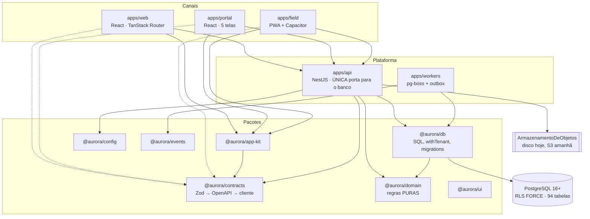
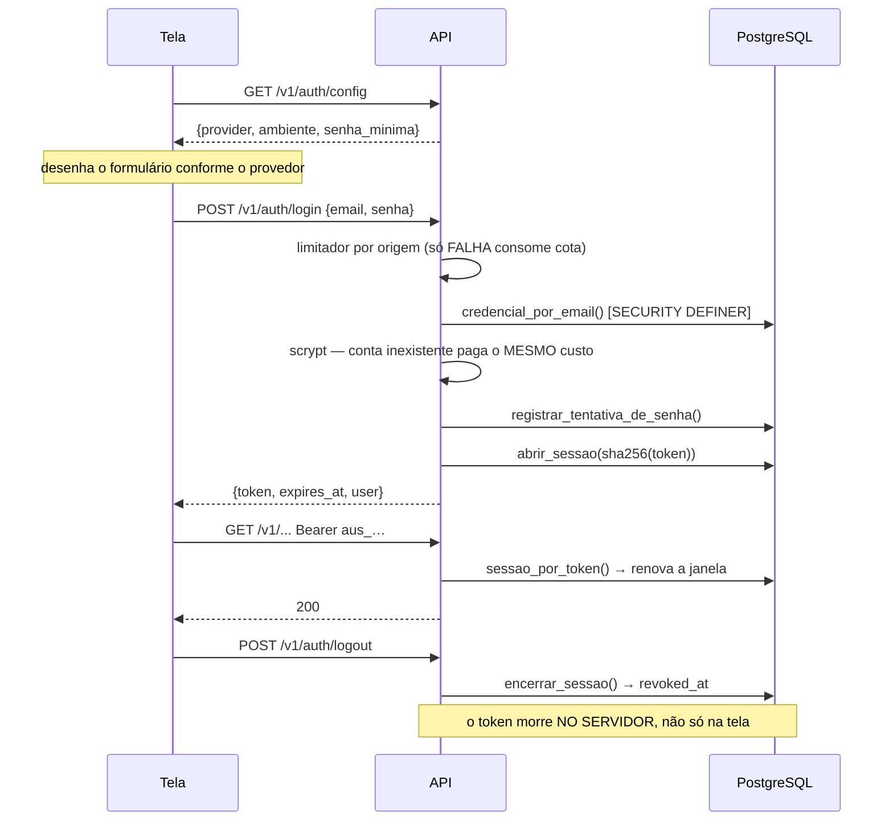
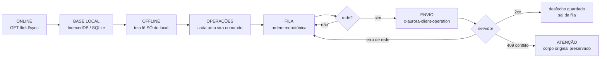

# AI-HANDOFF — o documento canônico de continuidade

> **SE VOCÊ É UMA NOVA IA (OU UMA PESSOA NOVA), COMECE AQUI.**
> Leia este arquivo inteiro. Depois leia **apenas** os arquivos indicados na
> seção do módulo que você vai mexer (§34). **Não varra o repositório inteiro** —
> ele tem ~600 arquivos versionados e a varredura gasta o seu contexto sem
> ensinar mais do que está escrito aqui.

**Atualizado em:** 30/09/2026 (demo pública, §27-A) · **HEAD desta atualização:** ver `git log -1`
**Migration mais recente:** `0046_item_imagem_e_categoria.sql` · **47 migrations** ·
**94 tabelas** · **183 rotas** · **110 permissões** · **11 papéis** ·
**107 tipos de evento** · **1707 testes de unidade/HTTP + 147 de navegador**

---

## 1 · Identidade do projeto

| | |
| --- | --- |
| **Repositório** | `voceconectadigital/technecaremeds` — **não renomear** |
| **Branch** | `main` (único) |
| **Monorepo** | npm workspaces (ADR-021). `packages/*` e `apps/*` |
| **Nome técnico interno** | **Aurora**. É codinome, namespace (`@aurora/*`, `aurora_app`, `aurora:token`) e nome de trabalho |
| **Nome comercial** | **indefinido**. O cliente usa "Be Care", "Téchne Care", "Be Care Clinical Platform" nos documentos dele e diz por escrito que o definitivo sai na etapa de marca |

### Os três nomes, e o papel de cada um

Perder tempo tentando renomear o projeto é o erro mais caro que você pode
cometer aqui. Não renomeie nada.

- **`technecaremeds`** — o repositório. Nome histórico, vindo do sistema de
  referência auditado. **Fica como está.**
- **`Aurora`** — o nome técnico. Aparece em pacotes, papéis de banco, prefixos de
  variável e chaves de armazenamento. **Trocá-lo quebraria** sessões guardadas,
  migrations aplicadas e a fila offline de quem já tem trabalho no aparelho.
- **`Be Care / Téchne Care`** — a marca do cliente, **provisória**. Toda string
  visível ao usuário mora em `marca.config.json` e é carimbada por
  `npm run marca`. Trocar a marca é editar **um** arquivo e rodar **um**
  comando — nunca uma caçada a strings.

> `marca.config.json` explica a separação no próprio arquivo. Leia-o antes de
> qualquer conversa sobre nome.

### Objetivo do produto

Plataforma multitenant de gestão de ativos, manutenção e **engenharia clínica**.
Nasceu de uma auditoria somente-leitura do sistema TechneCare/Arkmeds
(`docs/01-AUDITORIA-TECHNECARE.md`) e é especificada por
`docs/AURORA-CMMS-SPEC-v0.2.md`.

**Públicos previstos** (PLAT §2 dos documentos do cliente): prestadora de
serviço, hospital, fabricante, consultoria, laboratório de instrumentação. **Uma
plataforma, configuração diferente** — não cinco sistemas.

---

## 2 · Resumo do produto

Um CMMS de engenharia clínica: o hospital abre chamado, a coordenação tria e
vira ordem de serviço, o técnico executa em campo (com ou sem rede), e o sistema
emite documento, mede SLA e produz indicador.

**Cinco canais, todos sobre a MESMA API:**

| Canal | O que é | Quem usa |
| --- | --- | --- |
| `apps/web` | Aplicação interna, 16 rotas | Coordenação, gestão, administração |
| `apps/portal` | Portal do cliente, 5 telas | O hospital: abre chamado e acompanha |
| `apps/field` | PWA **e** app de loja (Capacitor) | Técnico em campo, offline-first |
| `apps/api` | NestJS. **Única porta para o banco** | Todos os acima, e integrações |
| `apps/workers` | pg-boss + publicador de outbox | Varreduras, SLA, expiração |

---

## 3 · Estado atual

**Legenda:** ✅ implementado · 🟡 parcial · ⬜ futuro · 🔒 bloqueado · ❓ a validar

| Domínio | Estado | Observação |
| --- | --- | --- |
| Identidade / organizações | ✅ | `organizations`, `users`, `memberships`, `membership_scopes` |
| **Autenticação por senha** | ✅ | **Novo em 29/09/2026.** Ver §7 |
| MFA | ⬜ | `users.mfa_enabled` existe e é sempre `false` |
| SSO | ⬜ | A porta `AuthProvider` existe para isso |
| RBAC | ✅ | 110 permissões, 11 papéis de fábrica, `deny` individual, escopos |
| RLS / isolamento | ✅ | `FORCE` em todas as tabelas tenant-scoped; 24 suítes adversariais |
| Ativos | ✅ | Unicidade configurável, transferência como operação, QR |
| Chamados (`service_requests`) | ✅ | Entidade separada da OS (ADR-002) |
| Ordens de serviço | ✅ | Estados × motivos configuráveis (ADR-003) |
| SLA | ✅ | Tempo útil por fuso e feriado, pausa por motivo |
| Agenda | ✅ | Projeção da OS (ADR-011); confere antes de salvar |
| Preventivas | ✅ | Frequência por tarefa; **ciclo nunca fecha** — ver §32 |
| Estoque | ✅ | Razão imutável, saldo por gatilho, reserva, **imagem e categoria por item** (0046) |
| Contratos | ✅ | Cobertura por expressão, medição congelada |
| Orçamentos | ✅ | Versionado, dinheiro em centavos |
| Documentos | 🟡 | Motor completo; 6 tipos provisionados com **payload vazio**; **sem PDF** |
| Indicadores | ✅ | Toda métrica viaja com a própria definição |
| Portal | ✅ | Com varredura anti-vazamento (§21) |
| Field / offline | ✅ | Idempotência provada sob concorrência |
| Notificações | 🟡 | Fila de saída existe; **nenhum transporte** (e-mail/WhatsApp) |
| Automações | ✅ | Motor de regras com salvaguardas |
| Busca global | ✅ | `tsvector` nativo (ADR-027) |
| Engenharia clínica | 🟡 | Criticidade e ciclo de vida sim; aceite e qualificação não |
| **Metrologia** | 🔒 | Só a "fronteira". **Cinco decisões bloqueadas** — ver §17 |
| Instrumentos / certificados / medições | ⬜ | **Não existem como tabela.** Ver §16 |
| Migração Arkmeds | 🟡 | Só importação de ativos; sem pipeline rastreável |
| Integrações (Omie, WhatsApp, BI…) | ⬜ | Nada. Ver §30 |
| IA | ⬜ | Nada. Ver §30 |
| Deploy | ⬜ | **Nada publicado.** Ver §27 |

---

## 4 · Arquitetura



### Responsabilidade de cada pacote

| Pacote | Responsabilidade | Regra que o define |
| --- | --- | --- |
| `packages/domain` | Regras **puras**. UUID v7, contexto, erros, permissões, checklists, SLA, senha, metrologia | **Sem HTTP, sem banco, sem SDK.** Se precisa de `pg`, não é domínio |
| `packages/db` | Migrations, SQL, `withTenant`, outbox, harness de teste | **`withTenant` é o único caminho** para tabela tenant-scoped |
| `packages/contracts` | Esquemas Zod das operações | **Fonte única**: valida o controller, gera o OpenAPI, tipa o cliente |
| `packages/events` | Catálogo de 107 eventos de domínio | Nome no formato `agregado.fato_no_passado` |
| `packages/config` | `loadEnv`, marca, **guard de destino de banco** | Falha **alto** no boot; nunca default silencioso em segurança |
| `packages/ui` | Design system próprio | Tokens em `src/styles/tokens.css`; componentes em §20-A |
| `packages/app-kit` | Sessão, cliente da API, tema, URL-state | Infra **sem opinião de produto**. Nada que decida o que a tela mostra |

---

## 5 · Fluxo de requisição

```
navegador
   │  Authorization: Bearer <token>
   │  x-aurora-organization: <uuid>   (sugestão, NUNCA autorização)
   ▼
context.middleware  ──► ContextResolver
   │                      ├─ AuthProvider.verify(token) → identidade
   │                      ├─ find_memberships_for_email() → vínculo REAL
   │                      └─ loadEffectivePermissions()
   ▼
PermissionsGuard (@RequirePermissions)
   ▼
Controller ──► parseWith(contrato, body)
   ▼
withTenant(db, ctx, …)  ← SET LOCAL de contexto, transaction-local
   ▼
PostgreSQL com RLS FORCE
   │
   └─► domain_events (outbox, MESMA transação)
            ▼
       apps/workers → OutboxPublisher → EventSink
```

**O frontend NUNCA executa CRUD de negócio direto no banco nem no Supabase.**
Não há cliente Supabase em nenhum `apps/*`. É o critério de aceite 9 do cliente
("APIs externas não acessam diretamente o banco") e é verificável:
`grep -ri supabase apps/*/src` não devolve nada.

---

## 6 · Multitenancy — como NÃO furar o isolamento

Esta é a propriedade que não pode falhar uma vez. São 10 camadas (SPEC §37); as
que você precisa conhecer para escrever código:

1. **`organization_id` nunca vem do cliente como autorização.** O cabeçalho
   `x-aurora-organization` só *sugere*; quem decide é a consulta de vínculo.
2. **`FORCE ROW LEVEL SECURITY`** em toda tabela tenant-scoped. `ENABLE` sozinho
   não vale para o dono da tabela.
3. **Contexto transaction-local** (`set_config(..., is_local => true)`): morre no
   COMMIT e nunca vaza para a próxima requisição da mesma conexão do pool.
4. **Falha fechada.** Sem contexto, `current_organization_id()` é `NULL`, e
   `organization_id = NULL` é falso → zero linhas.
5. **Papel sem privilégio.** O usuário da API herda de `aurora_app`:
   `NOBYPASSRLS`, não é dono de tabela nenhuma. O boot **recusa subir** se o
   papel puder ignorar RLS (`assertAppRoleIsSafe`).
6. **Chaves estrangeiras compostas** incluindo `organization_id` em toda relação
   entre tabelas tenant-scoped — a verificação de FK roda como dona da tabela e
   **ignora a RLS**.

### Padrão obrigatório para uma tabela tenant-scoped nova

```sql
CREATE TABLE aurora.minha_coisa (
  id                uuid PRIMARY KEY,
  organization_id   uuid NOT NULL REFERENCES aurora.organizations(id) ON DELETE CASCADE,
  -- … campos …
  created_at        timestamptz NOT NULL DEFAULT now(),

  -- 1. par (id, organization_id) único: é o que permite FK composta vinda de fora
  CONSTRAINT minha_coisa_id_org_uq UNIQUE (id, organization_id),

  -- 2. TODA FK para outra tabela tenant-scoped é COMPOSTA
  CONSTRAINT minha_coisa_ativo_org_fk
    FOREIGN KEY (asset_id, organization_id)
    REFERENCES aurora.assets (id, organization_id) ON DELETE RESTRICT
);

CREATE INDEX minha_coisa_org_idx ON aurora.minha_coisa (organization_id);

DO $do$
BEGIN
  ALTER TABLE aurora.minha_coisa OWNER TO aurora_owner;
  ALTER TABLE aurora.minha_coisa ENABLE ROW LEVEL SECURITY;
  ALTER TABLE aurora.minha_coisa FORCE  ROW LEVEL SECURITY;   -- 3. FORCE, sempre

  CREATE POLICY minha_coisa_tenant_isolation ON aurora.minha_coisa FOR ALL
    USING (organization_id = aurora.current_organization_id())
    WITH CHECK (organization_id = aurora.current_organization_id());  -- 4. WITH CHECK também

  GRANT SELECT, INSERT, UPDATE, DELETE ON aurora.minha_coisa TO aurora_app;
  GRANT SELECT ON aurora.minha_coisa TO aurora_readonly;
END
$do$;

-- 5. auditoria, se for dado de negócio
CREATE TRIGGER minha_coisa_audit AFTER INSERT OR UPDATE OR DELETE
  ON aurora.minha_coisa FOR EACH ROW EXECUTE FUNCTION aurora.fn_audit('minha_coisa');
```

E **acrescente a tabela à lista esperada** em
`packages/db/src/__tests__/migrations.test.ts` — há um teste que compara o schema
inteiro e ele vai falhar (de propósito).

**Nunca** use `unsafeCrossTenant` em código de domínio: uma regra de lint o
barra, e ela **dispara de verdade** (foi verificada com probe).

---

## 7 · Autenticação  ⚠️ MUDOU EM 29/09/2026

### A porta

`apps/api/src/auth/auth-provider.port.ts` define `AuthProvider`: uma função,
`verify(bearerToken) → identidade | null`. **O domínio nunca conhece o SDK de um
fornecedor.**

### Os três adaptadores

| Valor de `AURORA_AUTH_PROVIDER` | Estado | O que faz |
| --- | --- | --- |
| `local` | ✅ dev/teste | Aceita `local:<sujeito>:<e-mail>`. **SEM SENHA.** Recusado em homologação e produção, duas vezes: pela configuração e pelo construtor |
| `password` | ✅ **é o login real** | Senha em `scrypt`, sessão como token opaco revogável |
| `supabase` | 🔒 **sem adaptador** | O boot **LANÇA**. Bloqueado por falta de acesso ao projeto (ADR-025, OQ-16) |

> **Defeito corrigido em 29/09:** `AURORA_AUTH_PROVIDER` existia, era validada e
> **ninguém a lia** — `app.module` caía em `LocalAuthProvider` sempre. Definir
> `supabase` fazia o boot passar e o processo continuava aceitando entrada sem
> senha. A escolha agora está em **um** lugar
> (`apps/api/src/auth/escolher-provedor.ts`) e o caso sem adaptador falha alto.

### Como o login por senha funciona



**Rotas** (as três públicas, na lista de isenção do `context.middleware`):
`GET /v1/auth/config` · `POST /v1/auth/login` · `POST /v1/auth/logout`

**Decisões que você não deve desfazer sem pensar:**

- **Token opaco, não JWT.** Revogar um JWT exige lista de revogados consultada no
  banco a cada requisição — o custo que o JWT prometia evitar. Sem esse ganho,
  sobra a desvantagem: JWT roubado vale até expirar.
- **O banco guarda `sha256(token)`, nunca o token.** Vazou o backup? Ninguém
  entra como ninguém.
- **A recusa é idêntica** para e-mail inexistente, conta sem senha e senha
  errada — **inclusive no tempo** (a conta inexistente paga um `scrypt` de
  engodo). Distinguir transformaria o login num oráculo de cadastro.
- **Bloqueio progressivo COM prazo** (5 erros → 1 min; 10 → 15 min). Permanente
  viraria negação de serviço contra a pessoa certa.
- **O limitador por origem conta só FALHAS.** Contar acertos puniria um hospital
  inteiro atrás de um NAT.
- **`aurora.definir_senha` NÃO é concedida a `aurora_app`.** Só o comando
  administrativo define senha.

### Sessão no cliente

`localStorage`: `aurora:token` e `aurora:organizacao`. A organização é **escolha**,
nunca autorização — trocá-la à mão no navegador dá 403. Sobrevive a refresh.
Sair chama `POST /auth/logout` **e** limpa o local (`useEncerrarSessao`).

### Criar a primeira conta

```bash
npm run admin:criar
```

Interativo: escolhe organização, pede e-mail, nome, e a senha **duas vezes com
eco desligado**. Não aceita senha por argumento nem por variável de ambiente.
Argumentos: `--org=<slug> --email=… --nome=… --papel=admin|owner`,
`--senha-stdin` (para automação), `--aceitar-senha-fraca` (dispensa explícita,
que grita na saída).

**MFA e recuperação por e-mail não existem.** Recuperação depende de transporte
de e-mail, que o sistema não tem. Esquecer a senha hoje = rodar `admin:criar` de
novo.

---

## 8 · RBAC

- **110 permissões**, fonte única em `packages/domain/src/permissions.ts`. O banco
  é espelho, e um teste garante que não divergem.
- **11 papéis de fábrica**, `is_system`, não editáveis. Customizar é duplicar.
- **`deny` individual vence** qualquer concessão de papel.
- **Escopo** é outra coisa: `membership_scopes` limita por cliente, local,
  atribuição e almoxarifado. **Permissão + escopo = autorização.**

### Como adicionar uma permissão

1. Acrescente em `PERMISSIONS` (`packages/domain/src/permissions.ts`).
2. Inclua nos papéis de fábrica que a devem ter (ou em `except`).
3. `syncPermissionCatalog(adminDb)` grava no banco — o seed e o `admin:criar` já
   chamam. **Sem isso, a FK recusa** a associação.
4. Proteja a rota: `@RequirePermissions('recurso.acao')`.
5. Declare no contrato (`permissions: ['recurso.acao']`) — `npm run openapi:check`
   **falha** se o contrato e o guard discordarem.
6. Teste com um papel que **não** a tem, esperando 403.

> `PermissionsGuard` devolve 403 **nomeando a permissão que falta**. Rota sem
> `@RequirePermissions` passa pelo guard — a autenticação é do middleware.

---

## 9 · Banco de dados

PostgreSQL **16+**. Sem extensões (ADR-026 sem `ltree`, ADR-027 sem `pg_trgm`):
não são garantidas em PostgreSQL gerenciado e não existem no PGlite.

**UUID v7 gerado na aplicação** (ADR-024), por `newId()` de `@aurora/domain`.
Nenhuma coluna de chave de negócio tem `DEFAULT` de geração no banco.

**Numeração humana** (`SR-2026-0001`, `WO-2026-0001`, `CAL-…`) sai de contador com
bloqueio de linha — nunca `max(n)+1`, que sob concorrência gera dois iguais.

### Papéis de banco

| Papel | Para quê |
| --- | --- |
| `aurora_owner` | Dono das tabelas |
| `aurora_migrator` | Aplica migrations |
| `aurora_app` | **A API.** `NOBYPASSRLS`, não é dono, submetido às políticas |
| `aurora_identity` | Resolve vínculos. **SÓ SELECT** — há teste que exige isso |
| `aurora_auth` | **Novo (0045).** Credenciais e sessões. Escreve em 2 tabelas, e só |
| `aurora_publisher` | Lê o outbox entre organizações; não altera negócio |
| `aurora_scheduler` | pg-boss |
| `aurora_readonly` | Leitura |

### Mapa de tabelas por domínio

| Domínio | Tabelas principais |
| --- | --- |
| **Plataforma** | `organizations` · `users` · `memberships` · `membership_scopes` · `roles` · `permissions` · `role_permissions` · `membership_roles` · `membership_permission_overrides` |
| **Autenticação** | `user_credentials` · `user_sessions` — **sem privilégio para `aurora_app`** |
| **Auditoria/eventos** | `audit_logs` (append-only) · `domain_events` (outbox) |
| **Diretório** | `customers` · `customer_contacts` · `locations` · `location_types` · `suppliers` · `teams` · `team_members` · `calendars` · `calendar_windows` · `availability_blocks` |
| **Catálogos** | `catalog_definitions` · `catalog_items` · `custom_field_definitions` |
| **Ativos** | `assets` · `asset_categories` · `asset_models` · `manufacturers` · `criticality_levels` · `asset_identifiers` (projeção de unicidade) · `asset_transfers` · `meters` · `meter_readings` |
| **Chamados/OS** | `service_requests` · `work_orders` · `work_order_statuses` · `work_order_status_transitions` · `wait_reasons` · `work_order_comments` · `*_status_history` |
| **Execução** | `checklist_templates/_sections/_items` · `checklist_responses/_answers` · `time_entries` · `attachments` · `signatures` · `completion_requirements` |
| **SLA** | `sla_policies` · `sla_targets` · `sla_clocks` · `sla_pauses` |
| **Preventivas** | `maintenance_plans` · `plan_tasks` · `plan_cycles` · `plan_cycle_items` |
| **Estoque** | `warehouses` · `inventory_items` · `stock_movements` (razão imutável) · `stock_balances` (projeção) · `stock_reservations` · `stock_lots` · `price_lists` |
| **Comercial** | `contracts` · `contract_coverages` · `contract_services` · `contract_periods` · `quotes` · `quote_items` |
| **Documentos** | `document_types` · `documents` · `document_signatures` · `number_series` |
| **Analytics** | `fact_work_order` (mantida por gatilho) |
| **Notificações** | `notifications` · `notification_preferences` · `notification_deliveries` |
| **Automações** | `automation_rules` · `automation_actions` · `rule_runs` |
| **Offline** | `client_operations` (idempotência de campo) |

---

## 10 · Migrations

```bash
npm run db:migrate    # aplica
npm run db:status     # o que já foi aplicado
npm run db:destino    # só confere para onde a URL aponta
```

- Arquivos em `packages/db/migrations/NNNN_nome.sql`, aplicados em ordem.
- **Checksum**: alterar uma migration já aplicada é detectado e recusado.
- **Trava de transação** (`pg_advisory_xact_lock`) — duas instâncias migrando o
  mesmo banco não se atropelam.
- Idempotentes e reprodutíveis do zero.

### ⚠️ O GUARD DE DESTINO — leia antes de qualquer comando de banco

Em 30/08/2026 um projeto Supabase criado para o Aurora amanheceu com o schema
inteiro de **outro produto** dentro. O comando que fez isso não era do Aurora —
mas até ali todo script do Aurora aceitava qualquer `DATABASE_URL`.

`aurora.destinos.json` + `packages/config/src/destino.ts` são a correção:

- **lista fechada** por ambiente (host + banco + `ref` do Supabase);
- **não há variável de escape** — "uma saída de emergência vira o caminho normal
  na primeira pressa";
- o `ref` é extraído do host **e** do usuário do pooler (`postgres.<ref>@…`);
- destino **remoto exige `AURORA_AMBIENTE`** declarado, e a intenção é conferida
  contra o destino;
- há uma lista de **bloqueados** que recusa **com o motivo**.

Destino novo entra na lista **por decisão**, editando o JSON — nunca por acidente.

---

## 11 · Supabase

**Estado: 🔒 BLOQUEADO, e nada depende disso.**

O CLI está autenticado e lista 28 projetos em ~18 organizações. **Nenhum é
identificável como o do Aurora.** Nenhuma operação remota foi executada
(ADR-025, OQ-16). Para destravar: alguém com acesso concede acesso, ou informa o
*project ref*.

**Não confunda quatro coisas:**

| | O que é |
| --- | --- |
| **Supabase hospedado** | O projeto remoto. Bloqueado |
| **Supabase local** | Stacks de **outros produtos** na máquina do dev (`ecommerce-template`, `pragminas-digital-hub`, `hpproto`). **NÃO TOQUE** |
| **PostgreSQL da aplicação** | O que o Aurora usa. Hoje, o contêiner `aurora-postgres` |
| **Supabase Auth** | Provedor de identidade previsto, **sem adaptador** (§7) |

Nada no código depende de Supabase: as migrations rodam em qualquer PostgreSQL
16+, arquivos vão por adaptador, identidade vai por porta.

---

## 12 · Fluxo de chamado / OS

```
service_request (relato do cliente, IMUTÁVEL após envio)
   └─ triagem ──► aceita ──► 1..N work_orders
                  recusada (exige motivo)
                  duplicada (aponta a original, não destrói)
work_order
   └─ atribuição ─► agenda (confere ANTES de salvar)
        └─ execução: checklist · horas · peças · fotos · diagnóstico · assinatura
             └─ bloco de conclusão → 412 com a LISTA do que falta
                  └─ concluída → validada → fechada
                       └─ reabrir cria relógio de SLA NOVO
```

**A máquina de estados é DADO, não código** (ADR-003):

- **Categoria** — fixa na plataforma. É o que o software interpreta (se conta
  como ativa, se o relógio corre, se o equipamento está parado).
- **Situação** — configurável por organização, declarando uma categoria. É o
  vocabulário do cliente.
- **Motivo de espera** — configurável, com `pauses_sla` e responsável.

> **Não escreva `if (status === 'aguardando')` em lugar nenhum.** O grafo vive em
> `work_order_status_transitions` e um gatilho recusa transição não declarada. A
> referência auditada tinha **42 estados** porque codificou o motivo dentro do
> estado.

**Falta de peça NÃO pausa o SLA** por padrão: o atraso é nosso.

---

## 13 · Offline (a seção que mais importa do `apps/field`)



### Invariantes que você NÃO pode quebrar

1. **Reenviar a mesma operação nunca duplica registro.** `client_operations`
   guarda o desfecho por `client_operation_id`. A reserva acontece **dentro da
   transação do trabalho** — um interceptor deixaria "já fiz isso" gravado para
   trabalho que nunca aconteceu.
2. **Nada sai da fila sem resposta do servidor sobre aquele comando.** Não sai
   por tempo, nem por número de tentativas, nem por erro de rede. O único
   descarte é o explícito, numa tela que mostra o que está sendo jogado fora.
3. **Nada é descartado em silêncio.** Mesmo id + outro corpo → 409
   `digest_mismatch`. Mesmo id + outra pessoa → 409 `membership_mismatch`.
   Conflito de estado é gravado **com o corpo da requisição**, em transação
   própria.
4. **A tela lê SEMPRE da base local**, nunca da rede. Ler "quando dá" dá dois
   modos à tela, e o vazio aparece justamente no subsolo.
5. **O relógio é o do servidor.** `synced_at` volta como `since`.
6. **A porta de armazenamento tem 8 regras de semântica** e uma suíte de
   conformidade que roda contra memória, SQLite **e** IndexedDB real no
   navegador. Dois adaptadores propositalmente errados vivem na suíte para
   provar que ela reprova.

**Rotas sob garantia de idempotência (9):** criar OS · transicionar OS · abrir
chamado · anexar checklist · responder item · cronômetro · apontar hora · anexar
arquivo · assinar · consumir peça.

**Fotos:** metadado na base local, estado do envio no mesmo registro, **bytes num
adaptador de arquivos**. Envio retomável por fatia de 256 kB, progresso gravado
**depois de cada fatia aceita**, e quem manda no progresso é o servidor.

---

## 14 · Storage / attachments

`ArmazenamentoDeObjetos` (`apps/api/src/common/arquivos/porta.ts`): disco hoje,
S3 amanhã, memória nos testes. **A escrita é posicional**
(`escrever(chave, deslocamento, bytes)`) — é o que torna a retomada segura: a
mesma fatia entregue duas vezes escreve por cima de si mesma.

- Registro em `aurora.attachments`; **bytes fora do banco**.
- `sha256` conferido no fim do envio.
- Chave de armazenamento **decidida pelo servidor**, com prefixo por organização.
- Dono: OS **ou** resposta de checklist (`att_has_owner`).
- Tipos e tetos por finalidade em `packages/domain/src/attachments.ts`.

**Para adicionar um tipo novo de anexo:** acrescente o valor em
`attachment_purpose` (enum), declare o content-type permitido e o teto em
`ALLOWED_CONTENT_TYPES`/`MAX_BYTES`, e ajuste o CHECK `att_has_owner` se o dono
for uma entidade nova.

> ⚠️ `AURORA_ARQUIVOS_DIR` num contêiner efêmero **some com o contêiner**, e as
> fotos com ele — em silêncio, porque o registro continua no banco.

---

## 15 · Documentos

Motor **único** com tipos (ADR-013) — a referência tinha seis módulos com 90% de
estrutura comum.

`draft → under_review → issued → released → (expired | superseded | cancelled)`

- **Número emitido nunca é reaproveitado.** Cancelado mantém o número queimado,
  com motivo de ≥10 caracteres.
- **Documento assinado não se edita** — gatilho recusa.
- **Hash canônico**: chaves ordenadas em toda profundidade.
- **O sistema não afirma validade jurídica de assinatura.** `icp_brasil` está
  modelado e é **recusado** enquanto a cadeia não for verificada.

🟡 **Parcial, e diga isso a quem perguntar:** os 6 tipos (`work_order_report`,
`calibration_certificate`, `electrical_safety_test`, `standard_certificate`,
`obsolescence_report`, `thermal_qualification`) estão provisionados com
**`payloadFields: []`** — os campos de cada um dependem de norma técnica não
confirmada. **Não há geração de PDF**: `pdf_key` existe, o renderizador não.

---

## 16 · Engenharia clínica / metrologia

**Fonte obrigatória:** `docs/AUDITORIA-GAP-BECARE-TECHNECARE-V2-2026-09.md`
(auditoria de gap contra os dois PDFs do cliente, 40 seções + matriz de 68
requisitos).

| Conceito | Estado |
| --- | --- |
| Criticidade, ciclo de vida do ativo | ✅ |
| Risco | 🟡 `risk_class`/`operational_risk` como texto livre; sem regra |
| **Instrumento** | ⬜ **não existe tabela.** `grep -ri instrument` só acha texto |
| **Certificado de instrumento/padrão** | ⬜ não existe |
| **Procedimento/protocolo metrológico** | 🟡 `checklist_templates` é o esqueleto certo (versionado e imutável), mas falta ponto de medição (nominal, tolerância, leituras), tipo de teste e responsável técnico |
| **Sessão de medição** | 🟡 `checklist_responses` já é ~60%: OS, protocolo congelado, técnico, data. Falta instrumento, certificado, origem, dado bruto |
| **Dado bruto** | 🟡 envio retomável existe; falta `purpose='raw_data'` e o dono "sessão" |
| Calibração / TSE / qualificação | 🟡 tipos provisionados, payload vazio |
| Aceite de equipamento | ⬜ |

**Não transforme planejamento em feature pronta.** O que está acima como ⬜ não
existe, mesmo que os documentos do cliente descrevam.

---

## 17 · A fronteira metrológica  🔒 NÃO ATRAVESSE

`docs/AURORA-METROLOGIA-FRONTEIRA.md` e `packages/domain/src/metrologia.ts`.

**O que está implementado** — porque não há nada a decidir:

- validade do padrão avaliada **na data da medição** (comparação de **texto** em
  `YYYY-MM-DD`, nunca `Date`: `new Date('2026-03-15')` é meia-noite UTC, que no
  Brasil é dia 14);
- o dia do vencimento **ainda vale**;
- data mal formada é **recusada**, não comparada;
- conferência de preenchimento da cadeia de rastreabilidade.

### As cinco decisões BLOQUEADAS

| # | Decisão | Por que não dá para inventar |
| --- | --- | --- |
| 1 | **Incerteza expandida** | Compor contribuições, graus de liberdade efetivos e o fator *k* são decisões com consequência regulatória |
| 2 | **Correção de erro sistemático** | Aplicar ou não, e com que sinal, muda o veredito |
| 3 | **Critério de aceitação e veredito por ponto** | O limite vem da norma do equipamento, não do sistema que registra |
| 4 | **Limites normativos de segurança elétrica** | Inventá-los **aprovaria equipamento reprovado** |
| 5 | **Arredondamento e algarismos significativos** | Arredondar antes de comparar transforma reprovado em aprovado |

**Há um teste que FALHA se alguém acrescentar uma função de cálculo ao módulo.**
Não é burocracia: o modo desta fronteira apodrecer não é alguém decidir violá-la
— é alguém acrescentar "só uma fórmula simples" num dia de pressa.

**Para destravar qualquer item:** procedimento escrito do responsável técnico +
casos de referência com resultado conhecido (incluindo pelo menos um **no
limite** da tolerância) + validação por metrologista. Sem os três, continua aqui.

O mesmo vale para **fórmulas de risco** não validadas.

---

## 18 · Eventos e workers

- **`domain_events` é outbox transacional**: o evento é gravado na MESMA
  transação do dado. Nunca "salva e torce para publicar".
- `OutboxPublisher` roda sob `aurora_publisher`, com `FOR UPDATE SKIP LOCKED`.
  Garantia **at-least-once** — o consumidor precisa ser idempotente por
  `event_id`.
- **pg-boss** é o agendador durável (roda também em PGlite). 6 jobs:
  `sla.sweep`, `plans.sweep`, `quotes.expire`, `contracts.alerts`,
  `documents.expiry`, `outbox.publish`.

**Para criar um evento:** declare em `packages/events/src/catalog.ts` (formato
`agregado.fato_no_passado`) — há um CHECK no banco e o catálogo recusa tipo
desconhecido. **Para criar um job:** `apps/workers/src/jobs/catalog.ts`.

---

## 19 · API

REST com OpenAPI 3.1 **gerado do roteador real** (`docs/openapi.json`).
Prefixo `/v1`, exceto `/q/:token` (vai impresso em etiqueta).
Erros no formato **RFC 9457** com `code`, `message`, `request_id`.

`npm run openapi:check` roda no `verify` e **falha** se: rota perdeu contrato,
contrato aponta para rota inexistente, contrato e guard discordam de permissão,
escrita guardada por permissão de leitura, ou rota literal sombreada.

### Caminho para criar um endpoint

```
1. contrato   packages/contracts/src/operations/<dominio>.ts → defineOperation
2. registro   exporte em packages/contracts/src/index.ts
3. permissão  packages/domain/src/permissions.ts (se for nova)
4. controller apps/api/src/<dominio>/<x>.controller.ts
              @RequirePermissions(...) + parseWith(Contrato, body)
5. dados      packages/db/src/<dominio>.ts, SEMPRE por withTenant
6. testes     apps/api/src/__tests__/api-<dominio>.test.ts
              incluindo um caso de OUTRA organização
7. npm run openapi   (regenera; o check no CI compara)
```

**Nunca** redeclare um DTO no frontend: o tipo vem do contrato.

---

## 20-A · Design system — o que saber antes de desenhar uma tela

Redesenhado em 29/09/2026. A fundação (tokens semânticos, contraste conferido,
foco visível, estado nunca só por cor) **não mudou**; o que mudou foi
calibração e o catálogo de componentes.

**Escala tipográfica DUPLA.** Base operacional densa (`2xs`…`md`, 11–16px)
porque leitura de tabela depende dela; e aberta a partir de `lg` (19px) até
`4xl` (49px), onde moram título de cartão, de seção, de página e número de
indicador. Títulos acima de 24px usam `tracking-display` (entreletra negativa).
**Hierarquia é a distância entre corpo e título, não o tamanho do corpo.**

**Elevação.** `shadow-card` é o piso de todo `Card` — dois estágios, quase
invisível de perto, e é o que dá profundidade a uma tela que antes era só
retângulos de 1px. `shadow-raised` para o que precisa se destacar DENTRE
cartões. A borda continua sendo a separação de lista e tabela.

**Superfícies:** `bg` (janela) < `surface-subtle` (barra lateral, cabeçalho de
tabela) < `surface` (cartão). A navegação fica sobre a rebaixada para que o
conteúdo seja a superfície mais clara da tela.

**Paleta de dados** (`--color-data-1..6`): só para série de gráfico e
identidade de miniatura. **Nunca para estado** — uma série que reusasse o
vermelho de crítico faria uma barra alta parecer alarme.

### Componentes de apresentação de dados

| Componente | Quando usar | A regra que ele carrega |
| --- | --- | --- |
| `Metric` / `MetricGrid` | número de painel | `value={null}` vira traço, nunca zero; `coverage` fica visível, não atrás de clique |
| `BarChart` | comparar grandezas com rótulo em frase | barras horizontais; tem tabela só para leitor de tela |
| `DonutChart` | composição de um todo | nunca para comparar grandezas |
| `Sparkline` | tendência dentro de um cartão | responde "para onde", não "quanto" |
| `Thumb` | item físico numa lista | o vazio é DESENHADO — iniciais sobre cor estável derivada do nome |
| `Section` | bloco de página com título | título `text-xl`, para varrer a página sem ler |
| `Toolbar` | busca + filtro + ação de uma lista | sempre na mesma ordem, em toda tela |
| `FilterChip` | filtro visível | ativo em três canais: fundo, peso e borda |
| `StatStrip` | números no topo de uma lista | versão compacta do `Metric`, quando o assunto já é da tela |
| `FieldPair` | rótulo + valor numa ficha | rótulo pequeno em caixa alta; o valor é o conteúdo |

**Gráficos são SVG à mão, sem biblioteca** — três formas simples não pagam
40–150 kB nem um segundo sistema de temas que discorda do nosso na primeira
cor. Todo gráfico tem alternativa textual: um `<svg>` sem ela é informação que
não existe para metade do painel.

**Imagem de item de estoque:** `inventory_items.image_key` guarda caminho
**relativo** (restrição de tabela recusa URL absoluta — ver a migration 0046) e
a borda HTTP monta `image_url`. As ilustrações de catálogo estão em
`apps/web/public/catalogo`; leia o `LEIA-ME.md` de lá antes de acrescentar uma.

### Três armadilhas que já custaram um teste vermelho

1. **Cor de série como cor de texto.** `--color-data-3` é âmbar e dá ~3,5:1
   sobre fundo claro. Para texto, misture com `--color-text` — resolve os dois
   temas de uma vez.
2. **Link de texto como alvo de toque.** A altura da linha fica abaixo dos
   24×24 da WCAG 2.2. Use `min-h-6`.
3. **Teste amarrado à decoração.** A saudação da tela inicial segue o relógio;
   uma asserção em "Bom dia" falha à tarde, sozinha, na integração contínua.

## 20 · Frontends


| | `apps/web` | `apps/portal` | `apps/field` |
| --- | --- | --- | --- |
| **Objetivo** | Operação interna | Autoatendimento do cliente | Execução em campo |
| **Rotas** | `/entrar` `/login`→`/entrar` `/organizacoes` `/` `/solicitacoes[/nova\|/$id]` `/ordens[/$id]` `/agenda` `/planos[/$id]` `/ativos[/$id]` `/estoque` `/contratos[/$id]` `/orcamentos[/$id]` `/documentos` `/indicadores` `/notificacoes` `/perfil` `/configuracoes[/automacoes]` | `/entrar` `/` `/chamados` `/abrir` `/equipamentos` | HOJE · OS · QR · SINCRONIZAÇÃO · PERFIL |
| **Estado** | TanStack Query + URL-state | idem | **base local é a fonte** |
| **Auth** | `useSession` + `/auth/login` | idem | idem |
| **Dados** | `useApiQuery`/`useApiMutation` tipados pelo contrato | idem | `useColecaoLocal` |
| **Responsivo** | testado em 1440/768/390 | barra embaixo, 4 destinos | polegar, 4 destinos |
| **Carregamento** | por rota (`lazy`), exceto entrar/organizações/hoje | — | **nenhuma tela preguiçosa** (rota preguiçosa não abre no subsolo) |

**Regras que atravessam as três:** filtro mora na URL · as ações possíveis vêm do
servidor (a tela não deduz o grafo) · arrastar no Kanban pede ao servidor antes
de mover · erro nunca evapora · WCAG 2.2 (foco visível, alvo de 44px, estado
nunca só por cor).

---

## 21 · Portal do cliente — proteção anti-vazamento

**O portal NÃO pode serializar entidades internas.** O modo de ele falhar não é
alguém decidir vazar — é uma consulta que ganha uma coluna a mais num `SELECT`
bem-intencionado, seis meses depois.

**PORTAL-011** (`apps/api/src/__tests__/api-portal.test.ts`) percorre a resposta
**inteira** de cada rota do portal, em toda profundidade, contra uma lista de
chaves que pertencem à prestadora: custo, margem, fornecedor, nota interna, quem
vai atender, valor de aquisição.

Duas coisas o tornam confiável:

1. **controle positivo** — a mesma lista apontada para a rota **interna** da
   mesma OS, exigindo que ela **acuse**. Sem isso, chaves com nome errado fariam
   tudo passar para sempre, provando nada.
2. **massa não vazia** — três provas anteriores passavam contra lista vazia
   (lista vazia não tem campo proibido dentro).

**Se você criar rota de portal, acrescente as chaves novas a essa lista.**

O vocabulário do cliente é **dado**: `work_order_statuses.customer_label`.

---

## 22 · Field

- **PWA e aplicativo de loja da MESMA base** (ADR-029/030), via **Capacitor**.
  React Native exigiria reescrever telas, fila e motor de conflito — e a versão
  reescrita divergiria.
- Porta `ArmazenamentoOffline` com **8 regras** e suíte de conformidade.
  IndexedDB no navegador; SQLite **preparado e não ligado**.
- Recursos do aparelho atrás de porta (câmera, leitor, arquivos, rede, push),
  carregados **sob demanda**.
- A tela de QR **resolve contra a base local** — um leitor que precisa de rede
  não serve na casa de máquinas.
- **Lojas estão fora desta fase.** Nada publicado, nada assinado. O que trava
  está em `docs/AURORA-FIELD-LOJAS.md`.

---

## 23 · Segurança

### NUNCA FAÇA

| ❌ | Por quê |
| --- | --- |
| `db.query` direto fora da infraestrutura de dados | Pula `withTenant` → sem contexto → ou vaza, ou falha estranho. **Há regra de lint que barra** |
| Aceitar `organization_id` do cliente como autorização | É o vetor clássico de cross-tenant |
| `unsafeCrossTenant` em código de domínio | Escotilha administrativa, barrada por lint, exige justificativa ≥10 chars |
| Desabilitar RLS, ou criar tabela sem `FORCE` | A política vira decoração |
| Dar `BYPASSRLS`/`SUPERUSER` ao papel da API | O boot recusa subir — e está certo |
| Service role / chave secreta no frontend | Não existe nenhuma hoje. Mantenha assim |
| Commitar segredo | `tools/ci/check-secrets.mjs` varre a cada commit |
| Criar rota tipo `/admin-sem-login` ou cadastro público | Não existe, e não deve |
| Chavear limitador em `x-forwarded-for` | O cliente escreve esse cabeçalho. Use o soquete (`req.ip`) |
| Afirmar validade jurídica de assinatura | O sistema registra **evidência**, não afirma validade |
| Inventar fórmula metrológica | §17 |
| Rodar comando de banco sem conferir destino | §10 |

### O que já existe

Autenticação individual real · RBAC com 110 permissões · RLS `FORCE` em todas as
tabelas tenant-scoped · trilha de auditoria **append-only** (só o gatilho
insere; `aurora_app` só lê) · `client_operations` sem `DELETE` · varredura de
segredos no CI · guard de destino de banco · **24 suítes com caso adversarial**
de outra organização.

**Faltando:** MFA · permissões por contrato e por ativo · criptografia de campo ·
rotina de backup/restauração documentada · auditoria em `checklist_answers` e
`attachments`.

---

## 24 · Testes

| Camada | Onde | Quanto |
| --- | --- | --- |
| Unidade + HTTP | 88 arquivos `*.test.ts` | **1707 passando**, 32 pulados |
| PostgreSQL real | mesma suíte, com `AURORA_TEST_PG_URL` | ~30 provas que ficam **puladas** sem a variável — e dizem isso |
| Navegador | `e2e/specs/*.spec.ts` (18 arquivos) | **147 passando**, 3 perfis |
| Contratos/OpenAPI | `npm run openapi:check` | conferência estrutural |
| Segredos | `tools/ci/check-secrets.mjs` | bloqueante |

```bash
npm run verify        # spec:audit → typecheck → lint → marca → openapi → test
npm test              # só a suíte
npx vitest run <arquivo>
npx playwright test   # precisa de AURORA_E2E_DATABASE_URL e AURORA_E2E_ADMIN_DATABASE_URL
```

**Banco de teste:** PGlite por padrão (ADR-022) — PostgreSQL 16.4 em WASM, em
processo. **Uma conexão só**: mais severo para vazamento de contexto, mais fraco
para concorrência. O que ele não prova tem suíte própria contra PostgreSQL real.

> A suíte **encontra defeito**: 40 na primeira fase, e nesta rodada mais dois — o
> limitador que punia NAT e o 422 onde o contrato dizia 429. Escreva testes que
> possam falhar.

---

## 25 · CI

`.github/workflows/ci.yml`, três tarefas:

| Tarefa | Banco | Prova |
| --- | --- | --- |
| `estatico` | nenhum | spec:audit, typecheck, lint, formatação, OpenAPI, marca, segredos |
| `banco` | PostgreSQL 16 de serviço | a suíte com `AURORA_TEST_PG_URL` ligado |
| `navegador` | PostgreSQL 16 de serviço | Playwright com a API sob papel **sem privilégio** |

A `estatico` é separada de propósito: termina em segundos. **Todos os três
precisam passar** antes de merge.

---

## 26 · Ambientes

`AURORA_AMBIENTE` responde "**qual implantação é esta**" e é outra pergunta que
`NODE_ENV` ("qual o modo de execução"). Uma homologação roda **com** build de
produção e mesmo assim **não é** produção.

| Ambiente | Existe? | Seed? | Travas |
| --- | --- | --- | --- |
| `desenvolvimento` | ✅ contêiner `aurora-postgres` local | ✅ | nenhuma |
| `teste` | ✅ banco `aurora_e2e` | ✅ | nenhuma |
| `homologacao` | ⬜ **sem máquina** | ✅ quando existir | recusa `AURORA_ALLOW_UNSAFE_DEV` e `AURORA_AUTH_PROVIDER=local` |
| `producao` | ⬜ não existe | ❌ **nunca** | idem, mais rígido |

Detalhes em `docs/AURORA-AMBIENTES.md`.

---

## 27 · Deploy

### Só a DEMONSTRAÇÃO está publicada. O produto conectado não.

| Item | Estado |
| --- | --- |
| API | **NOT DEPLOYED** — roda local |
| Web — **demonstração** | **PUBLICADA** em https://technecaremeds.voceconecta.com.br (Cloudflare Pages, `VITE_DEMO_MODE=true`, sem API) — ver §27-A |
| Web conectada / Portal / Field | **NOT DEPLOYED** |
| Workers | **NOT DEPLOYED** |
| PostgreSQL | **local**, contêiner `aurora-postgres` (porta 15432) |
| Supabase | 🔒 bloqueado |
| Storage | disco local |
| Lojas (Play/App Store) | **READY** (build), **NOT PUBLISHED** |
| Domínio / DNS | não existe |

**Não há Dockerfile, wrangler.toml, fly.toml nem compose versionados.** O Pages
da demonstração é configurado no painel da Cloudflare (ligado ao GitHub), não
por arquivo — ver §27-A.

**O que trava:** uma máquina. Opções comparadas com custo em
`docs/AURORA-AMBIENTES.md`; a que não gasta é a máquina do próprio cliente.

---

## 27-A · DEMO PÚBLICA

**URL:** https://technecaremeds.voceconecta.com.br — é o link que vai para o
cliente. Funciona **sem API, sem Supabase e sem banco**: dados fictícios, nada
persiste, nenhuma chamada de rede além dos próprios arquivos do site.

### Como funciona — uma troca, num lugar só

```
VITE_DEMO_MODE=true  → DemoDataProvider  (apps/web/src/demo/provedor.tsx)
caso contrário       → ApiDataProvider   (apps/web/src/dados/provedor.tsx)
```

Os dois entregam à árvore o MESMO `ApiClient` do `@aurora/app-kit`. As telas
chamam `useApiQuery(operação)` e não sabem qual dos dois está embaixo — **não
existe `if (demo)` nas telas.** Os únicos pontos que conhecem o modo:

| Arquivo | O que faz |
| --- | --- |
| `apps/web/src/dados/ambiente.ts` | `MODO_DEMO` (constante de compilação `__MODO_DEMO__`) e o contexto `useAmbiente` |
| `apps/web/src/dados/provedor.tsx` | `DataProvider`: escolhe `DemoDataProvider` ou `ApiDataProvider` |
| `apps/web/src/demo/cliente.ts` | `criarClienteDemo()`: o `ApiClient` que responde com as capturas — sem `fetch` |
| `apps/web/src/demo/entrar.tsx` | Entrada da demo: logo, "Ambiente de demonstração", botão **Explorar plataforma** (sem senha) |
| `apps/web/src/demo/sessao.ts` | Marca "já entrou" no `localStorage` com um marcador legível — **não é token**, não vai a lugar nenhum |
| `apps/web/src/routes/router.tsx` | `/entrar` vira a entrada da demo; link direto para tela interna abre a tela |
| `apps/web/src/shell/faixa-demonstracao.tsx` | Faixa no topo de toda tela: **DEMONSTRAÇÃO** · "dados fictícios e não persistentes" |

Título da aba: **Téchne Care — Demonstração** (o nome segue `marca.config.json`).

### As fixtures — respostas reais da API, sobre dados fictícios

`apps/web/src/demo/capturas.json` **não é escrito à mão.** Sai de:

```
npm run demo:capturar
```

que sobe a API de verdade **em processo**, sobre um PGlite em memória semeado
por `tools/demo/semeadura.ts` (3 clientes, 15 locais, 22 ativos, 28 OS em todos
os estados, 10 chamados, 13 itens de estoque com ilustração, 3 contratos, 5
orçamentos, 3 planos, 8 pessoas), faz as mesmas leituras que as telas fazem
(`tools/demo/capturar.test.ts`) e grava ~270 respostas. Nada toca rede,
Supabase ou banco remoto. Campos calculados (SLA, MTTR, saldos) são os que o
servidor calcula.

Na leitura, o cliente da demo: (1) desloca as datas em dias inteiros até hoje
— o que era passado na captura continua passado, janelas de agenda andam com
o calendário; (2) aplica filtros não capturados pelo campo de mesmo nome; (3)
resolve a busca global (OS, ativo, solicitação, comandos com `>`) localmente.

**Escrita:** todo comando (POST/PATCH/PUT/DELETE) é recusado com "Disponível
na versão conectada. Esta é uma demonstração: nenhuma alteração é gravada." —
a tela mostra como mostra qualquer recusa do servidor. "Sair" funciona.

**Mudou um contrato ou uma tela passou a pedir outra operação?** Rode
`npm run demo:capturar` de novo e versione o `capturas.json`. O teste
`apps/web/src/demo/__tests__/cliente.test.ts` reprova se uma captura deixar de
caber no contrato. Rode de manhã: a semeadura empurra "hoje à tarde" para o dia
seguinte quando roda depois do meio-dia, para nada nascer atrasado.

### Como garantir que a demo não chama API

1. **Build:** `vite.config.ts` **recusa** `VITE_DEMO_MODE=true` junto de
   `VITE_API_URL`. No build conectado, `../demo/provedor` é resolvido para um
   módulo vazio — as capturas **não existem** no pacote de produção (conferido:
   nenhum `capturedAt`/"Explorar plataforma" no `dist` conectado).
2. **Código:** `criarClienteDemo` não tem `fetch` nem URL base.
3. **Prova automática:** `npm run demo:e2e` (`e2e/demo/`) — desktop 1440 e
   Pixel 7 — reprova se houver pedido a `/v1`, `/api`, `*.supabase.co` ou a
   qualquer domínio externo, resposta ≥ 400, erro de console ou rolagem
   lateral; cobre entrada, as 9 telas principais, ficha de OS e de ativo
   recarregadas, rota profunda direta, busca e uma escrita recusada. Contra o
   site publicado: `DEMO_URL=https://technecaremeds.voceconecta.com.br npm run demo:e2e`.
4. **Única requisição externa no domínio publicado:** o beacon do Cloudflare
   Web Analytics (`static.cloudflareinsights.com`), injetado pela BORDA porque a
   zona `voceconecta.com.br` tem o Web Analytics automático ligado — não está
   no nosso HTML (o `*.pages.dev` não o tem). Não é backend; o teste o tolera
   nominalmente. Para zerar, desligue o Web Analytics da zona no painel.

### Como publicar

O projeto Pages `technecaremeds` (conta Cloudflare voceconecta) é ligado ao
GitHub e publica **a cada push em `main`**:

| Configuração | Valor |
| --- | --- |
| Build command | `npm run build --workspace @aurora/web` |
| Output | `apps/web/dist` |
| Variável (produção e preview) | `VITE_DEMO_MODE=true` |
| `VITE_API_URL` | **não definida** — o build recusaria |

Local: `npm run demo:build` (usa `apps/web/.env.demo`) e
`npm run preview:demo --workspace @aurora/web`.

**Quando a API existir:** o site conectado precisa de OUTRO projeto Pages (ou
remover `VITE_DEMO_MODE` deste e definir `VITE_API_URL`). Não misture: o
build recusa os dois juntos de propósito.

---

## 28 · Homologação

```bash
npm run homolog:semear -- --reset   # massa
npm run admin:criar                  # conta administrativa
npm run smoke:homolog                # 14 verificações contra uma implantação
```

**A massa:** 2 organizações (`[HOMOLOGAÇÃO] Prestadora Horizonte` e
`Hospital Santa Clara`), 8 personas, 3 clientes, 8 locais, 7 ativos, 3 chamados,
7 OS em vários estados, 2 contratos, 1 plano, 5 saldos (2 abaixo do mínimo).

**Nada é dado real.** Organizações com `[HOMOLOGAÇÃO]` no nome; e-mails em
`@homologacao.aurora.test` (domínio reservado que não recebe mensagem); pessoas
são personagens. O script **recusa rodar** com `AURORA_AMBIENTE=producao`.

### ⚠️ Conta temporária de demonstração

Existe hoje, no banco local, uma conta **`admin.demo@becare.local`** com papel
`admin` na Prestadora Horizonte, criada para o cliente avaliar o produto.

**Ela é temporária, tem senha fraca aceita deliberadamente
(`--aceitar-senha-fraca`) e NÃO serve para produção.** A senha foi combinada por
escrito e **não está no Git**. Antes de qualquer implantação real: remova a conta
ou redefina a senha com `npm run admin:criar`.

---

## 29 · Migração do Arkmeds

**Não acesse o Arkmeds.** A auditoria de 28/08 foi somente-leitura e está
encerrada; toda informação necessária está em `docs/01-AUDITORIA-TECHNECARE.md`.

**Estratégia** (PLAT §12 do cliente): preservar a exportação original → arquivo
histórico → mapear ativos, locais, fabricantes, preventivas, OS, documentos,
contratos, usuários → deduplicar e padronizar → importar amostra → validar →
lote oficial com relatório de inconsistências → operar em paralelo no piloto.

**O que existe:** `importAssets` (só ativos), com erro **por linha** via
`SAVEPOINT`, e curadoria de fabricante/modelo (`normalized_name`, `verified`,
`merge`).

**O que falta, e é a recomendação:** transformar em **pipeline rastreável** —
`import_batches` (arquivo original como anexo com SHA-256, origem, quem, quando,
amostra/oficial) + `import_rows` (linha crua, destino, id criado, `external_id`,
erro) + **`external_id`/`external_source`** nas entidades de destino. Sem isso o
critério de aceite 8 do cliente não passa.

---

## 30 · Integrações futuras — ⬜ NADA DISTO EXISTE

Não conclua que existe porque os documentos do cliente descrevem.

| | Estado |
| --- | --- |
| Omie | ⬜ nem conector, nem `external_id` |
| WhatsApp / e-mail / calendário | ⬜ a fila de saída existe; **nenhum transporte** |
| BI / exportação CSV-XLSX | ⬜ |
| Sistemas hospitalares | ⬜ |
| Webhooks / API key | ⬜ previstos na SPEC §30, sem tabela |
| Instrumentos (N1 arquivo, N2 gateway, N3 SDK, N4 próprio) | ⬜ |
| **Be Care Link** | ⬜ hardware. Só o lado software: `client_operation_id`, fila e envio retomável **já são** a metade "transporte" |
| IA (5 modos) | ⬜ |

---

## 31 · Decisões de produto (ADRs reais)

30 ADRs em `docs/AURORA-CMMS-SPEC-v0.2.md` §45. As que mais mudam código:

| ADR | Decisão |
| --- | --- |
| **001** | Linha por tenant com RLS — não instância nem schema por cliente |
| **002** | **Chamado ≠ OS.** `service_request` é entidade própria |
| **003** | **Situação ≠ motivo de espera.** Categoria fixa + situação configurável + motivo separado |
| **004** | **Cliente sempre presente**, com `is_internal` — um único caminho de código |
| **006** | `asset` universal com rótulo configurável ("Equipamento" é vocabulário, não conceito) |
| **009** | Campos personalizados: jsonb **com definições tipadas** |
| **010** | **Monólito modular** + BaaS para identidade e arquivos. **Não microserviços** |
| **011** | **Não existe entidade "agendamento"** — a agenda é projeção da OS |
| **012** | Checklist **relacional e versionado**, não JSON |
| **013** | **Motor único de documentos** com tipos |
| **014** | Auditoria **e** eventos — são coisas diferentes |
| **015** | Portal usa `membership` com `seat_type`, não tabela de solicitantes |
| **018/029** | Field é PWA **e** app de loja, mesma base, via Capacitor |
| **022** | PGlite como banco de teste padrão |
| **024** | UUID v7 na aplicação |
| **026/027** | **Sem `ltree`, sem `pg_trgm`** — extensão não é garantida |
| **028** | Catálogos planos em `catalog_items`: mesma forma, mesma tabela |
| **025** | Supabase remoto **bloqueado** |

---

## 32 · Known issues e pendências

| Problema | Impacto | Estado | Depende de | Próxima ação |
| --- | --- | --- | --- | --- |
| **Ciclo de plano nunca fecha** | `plan_cycles.status` nunca vira `closed`; consulta por `status='open'` duplica a tarefa a partir do 2º ciclo | contornado (consultas pegam o maior `seq`, com teste) | **decisão do cliente** | Definir: fecha no fim da janela, no 1º item concluído, ou na abertura do seguinte? |
| **Sem PDF de documento** | `pdf_key` existe, nada renderiza | aberto | escolha de renderizador | — |
| **Payload dos 6 tipos de documento vazio** | Calibração/TSE/qualificação não têm campos | aberto | **norma técnica** | §17 |
| **Sem transporte de notificação** | Fila de saída nunca entrega; entrega fica `pending` | deliberado | decisão de canal | Um "enviado" falso some sem rastro — por isso não foi simulado |
| **MFA inexistente** | `mfa_enabled` sempre `false` | aberto | provedor | §7 |
| **Recuperação de senha por e-mail** | Esquecer a senha exige `admin:criar` | aberto | transporte de e-mail | documentado na tela de login |
| **E2E do login por senha** | A suíte de navegador roda com provedor `local`; o login por senha tem 17 provas de HTTP e foi verificado à mão no navegador, mas **não tem prova automatizada de ponta a ponta** | aberto | um 4º par api+web no `playwright.config` | próxima rodada |
| **Supabase remoto** | Nenhuma operação remota possível | 🔒 | *project ref* ou acesso | §11 |
| **Sem deploy** | Nada publicado | 🔒 | uma máquina | §27 |
| **Indicadores de tempo sem formato** | MTTR e afins mostram "formato ainda não apresentado nesta tela" | aberto | trabalho de UI | formatador de duração |
| **`fn_calendar_window_no_overlap` usa advisory lock** | `EXCLUDE` exigiria `btree_gist` | deliberado | — | comentado na migration |
| **Retenção de `client_operations`** | Tabela só cresce; sem `DELETE` por desenho | ❓ | decisão de operação | apagar reabre a duplicata que ela fecha |
| **API diverge do contrato em 4 respostas** (achado pela captura da demo) | `serviceRequests.detail` lista transição para `duplicate` (contrato diz `merged`); `members.list` devolve `seat_type: portal` (contrato: `staff|customer`); `insights.mttr`/`firstResponse`/`byWaitReason` devolvem `data` em outra forma; `numeric` volta como número no PGlite e texto no `pg` | aberto | — | alinhar contrato ou API; o cliente só não reclama porque não valida resposta em produção |
| **130 organizações-lixo** já apareceram no banco de desenvolvimento, deixadas por suítes | atrapalha listagens administrativas | mitigado | — | `admin:criar` filtra slugs com cara de teste |

---

## 33 · Regras de continuidade para uma nova IA

1. **Leia este arquivo inteiro.** Ele substitui a leitura do repositório.
2. **Leia só os arquivos da seção do módulo que vai alterar** (§34).
3. **Não varra o repositório inteiro sem necessidade.**
4. **Confira `git log -1` e `npm run db:status`** antes de alterar banco.
5. **Rode os testes do módulo** enquanto trabalha:
   `npx vitest run <arquivo>`.
6. **Rode `npm run verify` antes de qualquer commit.** No CI ainda somam
   `format:check` e a varredura de segredos.
7. **Atualize este arquivo** se mudar arquitetura, auth, banco, tenant, offline,
   convenção de API, infraestrutura, deploy ou estado de uma feature
   importante (§36).
8. **Não invente**: fórmula metrológica (§17), exigência jurídica, validade de
   assinatura, regra de norma técnica, ou fórmula de indicador não confirmada.
   Marque **A VALIDAR** e siga para trabalho independente.
9. **Diga o que não fez.** Este projeto tem o hábito de registrar a lacuna por
   extenso — mantenha-o.

---

## 34 · Mapa de código — "se quiser alterar X, leia Y"

| Quero mexer em… | Leia primeiro |
| --- | --- |
| **Autenticação / login** | `apps/api/src/auth/*` · `packages/domain/src/senha.ts` · `packages/db/src/credenciais.ts` · `migrations/0045` · `apps/web/src/routes/entrar.tsx` · `packages/app-kit/src/session.tsx` + `encerrar-sessao.ts` |
| **Criar conta / senha** | `tools/admin/criar.mjs` |
| **RBAC / permissões** | `packages/domain/src/permissions.ts` · `packages/db/src/rbac.ts` · `apps/api/src/common/permissions.guard.ts` · `migrations/0006` |
| **Multitenancy / RLS** | `packages/db/src/client.ts` (`withTenant`) · `migrations/0003`, `0007` · `packages/db/src/__tests__/tenant-isolation.test.ts` |
| **Contexto de requisição** | `apps/api/src/common/context.resolver.ts` + `context.middleware.ts` |
| **Ordens de serviço** | `packages/domain/src/work-orders.ts` · `packages/db/src/work-orders.ts` · `apps/api/src/work-orders/*` · `migrations/0020–0023` |
| **Chamados** | `packages/domain/src/service-requests.ts` · `migrations/0018–0019` |
| **Execução / checklist** | `packages/domain/src/checklists.ts` · `packages/db/src/execution.ts` · `migrations/0024–0026` |
| **SLA** | `packages/domain/src/business-time.ts` · `packages/db/src/sla.ts` · `migrations/0027–0028` |
| **Ativos** | `packages/domain/src/assets.ts` · `packages/db/src/assets.ts` · `migrations/0013–0016` |
| **Agenda** | `packages/domain/src/schedule.ts` · `migrations/0033` |
| **Preventivas** | `packages/domain/src/maintenance-plans.ts` · `migrations/0029` |
| **Estoque** | `packages/db/src/inventory.ts` · `migrations/0030` |
| **Contratos / orçamentos** | `packages/domain/src/contracts.ts`, `quotes.ts` · `migrations/0031–0032` |
| **Documentos** | `packages/domain/src/documents.ts` · `packages/db/src/documents.ts` · `migrations/0034` |
| **Metrologia** | `docs/AURORA-METROLOGIA-FRONTEIRA.md` **primeiro** · `packages/domain/src/metrologia.ts` |
| **Indicadores** | `packages/domain/src/metrics.ts` · `packages/db/src/metrics.ts` · `migrations/0035` |
| **Offline / fila** | `apps/field/src/fila.ts` · `armazenamento/porta.ts` + `conformidade.ts` · `packages/db/src/client-operations.ts` · `migrations/0043` |
| **Upload de anexo** | `apps/api/src/common/arquivos/*` · `packages/db/src/attachment-uploads.ts` · `migrations/0044` |
| **Sincronização de campo** | `packages/db/src/field-sync.ts` · `apps/api/src/work-orders/field.controller.ts` |
| **Portal** | `apps/api/src/portal/portal.controller.ts` · `packages/db/src/portal.ts` · `apps/portal/src/*` · **e a lista do PORTAL-011** |
| **Eventos / workers** | `packages/events/src/catalog.ts` · `apps/workers/src/*` |
| **Contratos de API** | `packages/contracts/src/operations/*` · `tools/openapi/generate.mjs` |
| **Marca / nome** | `marca.config.json` · `tools/marca/aplicar.mjs` |
| **Destino de banco** | `aurora.destinos.json` · `packages/config/src/destino.ts` · `tools/db/destino.mjs` |
| **Configuração / env** | `packages/config/src/env.ts` · `.env.example` |
| **Design system** | `packages/ui/src/styles/tokens.css` · §20-A deste documento |
| **Requisitos do cliente** | `docs/AUDITORIA-GAP-BECARE-TECHNECARE-V2-2026-09.md` |

---

## 35 · Source of truth

| Informação | Fonte oficial | **Não** confie em |
| --- | --- | --- |
| Estrutura do banco | `packages/db/migrations/*.sql` | documentação, comentários |
| Rotas e formatos | controllers + `packages/contracts` + `docs/openapi.json` | listas escritas à mão |
| Permissões | `packages/domain/src/permissions.ts` | a tabela do banco (é espelho) |
| Estados de OS | `work_order_status_transitions` (dado) | qualquer `if` em código |
| Eventos | `packages/events/src/catalog.ts` | — |
| Decisões de arquitetura | ADRs na SPEC §45 + `docs/adr/` | — |
| **Estado de implementação** | **o código e os testes** | qualquer documento, inclusive este |
| Requisitos do cliente | os dois PDFs + a auditoria de gap | — |
| Regras de negócio | `docs/AURORA-CMMS-SPEC-v0.2.md` | — |
| Histórico real | `git log` | relatórios de sessão |

> **Quando documentação e implementação divergirem, o código vence** — e então
> **corrija a documentação**.

---

## 36 · Como manter este documento atualizado

**Atualize `docs/AI-HANDOFF.md` quando mudar:**

arquitetura · autenticação · banco (migration nova) · multitenancy/RLS ·
offline · convenção de API · infraestrutura · deploy · estado de uma feature
importante (⬜→🟡→✅) · uma pendência conhecida (§32) · o mapa de código (§34).

**Não atualize** para mudança cosmética, refatoração interna sem efeito externo,
ou correção de bug que não muda contrato nem comportamento documentado.

Ao atualizar, ajuste o cabeçalho (data, migration mais recente, contagens) — são
o primeiro sinal de que o documento envelheceu.

---

## 37 · Comandos de referência

```bash
# desenvolvimento
npm install
npm run verify                    # o portão inteiro
npm run typecheck | lint | test

# banco
npm run db:migrate | db:status | db:destino
npm run homolog:semear -- --reset
npm run admin:criar

# subir localmente (dois terminais)
#   API  — precisa de DATABASE_URL e AURORA_AUTH_PROVIDER=password
node tools/e2e/api.mjs
#   WEB
VITE_API_URL=http://localhost:3011/v1 npx vite --config apps/web/vite.config.ts --port 5411

# testes de navegador
npx playwright test               # exige AURORA_E2E_DATABASE_URL e ..._ADMIN_...

# contratos
npm run openapi | openapi:check
```
